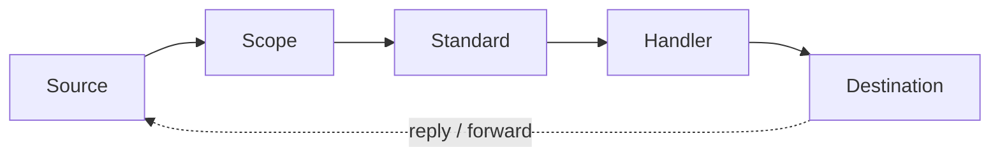

# Product

- **简体中文:** [../zh/PRODUCT.md](../zh/PRODUCT.md)
- **Related:** [Roadmap](ROADMAP.md) · [Message orchestration](MESSAGE_ORCHESTRATION.md) · [Connector catalog](CONNECTOR_CATALOG.md) · [Personal → org](rfcs/personal-to-org.md)

## In one sentence

Regenic brings work messages from every channel into one place, decides what needs handling by your standards, hands it to you or an agent, and sends the result back to the original channel, with a source for every step.

## The problem

The context for a single piece of work is usually scattered: a discussion in a team chat, customer feedback on WhatsApp, an approval thread in DingTalk, the log of an agent session. Each tool sees only its own slice. Answering "what did we promise this customer?" or "where is this project stuck?" means digging through each one and copy-pasting.

Regenic doesn't replace those tools. Messages are still written and answered where they live. Regenic pulls them in, puts them in one format, and hands them to you, your executors, or your own systems.

## The capability: one message-handling chain

Regenic offers a single capability: a traceable chain for handling messages. Messages come in from channels, get judged and handled, and the result goes back to a channel. Every way of using Regenic is a different configuration of this chain.

The chain has five stages. Each one can be swapped and combined:

| Stage | Question it answers | Can be |
| --- | --- | --- |
| **Source** | Where messages come from | Feishu, Slack, WhatsApp, Telegram, DingTalk, WeCom, agent sessions, imported files. Provided by [connectors](CONNECTOR_CATALOG.md). |
| **Scope** | Which messages matter this time | Specific conversations, a time window, newly arrived messages, keyword or semantic search results. |
| **Standard** | What is worth handling, and how to judge it | Rules, versioned judgment standards, or a judgment from an executor. When unsure, defer to a person. |
| **Handler** | Who handles it | You; a connected agent or model ([executor](EXECUTOR.md)); an external system over the API or MCP. |
| **Destination** | Where the result goes | A reply or forward to a channel, a to-do or reminder, a digest, a cited answer, an external system. |

However the chain is configured, four things always hold:

1. **One message format.** Messages from every source become the same kind of Event, keeping channel, conversation, sender, and source message ID.
2. **Everything is traceable.** Every judgment, answer, digest, and action points back to the original messages.
3. **Read and send are separate grants.** Being able to read doesn't mean being able to send. Sending needs its own grant; judgment and distillation never raise permissions.
4. **Data stays local.** Your machine or self-hosted instance holds the authoritative data, exportable as JSONL or Markdown.

## Scenarios: configurations of the same chain

Regenic doesn't design features for individual scenarios. Users compose scenarios from the five stages, and can save, reuse, and share them. The examples below include both current capabilities and target configurations; unshipped combinations are governed by the roadmap and do not imply dedicated features:

| Scenario | Source | Scope | Standard | Handler | Destination |
| --- | --- | --- | --- | --- | --- |
| Work through messages | All sources | Recent conversations | Needs me | Me | Reply in the original channel |
| Follow through on commitments | All sources | Commitments I made or received | Still waiting, or overdue | Me | Reminder, then reply |
| Answer questions across channels | All sources | Search results | — | Executor | Cited answer |
| Daily digest | All sources | Today's messages | Worth attention | Executor | Sourced digest |
| Reply to customers | Customer conversations | New messages | Question type and citable evidence | Executor, confirmed by a person before sending | Reply to the customer |
| Hand work to an agent | Chosen conversations | Messages matching a rule | Rule | Executor | Result written back to the conversation |
| Move context between channels | One conversation | Selected messages | — | Me | Forward to another channel |
| Let external AI search conversations | All sources | Search results | — | External AI (MCP) | External tool |

The default view in the workbench is just one of these configurations. It has no special status.

## Where today's features sit in the chain

| Feature | Place in the chain |
| --- | --- |
| Connectors | Source |
| Search | Scope (retrieval); with an executor, it becomes "answer questions across channels" |
| Workbench | The handling surface when the handler is "me", plus reply and forward as destinations |
| Standards and triage | Standard |
| Executors | Handler |
| Recipes | How the five stages are combined and run on a condition or schedule |
| Standards + Recipes | Can later compose follow-up scenarios such as "still waiting → remind" |
| Scheduled Recipes + executors | Can later compose scenarios such as "today's messages → sourced digest" |
| API, MCP, CLI | How external systems join as a handler or destination |
| Evidence Bundles | The destination format for handing context to external systems |

The kernel, sync progress, and diagnostics are infrastructure, not part of the chain. They stay out of the user's way and only surface when they affect use.

## Admitting new features

When weighing a new request, go in this order:

1. **If it can be configured from existing stages, make it a configuration.** Don't add a new entry point.
2. **If it can't, extend a stage.** The new capability must serve at least two scenarios—for example, a new source, a new kind of standard, or a new destination.
3. **Don't write logic for a single scenario.** Code, pages, or concepts that serve only one scenario don't go into the product.

Users deal with five concepts: the five stages. Any other term that has to appear should be explainable as part of one of them.

## Principles

1. **Local is the source of truth.** Your machine or self-hosted instance holds the authoritative data. No vendor cloud required.
2. **Channels stay where they are.** Regenic reads from and writes back to your existing apps; it doesn't replace them.
3. **Read and send are separate grants.** Being able to read doesn't mean being able to send. Judgment and distillation never raise permissions.
4. **Everything is traceable.** Every conclusion points back to the original messages.
5. **Every stage is swappable.** Connectors, executors, and models can be replaced or written yourself. The kernel itself never calls a model.
6. **General capability, user-composed scenarios.** The product provides stages, not hard-coded scenarios.
7. **Your data is portable.** Export messages as JSONL or Markdown.

## Direction

Today's release has basic support for all five stages, but composition is incomplete and some features still exist as standalone pages. Next:

- **Full composition.** Let the five stages be freely combined, saved, and reused, and fold today's standalone features into configurations.
- **Stronger standards.** Decide what needs attention now based on personal habits and team standards, revise them over time, and defer when unsure.
- **From individuals to teams.** With consent, merge several people's message streams into shared team context without widening anyone's access.

See the [roadmap](ROADMAP.md) for phases and progress.

## Out of scope

- A new chat app, or replacing the messaging apps you already use
- A general knowledge base, note-taking, or document suite
- Generic ERP modules
- Features designed for a single scenario
- Treating personal AI labels as organizational facts
- Unbounded agent loops without standards and context constraints

## Design docs

| Topic | RFC |
| --- | --- |
| Ingestion, tiering, and cleanup | [0005](rfcs/0005-context-storage-lifecycle.md) |
| Facts and snapshots | [0002](rfcs/0002-context-graph.md) |
| Standards and distillation | [0001](rfcs/0001-standards-data-model.md), [0007](rfcs/0007-daily-distillation.md) |
| Collaboration and handoff | [0003](rfcs/0003-collaboration-objects.md) |
| One API for humans and agents | [0004](rfcs/0004-human-agent-api.md) |
| Permissions, agent identity, and send rights | [0006](rfcs/0006-acl-agent-identity.md) |
| Thread surface: prompts and read state | [0008](rfcs/0008-thread-surface.md) |
| Work items and execution | [0009](rfcs/0009-work-orchestration.md) |
| Cross-channel forwarding | [0010](rfcs/0010-cross-channel-forward.md) |
| Conversation lifecycle and policy hooks | [0011](../zh/rfcs/0011-conversation-lifecycle.md) (Chinese only) |

Methodology: [regenic-ai/regenic-book](https://github.com/regenic-ai/regenic-book).
