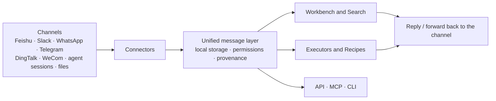

# Product

- **简体中文:** [../zh/PRODUCT.md](../zh/PRODUCT.md)
- **Related:** [Roadmap](ROADMAP.md) · [Message orchestration](MESSAGE_ORCHESTRATION.md) · [Connector catalog](CONNECTOR_CATALOG.md) · [Personal → org](rfcs/personal-to-org.md)

## In one sentence

Regenic is an open-source, local-first platform that brings work messages together from any channel so you can search, organize, and process them your way.

## The problem

The context for a single piece of work is usually scattered: a discussion in a team chat, customer feedback on WhatsApp, an approval thread in DingTalk, the log of an agent session. Each tool sees only its own slice. Answering "what did we promise this customer?" or "where is this project stuck?" means digging through each one and copy-pasting.

Regenic doesn't replace those tools. Messages are still written and answered where they live. Regenic pulls them in, puts them in one format, and hands them to you, your executors, or your own systems.

## How it fits together

| Part | What it does |
| --- | --- |
| **Connectors** | Read messages from a channel and, where supported, write back. Feishu, DSH, and Cursor are built in; other channels ship as plugins. See the [connector catalog](CONNECTOR_CATALOG.md). |
| **Unified message layer** | Every message becomes the same kind of Event, stored on your machine with its channel, conversation, sender, and source message ID. |
| **Workbench** | See the work in front of you, conversation by conversation. Reply, forward, pin, hide, and follow up. |
| **Search** | Search across every connected channel with keyword and local semantic retrieval. Expand the surrounding context and jump to the original message. |
| **Executors** | Plug in an agent or model to answer questions from search results or run work items routed by Recipes. The kernel itself never calls a model. See [Executors](EXECUTOR.md). |
| **Recipes and rules** | Decide which messages need attention, which executor handles them, and when. |
| **Standards and digests** | Versioned judgment standards, daily digests, and drift signals, so "what's worth handling" is written down and can be revised. |
| **Integration** | Connect your own tools and workflows through the HTTP API, a read-only MCP server, and the CLI. |

## What works today

- **One place to read and reply.** Work through connected conversations in one workbench, and reply in the original channel when the connector supports it and you've granted send access.
- **Search across channels.** One query covers every connected source. Every result links back to the original conversation.
- **Analyze many conversations at once.** Pick an executor in Search and have it summarize progress or check commitments from the results, with citations.
- **Move context between channels.** Forward a message or a whole conversation to another channel, and edit it before sending.
- **Hand work to agents.** Use Recipes to route matching work items to an executor, then track status and answer confirmations from the workbench.
- **Follow-ups and digests.** Spot conversations waiting on a reply, and generate daily digests with sources.
- **Bring your own systems.** External AI tools search conversations over MCP; scripts and services read and write through the API and CLI, or publish Evidence Bundles.

What you can do with a given channel depends on its connector and the access you grant. Some connectors are read-only; some need sending turned on explicitly.

## Principles

1. **Local is the source of truth.** Your machine or self-hosted instance holds the authoritative data. No vendor cloud required.
2. **Channels stay where they are.** Regenic reads from and writes back to your existing apps; it doesn't replace them.
3. **Read and send are separate grants.** Being able to read doesn't mean being able to send. Digests and summaries never raise permissions.
4. **Everything is traceable.** Every search result, digest, and conclusion points back to the original messages.
5. **Every part is swappable.** Connectors, executors, and models can be replaced or written yourself.
6. **Your data is portable.** Export messages as JSONL or Markdown.

## Where we're headed

Today Regenic covers ingestion, the workbench, search, executors, and integration APIs. It is not yet a full autonomous workflow system. Next:

- **Composable processing.** Chain filtering, transformation, analysis, routing, and write-back into your own workflows, beyond search and Q&A.
- **Proactive triage and follow-through.** Decide what needs attention now based on personal habits and team standards, extract conclusions and to-dos, and hand them to the right person or agent.
- **From individuals to teams.** With consent, merge several people's message streams into shared team context without widening anyone's access.

See the [roadmap](ROADMAP.md) for phases and progress.

## Out of scope

- A new chat app, or replacing the messaging apps you already use
- A general knowledge base, note-taking, or document suite
- Generic ERP modules
- Treating personal AI labels as organizational facts
- Unbounded agent loops without standards and context constraints

## Design docs

| Topic | RFC |
| --- | --- |
| Ingestion, tiering, and cleanup | [0005](rfcs/0005-context-storage-lifecycle.md) |
| Facts and snapshots | [0002](rfcs/0002-context-graph.md) |
| Standards and distillation | [0001](rfcs/0001-standards-data-model.md), [0007](rfcs/0007-daily-distillation.md) |
| Collaboration and handoff | [0003](rfcs/0003-collaboration-objects.md) |
| One API for humans and agents | [0004](rfcs/0004-human-agent-api.md) |
| Permissions, agent identity, and send rights | [0006](rfcs/0006-acl-agent-identity.md) |
| Thread surface: prompts and read state | [0008](rfcs/0008-thread-surface.md) |
| Work items and execution | [0009](rfcs/0009-work-orchestration.md) |
| Cross-channel forwarding | [0010](rfcs/0010-cross-channel-forward.md) |

Methodology: [regenic-ai/regenic-book](https://github.com/regenic-ai/regenic-book).
