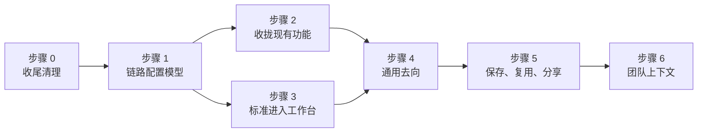

# 推进规划与桌面 UI 规划

- **相关：** [产品说明](PRODUCT.md) · [路线图](ROADMAP.md) · [桌面端](DESKTOP.md) · [执行器](EXECUTOR.md) · [RFC 0009](rfcs/0009-work-orchestration.md)
- **状态：** 规划草案，未实现部分不代表已交付

本文把[产品说明](PRODUCT.md)里的「一条消息处理链路」落成可执行的推进步骤，并给出桌面端的目标结构。路线图的阶段划分不变，本文只细化 Phase 2 到 Phase 3 之间要做什么、按什么顺序做、做完怎么验收。

## 一、目标

用户只面对五个环节：**来源、范围、标准、处理者、去向**。所有场景都是这五个环节的一份配置，可以保存、复用和分享。

落到工程上，有三条硬约束：

1. **一种配置对象。** 场景不再各自有表、服务和页面，统一由「链路配置」表达。
2. **结论可追溯。** 无论是工作台里的人工处理、定时摘要还是搜索回答，结论都能回到原始消息。搜索回答面向大规模、高频的范围处理，保留独立的回答记录与聚合事实缓存（`search_answers`、`aggregate_fact_cache`），这是性能需要，不是单场景实现。
3. **基础设施退到后台。** 内核、同步、诊断只在影响使用时出现。

## 二、现状

### 已经符合产品方向

| 环节 | 现有能力 |
| --- | --- |
| 来源 | 连接器标准、内置与插件连接器、文件导入、统一 Event |
| 范围 | 会话列表、跨渠道检索（词法 + 本地语义）、时间窗口与完整范围聚合 |
| 标准 | 版本化判断标准、缺口收集、偏差提示（尚未进工作台） |
| 处理者 | 我（工作台）、Agent 执行器（DSH、Cursor、HTTP），只有 Agent 能成为执行器 |
| 去向 | 回复写回、跨渠道转发、Evidence Bundle、附引用的答案 |
| 编排 | Recipes：匹配、触发（推 / 拉 / 定时）、执行器、写回目标、人工确认 |

本轮已经删除客服、每日摘要、个人跟进、回复提案和待处理分拣这些单场景实现。它们以后由配置组合出来，不再回到产品里。

### 与产品说明仍不一致的地方

| 问题 | 现状 | 应当是 |
| --- | --- | --- |
| 分派策略写死 | 设置页四条固定规则（高优先 / 可行动 / 短文本 / 默认） | 标准的一个版本，可在工作台查看和修订 |
| Recipe 字段不按环节组织 | `match`、`trigger`、`executor_type`、`can_write_back` 平铺 | 五个环节各自成段，缺省值明确 |
| 设置页承载诊断 | 内核、数据库、取消任务、工作身份诊断与语言并列 | 设置只放偏好；诊断收进「状态」，平时折叠 |
| 引擎页混合两类概念 | 连接器与执行器在同一页 | 来源和处理者分开呈现 |
| 残留文案与类型 | `followUps.*`、`proposal.*`、`settings.contextKind.daily_digest`、`daily_digest` artifact 类型 | 删除，或解释为某个环节的一部分 |
| 文档未对齐 | ROADMAP、MESSAGE_ORCHESTRATION、DESKTOP 仍按旧模块描述 | 按五个环节重写 |
| 「标准」没有用户入口 | 只能通过 CLI / API 操作 | 工作台内可看、可改、可回滚 |

## 三、推进步骤

每一步都可以单独合并和验收。顺序的原则是：先统一模型，再把已有功能收拢进来，最后才扩展新能力。



### 步骤 0：收尾清理（当前分支，已完成）

范围：把本轮删除做干净，不引入新概念。

- 已删除残留 i18n：`followUps.*`、`triage.*`、`proposal.*`、`nav.followUps`、`settings.contextKind.daily_digest`；设置页刷新按钮改用 `settings.refresh`。
- 已删除 `daily_digest` artifact 类型、只服务它的 `supersedeProposedArtifact`、摘要预览里的 `utc_date` 与 `directions` 解析；schema 87 直接删除库里残留的 `daily_digest` 记录及其状态，不保留类型。
- `DESKTOP.md` 已改为「只有 Agent 能当处理者，DSH 和 Cursor 都是 Agent」，并同步新的侧栏、状态菜单、「接入」页标签和五步链路编辑器。
- 搜索事实缓存的回归测试纳入 CI（Agent 隔离、空事实、过期、旧路由重算、运行中批次取消）。

验收：全仓库无单场景残留引用；类型检查、API / 存储 / 桌面测试通过；本地库从 schema 85 升级到 87 可用。

### 步骤 1：链路配置模型（存储文档与 API 已切换，调度列名仍待改）

范围：把 Recipe 演进为按五个环节组织的「链路配置」，存储和 API 先行，桌面暂时沿用现有规则页。

已落地：schema 88 把每条规则写成 `flow_json`，`/v1/me/recipes` 已删除，桌面和导入导出改走 `/v1/me/flows`。内核仍按同一份配置执行；工单上的 `recipe_id` 还是这条链路的引用，下一步再改列名。当前只接受已经能跑的组合：全部来源、新消息范围、Agent 处理者、回复或留在工作台。

```ts
interface FlowConfig {
  id: string;
  name: string;
  source: { installations: string[] | "all" };
  scope:
    | { kind: "new_messages"; match: RecipeMatch }
    | { kind: "conversation"; thread_id: string }
    | { kind: "time_window"; window: "today" | "last_7d" | { after: string; before: string } }
    | { kind: "retrieval"; query: string };
  standard?: { standard_id: string; version: "pinned" | number };
  handler:
    | { kind: "me" }
    | { kind: "agent"; executor_type: string; task?: string; params?: Record<string, JsonValue> }
    | { kind: "external"; protocol: "http" | "mcp"; target: string };
  destination:
    | { kind: "reply"; thread: "origin" | string; confirm: boolean }
    | { kind: "forward"; thread: string }
    | { kind: "answer" }
    | { kind: "reminder"; due: string }
    | { kind: "digest" }
    | { kind: "bundle"; policy: string };
  trigger: RecipeTrigger;
}
```

- 新增 schema 版本：一次性把现有 Recipe 转成 `FlowConfig`，不保留双写。`executor_type` → `handler.agent`，`match` → `scope.new_messages`，`can_write_back` + `write_back_thread_id` → `destination.reply`。
- `/v1/me/recipes` 改名为 `/v1/me/flows`，删除旧路由。个人 CLI 没有单独的规则命令，无需改名。
- 内核调度只认 `FlowConfig`，工单（WorkItem / WorkRun）记录所属 flow 与各环节快照，结论可追溯到当时的配置。

验收：现有规则全部迁移且行为不变；新旧 API 不并存；导入导出使用新格式。

### 步骤 2：把现有功能收拢为配置

范围：消除「部分功能仍以独立页面存在」。

| 现有功能 | 收拢后 |
| --- | --- |
| 搜索页「让 Agent 回答」 | 保持现有实现：`search_answers` 记录、map-reduce 与 `aggregate_fact_cache` 服务大规模高频处理，不并入普通工单。只在链路层把它表达为 `scope.retrieval` + `handler.agent` + `destination.answer`，以便「存为链路」后定时复用同一条执行路径和缓存 |
| 工作台默认视图 | 内置 flow：全部来源 + 最近会话 + 「需要我处理」标准 + 处理者为我 + 回复原渠道；可复制修改，没有特殊地位 |
| 转发 | `destination.forward` 的一次性运行 |
| Evidence Bundle 发布 | `destination.bundle` |

验收：工作台和转发能在运行记录里按同一格式查看来源、范围、处理者和去向；搜索回答存为链路后，定时运行仍命中聚合事实缓存。

### 步骤 3：标准进入工作台

范围：路线图 Phase 2「主动分拣」和「在工作台中查看和修订标准」。

- 把设置页四条分派规则转成「需要我处理」标准的 v1，删除 `personal_dispatch_policy_v1` 与设置页分派卡片。
- 工作台每条会话显示命中的标准与理由；用户可以「这条不该进来 / 这条应该进来」，生成标准修订提案。
- 没把握时进入「暂缓」，而不是默认塞进当前工作。
- 标准页：版本列表、差异、启用 / 回滚，复用现有 Standard Proposal 与 pinned version。

验收：至少一条个人标准能在桌面上完成「发现偏差 → 修订 → 新版本生效 → 回滚」。

### 步骤 4：通用去向

范围：补齐能服务两个以上场景的去向，让「跟进」「每日摘要」以配置出现。

- `destination.reminder`：到期提醒，提醒内容带原始消息出处。服务「跟进承诺」「等待回复超时」。
- `destination.digest`：定时汇总，复用聚合 map-reduce 与事实缓存，结论逐条带引用。服务「每日摘要」「周报」。
- `destination.reply` 增加 `confirm: true`：发送前人工确认。服务「回复客户」与任何高风险写回。

验收：不新增场景专用代码，用三份 flow 配置跑通「跟进承诺」「每日摘要」「回复客户」。

### 步骤 5：保存、复用、分享

- flow 模板：从任一运行记录「另存为链路」。
- 导出 / 导入 flow（JSON），导入时按能力校验来源与处理者是否存在，不存在明确报错。
- 内置模板库只放配置文件，不放代码。

验收：一份模板在另一台机器导入后可直接运行，缺失的连接器或 Agent 会被列出。

### 步骤 6：团队上下文（Phase 3）

按路线图 Phase 3 推进：同一源消息一个权威 Event、多人视角、团队标准与团队摘要。flow 增加作用域（个人 / 团队），权限不因汇总而扩大。

## 四、桌面 UI 规划

### 原则

1. **导航即环节。** 一级导航只出现用户要操作的东西；每个入口都能解释成某个环节或它们的组合。
2. **处理在前，配置在后。** 打开应用先看到要处理的工作，配置入口不抢位置。
3. **出处常驻。** 任何结论、提醒、摘要都能一键回到原消息。
4. **基础设施静默。** 内核、同步、诊断收进顶栏状态芯片；出问题才展开提示。
5. **不按渠道名写 UI。** 继续只读内核声明（`can_send`、`create_with_task`、catalog 等）。

### 导航结构

| 当前 | 目标 | 对应环节 |
| --- | --- | --- |
| 工作 | **工作台** | 处理者 = 我，去向 = 回复 / 转发 |
| 搜索 | **搜索** | 范围 = 检索；可交给 Agent 得到附引用的答案 |
| 规则 | **链路** | 五个环节的编排与运行记录 |
| — | **标准** | 标准的版本、差异和修订 |
| 引擎 | **接入** | 来源（连接器）与处理者（Agent） |
| 设置 | **设置** | 语言、数据目录、语义搜索等偏好 |
| 设置里的内核 / 诊断 | **状态**（顶栏芯片展开） | 不属于链路 |

```text
┌──────┬───────────────────────────────────────────────────────────┐
│ ◎    │  顶栏：搜索框                          状态芯片 ● 正常  ⓘ  │
├──────┼──────────────────┬────────────────────────────────────────┤
│ 工作台 │ 视图：需要我处理 ▾ │  会话线程                               │
│ 搜索  │ ───────────────── │  · 命中标准：「需要我处理 v3」  理由 ›   │
│ 链路  │ ● 客户 A  飞书     │  · 消息流                               │
│ 标准  │   等你回复          │                                        │
│ 接入  │ ○ 项目群  Slack    │  ┌ 处理 ───────────────────────────┐  │
│      │   Agent 处理中      │  │ 回复 │ 转发 │ 交给 Agent ▾ │ 暂缓 │  │
│ ──── │ ○ 采购单  钉钉      │  └─────────────────────────────────┘  │
│ 设置  │   暂缓 · 待确认     │  Composer                              │
└──────┴──────────────────┴────────────────────────────────────────┘
```

### 各页面

#### 工作台

- 列表顶部的「视图」就是一份 flow 的范围 + 标准。默认视图是「需要我处理」，可以切到「全部」「暂缓」或用户保存的视图。
- 每行显示来源渠道、状态（等你 / Agent 处理中 / 暂缓 / 已完成）和命中标准的简短理由。
- 线程底部是统一的处理条：回复、转发、交给 Agent、暂缓。交给 Agent 时只列出 Agent，选择后可以「存为链路」，下次同类消息自动走这条链路。
- 判断不对时在线程头点「不该进来 / 应该进来」，生成标准修订提案，不打断当前处理。

#### 搜索

- 结果页保留现有检索、时间窗口和出处。
- 回答卡片：标题旁是 Agent 选择器（只列 Agent，默认 DSH），运行进度、缓存命中、完整范围说明保持现状。
- 回答完成后提供「存为链路」：把这次的范围、Agent 和去向保存成定时或手动运行的 flow，例如每天早上回答同一个问题。

#### 链路（替代规则页）

- 列表：每条链路一行，五个环节用芯片串起来（`飞书 → 新消息 → 需要我处理 v3 → DSH → 回复原会话`），右侧是启用开关与最近一次运行状态。
- 编辑器：五段纵向卡片，顺序固定为来源、范围、标准、处理者、去向，再加触发方式。每段只显示当前选择可用的选项（例如没有 `can_send` 目标时，去向不提供回复）。
- 试跑：选一条样本消息，逐段显示该消息在每个环节的结果，最后一步默认不发送。
- 运行记录：按链路筛选，每条记录展开后可以看到各环节当时的配置快照和引用的原始消息。
- 模板：「从模板新建」，模板只是预填的五段配置。

```text
┌ 编辑链路：客户问题自动起草 ───────────────────────────┐
│ ① 来源    [飞书 · 客户群 ▾]                           │
│ ② 范围    [新到的消息] 包含 [报价, 交期]               │
│ ③ 标准    [客户问题 v2 ▾]  没把握时：暂缓交给我         │
│ ④ 处理者  [DSH ▾]  任务说明：……                       │
│ ⑤ 去向    [回复原会话]  ☑ 发送前由我确认               │
│ 触发      [有新消息时 ▾]                               │
│                              [试跑]  [取消]  [保存]    │
└───────────────────────────────────────────────────────┘
```

#### 标准

- 列表：个人标准（以后加团队标准），显示当前生效版本和最近修订时间。
- 详情：判断条件、示例（命中 / 未命中）、版本差异、启用与回滚。
- 修订提案：来自工作台的「不该进来 / 应该进来」，接受后生成新版本。
- 设置页的四条分派规则迁移到这里后删除。

#### 接入

- 两个分区：**来源**（连接器，安装、同步范围、导入文件）和**处理者**（Agent，DSH、Cursor、HTTP Agent）。
- 能新建 Agent 会话的连接器安装后自动出现在处理者分区，不需要二次安装。
- 同步进度只在首次拉取或出错时显示，日常不出现 Sync 按钮。

#### 设置

只保留会改动的配置：界面语言、同步、本地语义搜索，以及「本机服务与数据」分组（连接哪个内核、数据库、数据目录与迁移、清理本机数据）。分派规则移到「标准」，取消任务、工作身份核对等只读诊断移到「状态」。

#### 状态（侧栏状态菜单 + 状态页）

- 平时只显示一个圆点和一句话：运行正常 / 同步中 / 需要留意。
- 点开是浮层：同步、网络、内存与磁盘、连接器告警。「查看完整状态」进入状态页：运行概况、需要处理的接入、取消任务与工单运行身份核对、路径与标识。日志导出待做。
- 只有影响使用时（内核未就绪、连接器凭证失效、磁盘不足）才在页面内提示，并给出直接修复入口。

### UI 推进顺序

| 顺序 | 改动 | 依赖步骤 |
| --- | --- | --- |
| U1 | 设置拆分：诊断移入状态页（侧栏状态菜单进入），设置只留偏好、本机服务与数据（已完成） | 步骤 0 |
| U2 | 引擎页改为「接入」，来源与处理者分区（已完成） | 步骤 0 |
| U3 | 规则页改为「链路」，五段式编辑器与链路芯片（界面已完成；保存和导入导出已使用 flow 配置） | 步骤 1 |
| U4 | 搜索回答与工作台处理条加入「存为链路」 | 步骤 2 |
| U5 | 新增「标准」页，工作台显示命中理由与修订入口，删除设置页分派卡片 | 步骤 3 |
| U6 | 链路去向增加提醒、摘要、发送前确认 | 步骤 4 |
| U7 | 模板与导入导出 | 步骤 5 |

## 五、度量与验收

| 指标 | 目标 |
| --- | --- |
| 单场景代码 | 新增功能中为单一场景写的服务、表或页面数为 0 |
| 用户可见概念 | 一级导航之外不出现五个环节以外的新名词 |
| 可追溯 | 每条运行记录都能打开引用的原始消息 |
| 标准修订 | 至少一条个人标准完成发现、修订、生效、回滚的闭环 |
| 场景覆盖 | 「跟进承诺」「每日摘要」「回复客户」三个场景仅靠配置跑通 |
| 后台静默 | 正常使用一天，诊断类提示出现次数为 0 |

## 六、风险

| 风险 | 应对 |
| --- | --- |
| Recipe 迁移改变既有规则行为 | 迁移前后用同一批样本消息试跑对比，结果不一致不发布 |
| 标准判断不稳定导致漏处理 | 没把握一律暂缓交给人，暂缓视图常驻工作台 |
| 五段式编辑器对新用户过重 | 没有链路时先选模板或「从空白开始」，编辑器随后才展开 |
| 一级导航变化影响老用户 | 一次性切换并在首次启动说明对应关系，不保留旧入口 |
