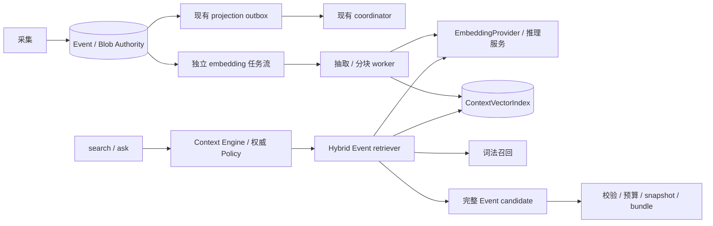

# EmbeddingGemma 2 记录检索架构

Regenic 通过 Event 与 Blob 保存记录证据，通过 Context Engine 按授权、生命周期和预算构建上下文。
本文设计在这条链路中加入 `google/embeddinggemma-2` 文本 embedding 与混合检索的方式。

- **状态：** 分批实施中；基础索引与可选的个人 current 混合召回已实现，默认关闭。独立搜索端点与 generation 运维仍待后续批次。当前实施状态见第 14–16 节。
- **源码基线：** 默认分支 `main`，提交 [`4e5b6e9f606f6c95a348725fc04f3fcd1815bfb8`](https://github.com/regenic-ai/regenic/commit/4e5b6e9f606f6c95a348725fc04f3fcd1815bfb8)，核对日期 2026-10-15。
- **相关：** [上下文管理架构](CONTEXT_MANAGEMENT_ARCHITECTURE.md) · [采集架构](INGESTION_ARCHITECTURE.md) · [技术栈](TECH_STACK.md) · [ACL 与 Agent 身份](rfcs/0006-acl-agent-identity.md)
- **文档范围：** 本次按任务要求新增中文专题；英文镜像留待后续文档 PR，不链接尚不存在的译文。

## 1. 背景与目标

记录查询包含中文同义表达、跨语言表达、长消息中的局部事实，以及精确名称、编号和时间。
词法检索保留精确匹配优势，向量召回补充不共享关键词的相关记录；两者都必须返回可绑定到权威 Event 的证据。

目标：

1. 在个人 SQLite 模式中提供可选、可关闭的语义检索，不要求启动 PostgreSQL。
2. CLI 与 API 复用同一检索协议与授权边界，消除装配差异造成的能力误解。
3. 支持异步增量索引、回填、模型升级与回滚，不阻塞采集提交。
4. 保持 revision、tombstone、时态选择、证据绑定、确定性排序和 snapshot 不变量。
5. 用中文评估集、ACL 负例与性能基准决定参数，而不是将示例参数固化为产品承诺。

### 1.1 范围外

原始设计 PR 仅新增文档；后续首批实施新增词法基础代码与测试，见第 14 节。
第 14 节首批仅覆盖词法基础；第 15 节第二批新增 embedding 端口、参考推理服务、
独立向量 sidecar 与任务 worker，不修改 Authority schema，也尚不实现 search API。
首期方案不做多模态索引、生成式查询改写、reranker、组织 ACL 实现或 Blob 读取优化。
这些能力需要独立设计与实施；模型名称不意味着运行环境已经具备相应能力。

### 1.2 状态分类

| 分类 | 内容 |
| --- | --- |
| 已实现 | Event + Blob、SQLite/PostgreSQL Authority、Context Engine、个人 policy、词法检索、投影 outbox、snapshot/replay、`/ask` |
| 第二批已实现，默认关闭 | 独立 `EmbeddingProvider`、`ContextVectorIndex`、SQLite embedding 任务流与个人文本 worker；见第 15 节 |
| 后续实施 | Event 级混合召回、`/search`、snapshot 检索追踪与真实数据质量验收 |
| 规划能力 | 两阶段检索、组织 ACL 与撤回安全的 replay、选择性永久删除、可选 pgvector、大规模 ANN、多模态 |
| 已核验官方资料 | 第二代模型标识/revision、声明许可证、维度、模板与官方文本模式示例；见第 2 节 |
| 已运行初验 | Windows CPU 固定 revision 载入、query/document 推理及 HTTP → CLI 持久化烟测；见第 15.4 节 |
| 待上线验证 | 真实数据质量、资源占用/吞吐、平台兼容性、权重分发与许可证义务复核 |
| 待测试确认 | chunk 大小、召回数量、融合参数、批量大小、延迟/内存预算、撤回和擦除时限 |

## 2. 模型资料与未知项

`google/embeddinggemma-2` 是本方案指定的目标标识，不是自动回退模型。
不能用第一代 EmbeddingGemma 或 Gemini Embedding 2 的资料替代该模型的证据。

2026-10-16 已重新读取 Google 官方模型卡、开发者指南和固定 revision 的配置，
不再依赖搜索摘要。核验结果如下，**资料核验不等于已完成运行或性能验证**：

| 核验内容 | 官方来源入口 | 核验结果 |
| --- | --- | --- |
| 模型与 revision | [Google 仓库元数据](https://huggingface.co/api/models/google/embeddinggemma-2/revision/914f7f89142e33e77833254d9c9b90c3cef7303b) | `google/embeddinggemma-2`；`914f7f89142e33e77833254d9c9b90c3cef7303b`，后续权重、tokenizer 与配置统一固定到该 revision |
| 许可证与模态 | [固定模型卡](https://huggingface.co/google/embeddinggemma-2/blob/914f7f89142e33e77833254d9c9b90c3cef7303b/README.md)、[发布页](https://blog.google/innovation-and-ai/technology/developers-tools/embeddinggemma-2/) | 声明 Apache-2.0；支持多模态，但 Regenic 首期仍仅处理文本。本次未分发权重；分发前另行落实许可证和 NOTICE 义务 |
| 文档/查询模板 | [固定 Sentence Transformers 配置](https://huggingface.co/google/embeddinggemma-2/blob/914f7f89142e33e77833254d9c9b90c3cef7303b/config_sentence_transformers.json) | `SearchQuery`：`task: search result \| query: `；`Document`：`title: none \| text: `。使用模板名时不重复手工加前缀；有标题时按官方格式单独处理 |
| 维度与相似度 | [固定模型配置](https://huggingface.co/google/embeddinggemma-2/blob/914f7f89142e33e77833254d9c9b90c3cef7303b/config.json)、上述 Sentence Transformers 配置 | 原生 768 维、cosine；MRL 可选 512/256/128 维。降维后重新 L2 归一化；查询和文档维度一致，降维改变 generation |
| 长度与文本运行方式 | [第二代开发者指南](https://developers.googleblog.com/embeddinggemma-2-the-developer-guide/) | 公开检索窗口为 8,192 tokens；文本模式约 270M 参数，使用 `config_kwargs` 禁用 vision/audio；官方要求 `sentence-transformers >= 6.1.0` |
| 归一化与运行库证据 | [固定 modules](https://huggingface.co/google/embeddinggemma-2/blob/914f7f89142e33e77833254d9c9b90c3cef7303b/modules.json)、固定 Sentence Transformers 配置 | 含 Normalize 模块；配置保存的构建版本为 PyTorch `2.14.0+cu130`、Transformers `5.18.0.dev0`、Sentence Transformers `6.1.0`，不是本机已验证的部署依赖清单 |

固定配置中的 `max_position_embeddings = 262144` 不等于公开支持的检索输入上限，
不能据此把输入窗口扩大到 262K。后续实现以公开的 8,192-token 窗口为上限，
计入模板和特殊 token，并在目标 tokenizer/运行库上验证拒绝超长输入、不静默截断。
本批没有安装 Python 推理栈、下载权重或进行本机推理，因此语义能力继续关闭。
服务协议中的维度与输入限制仍由固定 revision 的模型描述声明并校验，不作为所有后端的通用常量。

## 3. 当前系统架构与源码证据

本节只描述基线源码，不表示这些组件已经在某个部署环境运行。下方所有源码链接固定 commit 和行号。
个人 SQLite API 的词法装配已在首批实施中改变，见第 14 节；本节保留原设计基线以供对照。

### 3.1 Event、Blob 与 Authority

`IngestRecord` 经采集服务进入 Authority；Event 保存来源身份、操作、父版本、scope、时间和正文 hash，
正文 bytes 存入 Blob。`create`、`revise`、`tombstone` 是追加式生命周期操作，不是更新一列正文。
领域协议见 [Event/Blob 类型][event-types]；采集先写 Blob，再以 `expected_head_id` 等约束追加权威记录，
见 [写入与 tombstone][ingest-write]。Blob 与 Authority 不是单个跨存储事务，失败写入可能留下待清理 Blob。

文件 Blob 使用内容寻址并校验 hash，见 [文件 Blob][fs-blob]。API 可选 SQLite 或 PostgreSQL Authority，
两者当前均搭配文件 Blob，见 [个人 runtime][api-runtime]。Authority 还保存 Artifact、checkpoint、
snapshot 和 bundle；向量索引只能是可重建投影，不能成为第二套记录权威。

| 当前数据库定义 | 已有内容 | 未实现的内容 |
| --- | --- | --- |
| [SQLite 基础迁移][sqlite-base]、[上下文迁移][sqlite-context] | Blob 元数据、Event、source head、上下文表、projection outbox | 本方案向量表和独立 embedding 任务表 |
| [PostgreSQL Event schema][pg-events]、[上下文 schema][pg-context] | TEXT 标识、关系索引、JSONB 上下文载荷、outbox 租约/重试索引 | pgvector 扩展、vector 列、HNSW/IVFFlat |
| [PostgreSQL 迁移入口][pg-migrate] | schema 版本检查和事务性迁移 | 自动探测或安装向量扩展 |

核对的迁移定义没有 pgvector 配置；这不能推断目标部署是否人工安装了扩展。启用前必须单独探测。
当前 Event 写入同时安排投影任务，见 [SQLite enqueue][sqlite-enqueue] 和 [PostgreSQL enqueue][pg-enqueue]。
“事务性 outbox”指 Authority 写入和任务入队，不意味着 Blob、推理和索引写入具有跨存储原子性。

### 3.2 Context Engine 的读取顺序

当前顺序为：

```text
ContextRequest
  -> Authority 元数据与完整生命周期读取
  -> Context Policy 授权
  -> current/history/as_of 生命周期选择
  -> 已授权 Event 正文 materialization（Blob.getMany）
  -> AuthorizedContextRetrievalPlan
  -> retrievers -> 候选再校验/授权 -> 融合 -> 预算 -> snapshot + bundle
```

证据见 [assemble][engine-assemble]、[按生命周期授权][engine-authorize]、
[Authority source 与正文物化][authority-source]、[时态解析][engine-lifecycle]。
生命周期按来源身份分组，组内 Event 全部通过可见性检查才保留；不能让向量索引单独决定当前版本。

**首期向量 retriever 发生在 materialization 之后，不会自动消除 Blob 读取。**
Authority source 当前仍按组织读取元数据，随后物化已授权且被生命周期选中的 Event；
请求级检索过滤不能被描述为已经实现了先召回再读正文。
后续两阶段优化需先构造完整、已授权的生命周期元数据集合，再召回允许的 Event/hash，
仅物化入选正文，并重新执行证据校验；还需处理缺失 Blob、撤回竞态、预算和 protected Event。

**Event candidate 的 `item.text` 必须等于授权 Event 的 `text`。**
hash、status、scope、引用和记录时间也必须一致，见 [候选证据绑定][candidate-binding]。
首期 chunk 只用于召回和 UI snippet；最终候选仍使用 `event:<event_id>`、
`resource_id = event_id` 和完整 Event 正文。不能用 chunk ID 冒充 Event，也不能把 snippet 填进 bundle 原文。
同一 Event 的不同 retriever 必须生成一致的非评分 metadata 和 item，否则融合报错。

### 3.3 CLI/API 检索装配差异

| 入口 | 当前行为 | 设计影响 |
| --- | --- | --- |
| [CLI host][cli-host] | 组织上下文启用时打开独立 SQLite lexical DB，注册 indexed Event 与 accepted-thread-summary retriever，coordinator 接入 lexical index | 有持久词法索引，但没有向量实现 |
| [API kernel host][api-host] | 注册 deterministic Event 与 accepted-thread-summary retriever，未装配 lexical index | API 有正文词法评分，不等于已接入 CLI 的 FTS5 |
| [SQLite lexical index][lexical-schema] | 独立 DB，FTS5；按组织/generation 与授权 Event/hash 匹配 | 是派生词法预筛，不是 Authority 或 ACL |

API 投影服务虽调用 `syncLexicalIndex`，coordinator 在未装配索引时直接返回，
见 [coordinator 同步入口][coordinator]。不能因为存在该调用就宣称 API 已有持久词法索引。
[IndexedEventRetriever][indexed-retriever] 对未覆盖记录回退正文评分，并验证返回键属于授权集合。

现有 [ModelProvider][model-provider] 仅支持 `complete` 和 `health`；没有 embedding 方法。
[ContextRetriever 协议][context-port] 的[能力声明][context-capabilities]包含 `vector`，
但声明本身不是模型或索引实现。

### 3.4 投影 outbox、权限和 replay

[个人 API 投影服务][api-projection] 领取租约，按组织/thread 同步词法、执行投影，再确认任务；
失败重试并续租。另一执行入口见 [worker 投影服务][worker-projection]。
[Coordinator][coordinator-project] 按 projector/generation/checkpoint 写 Artifact 后更新 checkpoint；
生成 proposal 不等于已经接受 Artifact。

[Outbox 协议][outbox-port] 与 [SQLite 确认实现][outbox-complete] 只有任务级 owner/lease/completion，
没有消费者独立确认位。**这是竞争式工作队列，不是广播日志。**
新增 embedding worker 若抢走任务并标记成功，会让既有投影失去工作；详见第 7 节。

[PersonalContextPolicyEvaluator][personal-policy] 绑定 org/principal，检查 scope 非空，
但不检查成员资格，protected Event 集合为空。API principal 由 runtime 个人边界生成，
见 [请求构造][api-context-request]。[PersonalApiGuard][personal-guard] 检查个人 API 开关、
Origin、key 和监听地址；loopback 且无 Origin 的请求可能无需 key。这不是组织身份认证或完整组织 ACL。

[Replay][engine-replay] 校验存储结果、用途子集并调用 `canReplay`，返回旧 bundle，
不重新召回、不重算向量，也不逐 Event 重查当前权限。当前 personal policy/replay
不能被表述为完整的组织撤回保护；组织共享或强撤回上线前必须补足。

## 4. 关键设计决策与职责边界

以下为原设计职责划分；各组件的当前实现范围以第 14–16 节为准。

| 组件 | 职责 | 禁止承担的职责 |
| --- | --- | --- |
| Embedding 推理服务 | 固定模型 revision/tokenizer，按文档或查询模式推理，返回受校验向量与模型描述 | 读 Authority、决定 ACL、直接写 Event 或索引 |
| `EmbeddingProvider` | 独立领域端口；模型描述、document/query embedding、健康状态、超时与错误分类 | 把向量伪装成 `ModelProvider.complete` 文本输出 |
| `ContextVectorIndex` | 按 org/generation/Event/hash/chunk 持久化投影；在授权键集合内匹配；返回覆盖状态、水位和命中 | 成为 ACL 权威、提供未经授权的总命中数或正文 |
| Embedding worker | 从独立任务流读取权威版本，抽取/分块/推理、幂等写入、删除同步、重试与水位 | 领取并提前完成现有 projection outbox；修改来源内容 |
| Hybrid Event retriever | 消费授权 plan，组合词法/向量召回，Event 去重与排名融合，生成完整 Event candidate | 绕开 Policy、把 chunk 正文写入 Event candidate |
| Context Engine / API | 保持权威授权和候选校验；预算、snapshot、响应协议 | 信任索引内 scope 副本或客户端自报 principal |

推理服务优先本机或受控私有服务，查询同步推理与后台文档推理设置独立配额，
避免回填耗尽交互预算。没有可核验的模型运行支持时，服务保持不可用并使用词法基线。
不要求新增一个固定部署应用：具体进程边界由运行库支持和基准决定，但上述逻辑边界必须保留。



## 5. 文本抽取、分块与版本标识

### 5.1 抽取与模板

沿用现有正文解析语义，见 [Authority source][authority-source]，而不是直接把 Blob 的 JSON bytes
当作自然语言输入。抽取器单独版本化，首期仅处理确认可解码的文本；媒体附件、OCR、音频转写留待后续。
允许保留标题、段落、代码和来源定位，但不把整个 thread 或其他 Event 拼进单个 Event 的 chunk。
遇到非法编码、超大压缩内容、缺失 Blob 或不支持 media type，记录受限错误并跳过/隔离，不猜测正文。

- 原始 `content_hash` 不因抽取或规范化改变；另存抽取文本 hash 与 chunk hash。
- 记录 chunk ordinal、原文字符区间及规范化映射，snippet 必须能重新绑定到授权正文。
- 按段落/句子及 tokenizer token 数切块，长代码块和超长单句再拆分；不能按固定字节截断中文。
- chunk 上限、重叠、每 Event 最大 chunk 数和输入总量均待评估；不得超过经官方确认的输入限制。
- 文档模板与查询模板分别版本化，固定任务类型及字段顺序。是否需要前缀、归一化或特定语言指令，
  以第二代官方指南为准；未核验前不复制第一代模板。
- 禁止静默截断。截断策略必须显式、可观测并进入 generation；query 过长按协议拒绝或采用已评测策略。

### 5.2 Generation 与模型 revision

模型 revision 固定到不可变权重 commit/checksum，不能仅保存浮动模型名或 `latest`。
Generation 是整条投影配方的不可变标识，至少覆盖：

```text
model_id + model_revision + tokenizer_revision
+ extractor_version + normalization_version + chunker_version
+ document_template_version + query_template_version
+ output_dimension + vector_normalization + similarity_metric + numeric_format
```

记录 Event 的 `org_id`、`event_id`、`content_hash`、来源身份、权威读水位和 generation。
幂等键建议为 `(org_id, generation, event_id, content_hash, chunk_ordinal)`，并校验 chunk hash；
不使用 content hash 单独跨组织去重或共享查询缓存，以免暴露相同内容的存在。
维度、量化或模板变化均新建 generation，不允许混入旧空间；查询向量必须与目标 generation 完全一致。
检索/融合 profile 另行版本化，并与实际 generation、模型 revision 一起写入未来的 trace/snapshot 扩展。
当前 snapshot 没有替本方案自动记录这些新增信息；扩展协议需另行实现。

## 6. 本地 SQLite 与可选 PostgreSQL

### 6.1 本地模式

SQLite Authority、文件 Blob 与独立 lexical DB 继续保留。建议新增独立、可删除重建的向量 SQLite DB，
保存 generation manifest、chunk metadata、数值向量和覆盖水位，避免推理与索引锁阻塞权威写入。
首期可以对**授权集合**做精确相似度扫描，作为正确性基线；不把 SQLite 自带能力描述为已有向量扩展。
原生扩展或 ANN 仅在评测后选择，需要审查平台兼容性、扩展加载路径和依赖安全。

写入先发布完整 Event 的 chunk 集合，再标记该 Event 在该 generation 已覆盖；
失败不能留下“已覆盖但只有部分 chunk”的状态。缺失、损坏或未建索引均应可退回词法，
但本地大授权集扫描的延迟、向量 DB 大小和内存上限必须实测。

### 6.2 PostgreSQL/pgvector 可选模式

PostgreSQL Authority 并不自动获得向量检索。未来显式启用 pgvector 时，新增独立迁移和部署能力检查：
扩展版本、创建权限、维度、距离算子、索引类型、备份恢复、升级/回滚兼容性。
未安装或无权限时，不自动执行高权限安装；选择词法模式或另行批准的索引后端。

向量表应以 org/generation/Event/hash/chunk 定位，用事务发布覆盖 manifest。
精确扫描先作为参考，再评估 HNSW/IVFFlat；查询授权过滤、索引扫描和 LIMIT 的实际顺序需验证执行计划。
**不能先全库 ANN top-k，再做 ACL 过滤**，否则隐藏数据会影响排名、数量和延迟。
若所选 ANN 无法满足授权域内搜索与隔离要求，使用授权分区或精确扫描；不以加大 top-k 代替权限边界。
组织 RLS 可作为纵深防御，但不能替代 Context Policy。

## 7. 任务流与索引生命周期

### 7.1 独立任务流

推荐未来在 Authority Event 提交事务内新增独立 embedding outbox，
或通过独立、持久的 Authority 变更游标可靠派生任务；不能只依赖提交后的内存回调。
跨数据库派生必须有可恢复水位与定期对账，补偿“权威提交成功、任务未生成”的窗口。

现有 projection outbox 保持原有消费者和完成语义。另一可选方案是把 outbox 正式改成多消费者日志，
分别保存 `(job_id, consumer_id)` 的 lease、attempt、ack 与保留策略，并在所有必需消费者确认后回收。
这需要完整迁移，不能仅新增 `embedding` consumer 名称或复用现有 `completeContextProjectionJob`。

任务至少包含组织、Event/hash、generation、操作、权威变更序号和幂等键。
worker 领取租约后从 Authority 重读，验证版本/删除状态；推理后、提交索引前再检查变更栅栏。
至少一次交付加幂等写入，不宣称 exactly-once。跨索引事务失败时，重试从完整 Event 发布点恢复。

### 7.2 Revision、tombstone、撤回与永久删除

| 变化 | 推荐处理 | 查询侧约束 |
| --- | --- | --- |
| create/revise | 按新 Event/hash 建立 chunk；通过完整发布更新覆盖水位 | current 只使用权威 head；旧版本是否可供 history 由权威时态选择决定 |
| tombstone | 使该来源身份的 current 投影失效；记录删除/版本栅栏，清理不再保留的 chunk | tombstone 不等于物理删除；history 不得自行恢复为 current |
| 权限撤回 | 权威 policy epoch 立即变化，失效主体缓存与授权视图；索引 scope 副本异步更新/删除 | 即使索引未同步，也不能召回已撤回 Event；必要时拒绝旧 snapshot/replay |
| 永久删除 | 先建立不可召回的权威 purge fence，再清理全部 generation、chunk、任务、缓存和派生副本 | 历史查询、旧 generation、重试和回填不能复活内容 |
| 乱序/重复 | 比较权威序号、head/hash 与删除栅栏；迟到任务 no-op 或重排，幂等键去重 | 不按 worker 完成时间决定最新版本 |
| 失败/租约过期 | 有界指数退避加抖动、续租、隔离不可恢复输入、人工重放和对账 | 不标记虚假覆盖，不让单条坏记录永久阻塞所有组织 |

任务不能只处理正文变化；权限变更和 purge 也要有持久信号。删除优先级及最大传播时限待安全测试确认，
但权威拒绝访问不等待索引清理。并发删除与推理写回通过栅栏/CAS 或索引侧原子检查解决，
仅“写前读一次”不足以阻止竞态复活。

当前只有 tombstone 与运维批量清空等能力，**没有完整的选择性永久删除协议**。
批量清空会清理 Authority 后清理整个配置 Blob root，Blob/lexical 清理失败可仅记录日志，
见 [Authority 清空][authority-clear] 与 [API 清空][api-clear]；不能视作跨存储原子擦除，
也不应推断为共享多组织 Blob root 的安全删除方案。

未来 purge 必须覆盖引用该内容的 Artifact、snapshot/bundle、全文/向量索引、旧 generation、
缓存、诊断与备份；共享 Blob 先做组织隔离和引用检查，不能误删仍被合法引用的内容。
不可变 snapshot 不得原地改写成另一个结果；撤回/删除后可拒绝访问或按明确保留政策擦除其载荷，
只保留不含正文的审计凭据。备份擦除、保留期限和恢复时重放 purge fence 是独立验收项。

## 8. 授权与混合检索

### 8.1 权限先于相关性

所有检索运行在 Context Policy 形成的授权生命周期视图中：

1. 服务端确定 principal/org/purpose/allowed uses 和 read epoch；客户端不能提供授权集合。
2. 应用来源、thread、actor、时间、max-age、anchor 等现有筛选语义，形成允许的 Event/hash 键。
3. 词法与向量索引只在该集合内匹配，返回键必须逐项校验属于该集合且 hash/generation 一致。
4. 在融合和返回前重新校验 Event 绑定及 Policy。并发撤回须通过 policy epoch/栅栏发现，
   重试或 fail closed；不能以开始查询时可见为由忽略返回前已生效的撤回。

索引里的 org/scope/thread 字段仅用于加速与纵深防御；**向量索引不是 ACL 权威**。
隐藏记录不能参与对调用者可见的分数、计数、缓存或诊断；后过滤、索引副本 ACL 和宽泛服务身份均不足够。
组织模式必须先有真正的成员资格、scope 授权、身份映射和撤回协议；不能直接复用个人 policy 宣称已安全隔离。

### 8.2 召回、去重与融合

推荐先以一个 Hybrid Event retriever 包装词法和向量两路，避免向通用融合器注入不一致的 Event material。
词法保留精确名称/编号；向量覆盖同义、中文口语和跨语言表达；无 query 时保留现有浏览/anchor 行为，
不对空查询调用模型。

每路只召回授权域内结果。向量先按 Event 聚合 chunk，例如取最大相似度，再按 Event 排名；
聚合方法待评测，避免长消息因 chunk 多而获得不受控加分。同一 Event 在每路只贡献一个名次。
推荐排名融合采用加权 RRF：

```text
score(event) = sum(weight(route) / (rrf_k + rank(route, event)))
```

缺席路贡献零；`weight`、`rrf_k`、召回上限、相似度阈值均待中文评测。先分路稳定排名，
平分按 Event ID；chunk 平分按 ordinal。最终同分按 `candidate_id` 字典序，
并保留现有 policy/section 优先和预算规则。固定浮点表示和排序规则，拒绝 NaN/Infinity、错误维度及异常范数。

第 16 节在可选 Hybrid retriever 内实现 RRF；原有 [融合][engine-fusion] 与 [评分][engine-score]
按 retriever 命名空间保留分数、按 `(kind, resource_id)` 去重并加权求和，默认权重为
anchor/exact_match/lexical/recency；新分数名未配置权重时贡献为零。
Hybrid retriever 必须输出一个明确配置权重的融合分数，并版本化 retrieval profile，
不能假设添加 `vector` 分数就会参与排序，也不能让独立 Event retriever 再次重复计分。

另一个实施约束是 [现有 Event 构造函数][event-builder] 会拒绝 query 非空但词法分数为零的候选。
语义命中不能原样复用该入口而被过滤；未来需拆分“候选 material 构造”与“词法入选判断”，
共享完整 Event 绑定规则，不降低通用校验。chunk snippet 在结果展示层生成，不改变 candidate item。

### 8.3 确定性与两阶段优化

固定输入、generation、profile 和检索结果时，融合与 tie-break 必须稳定；
ANN 并行搜索、不同硬件推理或量化本身不保证 bitwise 确定性。必须记录实际选中引用、
分路排名和版本 trace，由 snapshot 保存本次结果，而非期待以后重新推理还原。
首期完整 Event 仍受 token 预算约束，长 Event 可能无法进入 bundle；
chunk 命中不能绕过预算。后续片段证据协议和两阶段 materialization 需独立评审。

## 9. 建议 API 协议与 `/ask` 复用

### 9.1 `POST /v1/me/context/search`

已在同一个个人 API Guard 边界下提供记录搜索入口，不要求 completion 模型可用。
接口接受以下严格协议：

```json
{
  "query": "上周讨论的上线回滚方案",
  "filters": { "sources": ["example"], "thread_ids": ["thread-1"] },
  "temporal": { "mode": "current" },
  "limit": 20
}
```

默认 `limit=20`，整数范围 1–100；首期限定 `temporal.mode = current`；
history/as_of 仅在历史版本覆盖和撤回测试通过后开放，之前显式拒绝，不静默改成 current。
filters 复用现有字段语义，未知字段、空白 query、过长输入、非法时间或超额 limit 返回 `400`。
服务端设置请求 ID、org/principal、`display` 用途、purpose 与受限预算；不接受客户端传入
policy hash、向量、授权键、generation、模型 revision 或任意推理服务 URL。

响应包含：

- `request_id`、`snapshot_id`、`read_epoch`、检索 profile 与实际 generation；generation 在纯词法时为空。
- `items`：Event ID、content hash、来源、发生时间、排名、受限 snippet 及证据引用。
  snippet 由已经授权的原文定位产生，不来自未经验证的索引正文。
- `degradation_flags`、覆盖/水位的安全摘要，以及 `truncated`；不返回全库总数、隐藏命中数、
  原始向量、内部错误或其他租户的覆盖信息。

初期复用 Context Engine assemble/预算选取并记录 snapshot，再转换为搜索视图；
因此 `limit` 是上限而非保证返回数量，仍存在全量授权正文读取和长 Event 预算限制。
不为首期引入游标；未来分页需绑定 principal/policy epoch、query、generation 和稳定读视图。
`401/403/404` 遵循个人 Guard 现有边界；限流 `429`、权威/Policy 不可用 `503`。
模型/索引故障但词法可用时 `200` 并明确降级；无命中 `200` 空数组，不能伪装模型成功。
输入和降级路径已有协议测试；`429` 沿用部署边界限流策略，本接口不新增独立限流器。

### 9.2 `/ask` 的复用

现有路径是 `POST /v1/me/context/ask`，不是根路径 `/ask`，见 [路由][api-ask]。
当前 [ask service][api-ask-service] 把 question 转成 ContextRequest，再调用
[ContextQuestionAnswerer][answerer] assemble、生成回答并校验引用。

search 与 ask 共用内部 assemble 和 Hybrid retriever，不在 ask 内部发 HTTP 请求调用 search。
ask 按 `display`/`reason` 用途和回答预算构建自己的 ContextRequest，直接消费完整 bundle，
不把搜索 snippet 当作回答证据；不是直接复用 display-only search snapshot。
词法降级时仍可基于授权 bundle 回答；completion 失败保留现有错误语义，不生成无引用回答。
引用绑定只证明引用属于 bundle，不证明每个自然语言断言都得到事实支持。

## 10. 回填、双写、切换与回滚

1. **建立基线：** 固定权重 revision 和 generation manifest，记录 Authority 起始水位，
   先启动独立增量任务流，再扫描历史；大组织采用可恢复 keyset/变更序号，不使用不稳定 offset。
2. **分批回填：** 按组织限速，只读取允许索引的文本；每 Event 完整发布并记录覆盖，
   中断可续跑。与增量重叠由幂等键消除；删除/权限栅栏始终优先。
3. **影子验证：** 旧 generation 继续服务；新 generation 对照精确扫描、词法基线和抽样 Authority，
   比较覆盖、延迟、召回、ACL 与删除结果。缺失索引不得作为“无相关记录”的证据。
4. **双写：** 增量任务明确投递旧/新 generation，分别记录完成状态、水位与失败；
   单个 generation 成功不能确认另一个完成，不跨 generation 混合向量或分数空间。
5. **原子切换：** 新 generation 追平可比较的 Authority 水位、通过质量/安全门槛后，
   按组织原子更新 active generation；每个请求固定一个 generation 到结束，不能半途换空间。
6. **回滚：** 保留旧 generation 的持续增量和删除同步，在受控窗口内切回 active 指针；
   若旧 generation 已停写，必须先追平或退回纯词法，不能恢复陈旧索引。
7. **回收：** 停止引用且回滚窗口结束后回收旧向量、任务与缓存；purge 必须同时覆盖新旧 generation，
   不能因保留回滚副本恢复已删内容。备份恢复也重放删除栅栏。

双写只针对派生索引，不新增第二次 canonical Event 写入。不得把现有 projector checkpoint 直接当作
向量覆盖水位；后者必须单独标识 generation 和完整发布进度。

## 11. 降级、可观测性、隐私与安全

### 11.1 降级

模型未配置、超时、向量维度错误、索引缺失/部分覆盖、generation 不匹配或过载时，
保留确定性词法基线并明确标识降级；局部缺失不隐藏现有词法结果。
权限服务或权威读失败、候选绑定失败则 fail closed，不能降级为不授权的搜索。
超时、并发、批量和熔断阈值由基准确定，交互查询优先于回填。

当前 runtime degradation flag 白名单只接受 `lexical_index_absent/partial/unbuilt`，
见 [白名单][degradation-allowlist] 和 [envelope 校验][engine-degradation]。
未来实现 `embedding_unavailable`、`vector_index_partial` 等标志时，必须同步扩展运行时白名单、
schema/协议（如适用）、客户端展示与测试；**本 PR 不修改代码**，不能直接返回未被接受的新标志。
引擎还会按 capability 生成 `vector_absent` 等标志，并无条件生成 `model_absent`；
不能把当前标志解释成 embedding 服务的真实健康探测。

### 11.2 可观测性

按抽取、排队、推理、写索引、授权、Blob materialization、词法、向量、融合、装配分别计时；
记录队列最老年龄、重试/租约丢失、覆盖水位滞后、删除传播、generation 切换、
模型错误类别和降级比例。跟踪推理 batch 吞吐、内存峰值、磁盘增长和 SQLite 锁等待。
指标标签保持低基数，禁止以 query、正文、chunk、完整 Event ID 或用户身份作为普通指标标签。
管理诊断须独立授权；业务响应不能泄露隐藏资源计数与内部失败内容。

### 11.3 隐私与安全

- 原文、查询、向量都按敏感派生数据保护。默认本地/受控处理；外发需明确部署策略、用户授权和供应商保留审查。
- 推理服务仅接收必要文本，不取得 Authority 凭据；本地进程按 OS 权限隔离，远端使用认证、加密与网络边界。
- 缓存键至少隔离组织、principal/policy epoch、用途、generation 和查询摘要；撤回立即失效。
  不共享跨组织 query/vector 缓存，不在普通日志保存原文、向量或可反推查询的明文。
- 限制输入 bytes/tokens、每 Event chunk 数、排队大小、并发与输出维度；校验响应长度、有限数值及范数。
  对模型文件固定来源/checksum，审查许可证与运行库加载行为，不启用未经审查的远程代码执行。
- 检索内容始终是不可信数据，不能因 embedding 或 snippet 命中获得指令权限；
  ask 延续 system/data 分离和引用绑定，不把记录正文拼成 system 指令。
- 安全测试覆盖跨组织/主体、成员撤回、恶意索引键、缓存污染、错误信息、时序与数量侧信道、
  删除竞态、旧 generation 和备份恢复。ANN 方案若不能满足隔离要求则不启用。

## 12. 中文评估与性能基准

评估数据必须经授权、脱敏，并保留 query 到相关 Event 的人工标注；避免将同一对话改写同时放入调参与验收集。

| 评估面 | 用例与指标 |
| --- | --- |
| 中文相关性 | 同义/口语、省略、否定、简繁体、中文标点、日期、专有名词、编号、长消息局部事实、中英混合与跨语言；Recall@k、MRR、nDCG@k、精确名称命中 |
| 混合增益 | 正文确定性词法、FTS5、纯向量、混合四组对照；纯语义命中不能被 lexical=0 门槛误删 |
| 生命周期 | revise/tombstone、乱序、重复、缺失 Blob、重试、history/as_of 覆盖与不可复活 |
| ACL 负例 | 不同 org/principal/scope、撤回前后、同文不同权限、隐藏文档挤占 top-k、缓存与 replay；正文/ID/snippet/计数/分数不得泄露 |
| 融合稳定性 | 多 chunk 同 Event 去重、同分稳定排序、固定输入重复运行、profile/generation 不混用 |
| 性能 | 多个 Event/chunk 规模、授权比例、长中文、冷/热缓存、并发、回填争用；p50/p95/p99、内存、磁盘、吞吐、写延迟和队列滞后 |
| 运维与擦除 | 崩溃、租约过期、索引损坏、模型超时、权限/删除与写回竞态、切换/回滚及备份恢复 |

参数实验需明确硬件、运行库、模型 revision、generation、语料分布和授权比例。
先比较小、中、大授权集的精确扫描，再决定是否需要 ANN；索引耗时不能掩盖当前 Blob 物化成本。
chunk/overlap、候选数、RRF 参数、batch、并发、内存与延迟 SLO、传播时限均为**待测试确认参数**，
不是本文已确认的默认配置。上线前由评审批准具体阈值；中文语义改进不能以精确匹配明显退化为代价。
ACL 泄露、撤回后可见和永久删除复活要求测试中为零；性能不足时缩小支持规模或退回词法，不能放松权限。

## 13. 分阶段计划、路径与验收

下表保留原设计阶段划分；已实施的基础与尚未启用的能力见第 14 节。

| 阶段 | 建议新增/修改路径 | 验收 |
| --- | --- | --- |
| 0：核验与基线 | 本文；后续 `packages/context-engine/test/` 评估夹具 | 官方第二代资料可复核，模型/revision/模板明确；中文词法与 ACL 基线建立 |
| 1：端口与本地推理 | 建议新增 `packages/domain/src/embedding-provider.ts`、`packages/domain/src/context-vector-index.ts`；独立 `packages/embedding-provider/` | 文档/查询模式分离，维度/NaN/超时/输入边界测试通过；不改变 completion 协议 |
| 2：独立任务与本地索引 | 建议新增 `packages/vector-index/`、`apps/worker/src/context-embedding.service.ts`；修改 `packages/authority-store/src/sqlite/`、`packages/authority-store/src/postgres/` 的任务持久化 | 至少一次幂等、独立确认、回填恢复、乱序/删除栅栏通过；不抢占现有 outbox |
| 3：混合与入口统一 | 建议新增 `packages/context-engine/src/hybrid-event-retriever.ts`；修改 `packages/local-cli/src/host.ts`、`apps/api/src/kernel-host.ts`、`apps/api/src/personal-context.controller.ts`、`apps/api/src/personal-context.service.ts` | search/ask 共用内部链路；Event 原文绑定、语义零词法命中、稳定排序、降级与预算测试通过 |
| 4：运维与安全门槛 | 修改未来 generation 管理、`packages/context-engine/src/deterministic-context-engine.ts` 的降级校验及相关协议/测试 | 双写/切换/回滚与删除恢复演练通过；批准质量与性能阈值，保持仅词法可运行 |
| 5：规模与组织能力 | 可选 pgvector 迁移；两阶段 source/engine 协议；组织 policy/replay 与 purge 协议 | 明确扩展前置条件；真正组织授权、撤回和历史读取测试通过后才开放多用户/历史搜索 |

主要风险与上线门槛：

1. **模型资料不可核验：** 不宣称规格、不发布依赖错误维度/模板的实现；官方核验是模型启用前置条件。
2. **Blob 与授权全集成本：** 首期不承诺向量索引带来端到端数量级加速；基准分解各阶段成本。
3. **队列语义冲突：** 独立任务及对账必须先完成；既有 lexical/projector 结果不因 embedding consumer 丢失。
4. **个人权限被误用为组织 ACL：** 在完整身份、授权、撤回安全 replay 和 purge 完成前，限定个人受控部署。
5. **异步投影陈旧与删除竞态：** 权威过滤、policy epoch、删除栅栏和全部 generation 清理均须验证；
   仅索引同步成功不足以验收。
6. **新增组件不可用：** 模型未配置、pgvector 不存在或向量 DB 损坏时，现有采集、词法检索与授权行为保持可用。

文档 PR 验收：仅 Markdown 变更；源码引用固定默认分支 commit 与行号；
模型未知项没有借用其他模型规格；已实现/建议/规划/待测试清晰分离；没有运行时、迁移或依赖变更。

## 14. 首批实施：词法基线与候选构造

本批不启用 embedding，也不增加 `/search`。实施内容：

- [API kernel host](../../apps/api/src/kernel-host.ts) 在个人 SQLite runtime 中与
  [CLI host](../../packages/local-cli/src/host.ts) 一样装配 indexed Event retriever，
  持久索引路径为 `${database}.lexical.db`，并把同一个索引交给 projection coordinator。
  测试/工具用的 personal host 复用 kernel host，避免只在测试入口接通索引。
  PostgreSQL runtime 仍使用确定性正文词法检索，不引入本地 SQLite 或宣称已有 pgvector。
- 现有 projection outbox 保持单消费者确认语义；无 thread 的 Event 也须完成词法同步才能确认，
  但不运行 thread-summary projector。索引未建或部分覆盖仍按同一正文词法算法回退。
- [Event 候选构造](../../packages/context-engine/src/deterministic-event-retriever.ts) 拆为
  `eventCandidateMaterialFor`（完整 Event material）与 `eventCandidateFor`（原有词法入选）。
  测试替身验证 lexical=0 的语义候选可进入引擎，但仍须通过完整原文/hash/引用绑定与预算。
  这不是向量 retriever 的实现，也不向运行时注册语义能力。

### 14.1 中文开发基线

[合成夹具](../../packages/context-engine/test/fixtures/chinese-retrieval.cjs) 包含 12 个 Event、
16 个查询（12 个正例、4 个负例），覆盖中文口语、专名/编号、日期、否定、繁体、全角、
中英混合、长记录局部事实、thread 筛选，以及隐藏/删除/旧版本负例。
标注是人工编写的合成开发标签，**不是独立 holdout，也不代表真实组织 ACL 或真实数据效果**。
同义/跨语言缺口故意保留，不能为了让词法指标变好而改写 query 或相关 Event 标注。

在 `k=10` 下，确定性正文词法和完整 FTS5 的基线一致：

| 指标 | 基线 |
| --- | --- |
| Recall@10 / MRR@10 / nDCG@10 | 均为 `0.833333333333` |
| 引用覆盖率 | `1` |
| 未授权选择 / 过期选择 / 负例选择率 | 均为 `0` |

两个零词法的跨语言/同义查询当前均无命中，是后续真实 embedding 的改进目标。
测试还比较未建索引、部分覆盖、完整覆盖的选择结果，并固定上述指标防止无意回归。
FTS5 不可用时也验证同样的回退选择与质量指标。

复现（仓库根目录；Node >= 20、pnpm 9.15.0）：

```powershell
pnpm --filter @regenic/context-engine test
pnpm --filter @regenic/context-engine bench:retrieval
```

微基准输出环境信息、每路 160 次装配的 p50/p95/p99、进程采样 RSS 与词法库大小。
它使用内存 Authority/Blob 替身和 SQLite FTS5，不包含真实 Blob I/O、模型推理、
冷启动、并发或大规模数据；不能作为上线延迟/内存 SLO，也不能据此声称向量检索已提速。
真实数据 holdout、模型吞吐和端到端性能基准仍是后续启用门槛。

2026-10-16 首次微基准记录：Windows x64、Node `v22.23.2`、AMD EPYC 7763，
每路预热两轮后测量 160 次装配；词法 SQLite 文件为 49,152 bytes。

| 路径 | p50 (ms) | p95 (ms) | p99 (ms) |
| --- | --- | --- | --- |
| 正文词法 | 2.746 | 3.832 | 4.619 |
| 完整 FTS5 | 2.569 | 4.116 | 4.908 |

此规模下不据此认定 FTS 更快。RSS 是同一进程依次运行两路时的采样峰值，
不是单路索引的独立内存开销，不能直接相减作为 FTS 成本。

## 15. 第二批实施：独立文本向量投影

### 15.1 已接入的代码与边界

- [领域端口](../../packages/domain/src/embedding-provider.ts)：
  固定模型描述、document/query 模式、token 计数、归一化向量校验、可重试错误；
  generation 覆盖模型/tokenizer revision、模板、维度、数值格式、抽取器和 chunk 参数。
- [本地 HTTP adapter](../../packages/embedding-provider/src/index.ts)：
  只接受数字回环地址 `http://127.0.0.1:<port>` 或 `http://[::1]:<port>`，
  禁止重定向；有请求/响应体上限、覆盖响应读取的超时与取消，不自动更换模型。
- [SQLite 向量投影](../../packages/vector-index/src/index.ts)：
  `${database}.vector.db` 的独立 schema v1，保存 generation manifest、
  source head/fence、任务、完整 Event 覆盖与 float32 chunk 向量，不保存 chunk 正文。
  WAL、外键、secure_delete 与 busy timeout 独立于 Authority/FTS。
  授权 Event/hash 集合内精确计算 cosine，先按 Event 聚合最大 chunk 分，再执行 limit；
  同分按 Event ID、chunk ordinal 稳定排序，不是先全库 top-k 再过滤。
- [个人文本 worker](../../packages/context-engine/src/context-embedding-worker.ts)：
  回填/增量共用完整 Authority 生命周期读取；每轮领取一个任务，持久租约、
  续租、退避重试、隔离不可重试输入。UTF-8 解码和 Blob hash 在 embedding 路径中严格校验，
  不改变既有正文读取行为。Unicode 分块保留 UTF-16 原文区间；
  对包含模板/特殊 token 的实际输入计数，超过 chunk 数上限时整 Event 隔离，
  不发布部分覆盖。
- API 与 CLI 共用插件。API 仅允许个人 SQLite 后端，
  在既有后台开关和人类空闲门控下每两秒触发一轮，不阻塞采集。
  模型不可用时任务失败并保留安全错误码；已知向量库初始化故障显式报告 unavailable，
  仍保留词法功能，不将损坏的向量库伪装为可用空索引。
  桌面数据目录的迁移、替换、清空和大小统计纳入 vector DB 及其 SQLite sidecar。
  清库会先取消并等待本进程 worker，再清除投影；清理后可继续索引。
  即使 embedding 已关闭，已有向量 sidecar 也参与 API 清库。

### 15.2 可靠投递与生命周期保证

本批选择第 7 节允许的**可恢复扫描/对账方案**，没有改用现有 projection outbox，
也不依赖易丢失的进程内提交回调。每轮从完整 Authority 视图登记当前来源任务，
在同一向量库事务中推进扫描 epoch；崩溃后重新扫描与幂等登记。
`reconciled_epoch` 只代表任务登记所见快照，**不是全量向量已完成的覆盖水位**；
真正的覆盖由 org/generation/Event/hash 对应的完整 chunk 集合决定。

source fence 跨 generation 共享。观察到 revision/tombstone 后，事务内失效旧版本
在全部 generation 的覆盖；删除不等待模型推理。推理前后重新读取生命周期，
发布时再次校验任务 owner、租约、source identity、当前 head/fence，
完整 chunk 替换与任务成功确认处于同一事务。旧 owner、过期租约和晚完成任务不能覆盖新版本。
向量任务不会领取或确认线程摘要/词法投影任务。

这是个人 current-only、完整元数据扫描的正确性基线，不是大规模 keyset 增量扫描。
最后一次 Authority 读取与独立 SQLite 提交之间仍存在竞态窗口：
尚未被观察到的删除/修订可能短暂保留旧物理投影，下一轮对账清理。
未来 retriever 必须始终使用当次权威授权后的 Event/hash 集合，不能相信向量库自行授予可见性。
本批不宣称组织 ACL 撤回、跨进程同步清库、选择性永久删除或物理擦除时限已经实现。
`secure_delete`/WAL checkpoint 也不构成备份、文件系统或推理内存的擦除证明。

### 15.3 本地运行

默认 `REGENIC_EMBEDDING_DRIVER=none`。以下为 Windows PowerShell 示例，
在仓库根目录执行；Python 运行库与权重需要联网下载，权重不包含在 Node 安装包或镜像中。
参考服务使用固定 revision 的文本路径（禁用 vision/audio），不读 Regenic 数据库，
不记录请求正文；运行库的 `image` extra 用于模型 processor 初始化，不表示启用了图片索引。

```powershell
python -m venv .venv-embedding
.\.venv-embedding\Scripts\python.exe -m pip install -r .\packages\embedding-provider\python\requirements.txt
.\.venv-embedding\Scripts\python.exe -B .\packages\embedding-provider\python\serve.py --port 8765 --device cpu
```

在另一个终端配置 API/CLI，再按现有方式启动个人 API：

```powershell
$env:REGENIC_EMBEDDING_DRIVER = "local_http"
$env:REGENIC_EMBEDDING_BASE_URL = "http://127.0.0.1:8765"
$env:REGENIC_EMBEDDING_TIMEOUT_MS = "30000"
$env:REGENIC_EMBEDDING_CHUNK_TOKENS = "256"
$env:REGENIC_EMBEDDING_MAX_CHUNKS = "128"
pnpm --filter @regenic/local-cli... build
pnpm --filter @regenic/local-cli start context-embedding-index --database C:\data\regenic.db --blob-root C:\data\blobs --org local-owner
pnpm --filter @regenic/local-cli start context-embedding-status --database C:\data\regenic.db --blob-root C:\data\blobs --org local-owner
```

替换示例数据库、Blob 目录和 org 为同一份个人库。`index` 每次最多处理一个任务，
可重复调用进行回填；失败数、superseded 数与 processed 数分别输出。
`status` 查看持久任务状态；可重试失败在 `retry_at` 后由后续轮次自动重试，
隔离任务仅在仍是当前 head 时可显式重放：

```powershell
pnpm --filter @regenic/local-cli start context-embedding-retry --database C:\data\regenic.db --blob-root C:\data\blobs --org local-owner --event "<event-id>"
```

256-token chunk、128 chunks/Event 与 30 秒超时是可调整的实验默认值，不是质量或延迟承诺。
chunk 参数改变会创建新 generation；本批没有 alias 切换、跨 generation 融合或旧 generation GC。
参考服务串行处理请求，未提供生产并发、限流或吞吐保证。

依赖安装后可运行不加载真实权重的协议/编码器测试：

```powershell
.\.venv-embedding\Scripts\python.exe -B -m unittest discover -s .\packages\embedding-provider\python -p "test_*.py"
```

**#227 验收时启用索引不等于启用语义搜索。** 当时 `/ask` 和 Context Engine 仍使用现有词法召回；
混合 Event retriever、查询路由、`/search`、snapshot embedding trace、
真实数据 holdout 与性能验收留待后续批次。本批协议测试和合成向量测试不能替代真实模型验收。

### 15.4 本批真实模型烟测

在独立 Python 3.12 虚拟环境中使用 Windows x64 CPU，实际下载并载入固定 revision；
Sentence Transformers `6.1.0`、Transformers `5.19.0`、PyTorch `2.14.1`、
torchvision `0.29.1`、Pillow `12.3.0`。没有使用替代模型或生产假向量。

真实运行发现 BF16 路径即使设置 `normalize_embeddings=True`，
转成 float32 后的一个输出范数仍为 `0.99835837`，超出 adapter 的 `0.001` 容差。
参考服务因此显式在 float32 转换后再次 L2 归一化，而不是放宽校验；
同时保留零向量、非有限值、错误维度与 tokenizer 截断的拒绝测试。

实际通过的短链路：

1. 本地 HTTP query/document 推理均返回 768 维有效向量。
2. 查询“上线得到许可了吗？”对“审批已通过，可以部署到生产环境。”
   与“午餐想吃番茄鸡蛋面。”的归一化向量点积分别约 `0.762754`、`0.632601`，
   相关文档排序在前。
3. 经真实 HTTP provider 执行 CLI `context-embedding-index`，
   持久化一个合成 Event：`processed=1, failed=0, superseded=0`。

这只证明参考依赖、模板、数值协议和索引发布链路能实际运行。
两个文档不能证明中文检索质量、可靠拒答阈值或性能 SLO，
也不表示尚未接入的混合 retriever 已完成验收。

## 16. 第三批实施：可选混合召回与 snapshot 追踪

个人 API 显式配置 embedding 后只注册一个 Hybrid Event retriever，不再并行注册
独立的 Event lexical retriever，避免重复计分。关闭 embedding 时保留原装配。
CLI host 支持同一装配；CLI 查询命令的环境配置接线与独立 search 入口在下一批完成。

- 两路都只消费 Policy 已授权、生命周期解析和 filters/anchors/max-age 筛选后的 Event/hash。
  query 使用独立模板；空查询、非 Event 请求不调用模型，history/as_of 显式降级为词法。
- 复用完整 Event material，允许 lexical=0 的语义命中，仍执行现有证据绑定和预算。
  向量 key/hash/覆盖、有限分数、chunk ordinal 和原文区间逐项验证；
  伪造授权键或无效绑定直接失败，不伪装为成功的词法降级。
- profile 为 `personal-hybrid-rrf-v1`：两路等权 RRF、`k=60`、向量最多 1000 个授权 Event，
  先 Event 聚合再 LIMIT；cosine 下限暂为实验值 `0.7`，待独立评测确认，不是已批准的拒答阈值。
  用归一化 RRF 作为明确配置权重的 `hybrid` 分数；分路同分以 Event ID 排序。
  未覆盖的词法命中保留，不能因向量局部覆盖消失。
- 已知模型/索引故障与部分覆盖产生独立降级标志；超长/非法 query 不降级成成功。
  索引 SQL/manifest/向量损坏有受限错误类型；非预期编程错误不吞掉。
- snapshot 新增可选 `retrieval_trace`，与 snapshot hash 一起固定实际 profile/generation/revision、
  授权域内覆盖数、两路 rank/score 和 chunk 位置；不保存 query 向量或索引正文。
  旧 snapshot 字段与哈希规则兼容；replay 仍返回已保存的 bundle，不重新推理。
- 推理结束后重读 Authority epoch 和 policy hash；观察到变化时拒绝本轮结果，要求重试。
  这不是跨存储原子事务，也不宣称已经解决规划中的组织撤回协议。

桌面现有上下文面板会展示 bundle 中的降级标志，不新增未受客户端识别的成功状态。
`model_absent` 仍描述原引擎 completion 能力占位，不代表 embedding 健康；
embedding 与 vector 的实际运行情况由新标志和 trace 表达。

后续实施见第 17 节；generation 运维、真实模型评测与故障/性能收尾仍待完成。
首期仅个人 SQLite/current 文本；组织 ACL、历史语义覆盖、pgvector/ANN、多模态和选择性永久删除
仍属单独的后续范围，不以合成评测冒充组织或真实用户数据质量认证。

## 17. 第四批实施：Search API/CLI 与查询入口统一

- `POST /v1/me/context/search` 返回 `200`，严格校验 query（非空、最多 8000 UTF-16 单元）、
  filters、current temporal 和 limit；不允许覆盖服务端 principal/purpose/预算/generation。
- 先 assemble 并保存 display-only snapshot，再投影 Event 搜索视图。固定最多 8000 token，
  limit 仅限制条数上限，长 Event 仍可能被整体预算排除。`truncated` 表示组装预算截断，
  不代表整个语料库还有多少条，首期没有游标。
- snippet 从授权 bundle 原文提取，优先采用已验证的匹配 chunk 起点，最多 480 Unicode code point。
  `snippet_start/end` 是 UTF-16 原文区间；完整 Event 仍是问答证据，snippet 不写回 bundle。
- 仅回传授权域覆盖摘要；纯词法时 generation 为 null，默认未配置 embedding 时 coverage 为 null。
  ask 响应新增 degradation_flags、retrieval_profile、generation，不改变原引用约束。
- CLI `context-search --database <db> --blob-root <dir> --org <org> --query <text>`
  可加 `--limit 20`、`--source <source>`、`--thread <thread>`，只接受 current temporal。
  search、assemble、ask 均读取 `REGENIC_EMBEDDING_*`，replay 不配置 embedding，不调用模型。
- 桌面协议类型同步可选 snapshot trace 与 search 视图；现有面板继续展示 bundle 降级标志，
  不在本批加入新的搜索页面。

[event-types]: https://github.com/regenic-ai/regenic/blob/4e5b6e9f606f6c95a348725fc04f3fcd1815bfb8/packages/domain/src/ingestion.ts#L121-L176
[ingest-write]: https://github.com/regenic-ai/regenic/blob/4e5b6e9f606f6c95a348725fc04f3fcd1815bfb8/packages/domain/src/ingestion-service.ts#L590-L679
[fs-blob]: https://github.com/regenic-ai/regenic/blob/4e5b6e9f606f6c95a348725fc04f3fcd1815bfb8/packages/blob-store/src/fs-blob-store.ts#L23-L70
[api-runtime]: https://github.com/regenic-ai/regenic/blob/4e5b6e9f606f6c95a348725fc04f3fcd1815bfb8/apps/api/src/personal-runtime.service.ts#L37-L80
[sqlite-base]: https://github.com/regenic-ai/regenic/blob/4e5b6e9f606f6c95a348725fc04f3fcd1815bfb8/packages/authority-store/src/sqlite/migrations.ts#L7-L38
[sqlite-context]: https://github.com/regenic-ai/regenic/blob/4e5b6e9f606f6c95a348725fc04f3fcd1815bfb8/packages/authority-store/src/sqlite/migrations.ts#L400-L484
[pg-events]: https://github.com/regenic-ai/regenic/blob/4e5b6e9f606f6c95a348725fc04f3fcd1815bfb8/packages/authority-store/src/postgres/schema.ts#L507-L556
[pg-context]: https://github.com/regenic-ai/regenic/blob/4e5b6e9f606f6c95a348725fc04f3fcd1815bfb8/packages/authority-store/src/postgres/schema.ts#L800-L907
[pg-migrate]: https://github.com/regenic-ai/regenic/blob/4e5b6e9f606f6c95a348725fc04f3fcd1815bfb8/packages/authority-store/src/postgres/migrate.ts#L9-L71
[sqlite-enqueue]: https://github.com/regenic-ai/regenic/blob/4e5b6e9f606f6c95a348725fc04f3fcd1815bfb8/packages/authority-store/src/sqlite/events.ts#L575-L611
[pg-enqueue]: https://github.com/regenic-ai/regenic/blob/4e5b6e9f606f6c95a348725fc04f3fcd1815bfb8/packages/authority-store/src/postgres/events.ts#L581-L630
[engine-assemble]: https://github.com/regenic-ai/regenic/blob/4e5b6e9f606f6c95a348725fc04f3fcd1815bfb8/packages/context-engine/src/deterministic-context-engine.ts#L119-L209
[engine-authorize]: https://github.com/regenic-ai/regenic/blob/4e5b6e9f606f6c95a348725fc04f3fcd1815bfb8/packages/context-engine/src/deterministic-context-engine.ts#L250-L274
[authority-source]: https://github.com/regenic-ai/regenic/blob/4e5b6e9f606f6c95a348725fc04f3fcd1815bfb8/packages/context-engine/src/authority-context-source.ts#L20-L98
[engine-lifecycle]: https://github.com/regenic-ai/regenic/blob/4e5b6e9f606f6c95a348725fc04f3fcd1815bfb8/packages/context-engine/src/deterministic-context-engine.ts#L852-L914
[candidate-binding]: https://github.com/regenic-ai/regenic/blob/4e5b6e9f606f6c95a348725fc04f3fcd1815bfb8/packages/context-engine/src/deterministic-context-engine.ts#L626-L685
[cli-host]: https://github.com/regenic-ai/regenic/blob/4e5b6e9f606f6c95a348725fc04f3fcd1815bfb8/packages/local-cli/src/host.ts#L33-L59
[api-host]: https://github.com/regenic-ai/regenic/blob/4e5b6e9f606f6c95a348725fc04f3fcd1815bfb8/apps/api/src/kernel-host.ts#L32-L47
[lexical-schema]: https://github.com/regenic-ai/regenic/blob/4e5b6e9f606f6c95a348725fc04f3fcd1815bfb8/packages/lexical-index/src/sqlite-context-lexical-index.ts#L136-L224
[coordinator]: https://github.com/regenic-ai/regenic/blob/4e5b6e9f606f6c95a348725fc04f3fcd1815bfb8/packages/context-engine/src/context-projection-coordinator.ts#L58-L94
[indexed-retriever]: https://github.com/regenic-ai/regenic/blob/4e5b6e9f606f6c95a348725fc04f3fcd1815bfb8/packages/context-engine/src/indexed-event-retriever.ts#L27-L143
[model-provider]: https://github.com/regenic-ai/regenic/blob/4e5b6e9f606f6c95a348725fc04f3fcd1815bfb8/packages/domain/src/model-provider.ts#L1-L30
[context-port]: https://github.com/regenic-ai/regenic/blob/4e5b6e9f606f6c95a348725fc04f3fcd1815bfb8/packages/domain/src/context-port.ts#L174-L224
[context-capabilities]: https://github.com/regenic-ai/regenic/blob/4e5b6e9f606f6c95a348725fc04f3fcd1815bfb8/packages/domain/src/context-port.ts#L30-L37
[api-projection]: https://github.com/regenic-ai/regenic/blob/4e5b6e9f606f6c95a348725fc04f3fcd1815bfb8/apps/api/src/personal-context-projection.service.ts#L64-L204
[worker-projection]: https://github.com/regenic-ai/regenic/blob/4e5b6e9f606f6c95a348725fc04f3fcd1815bfb8/apps/worker/src/context-projection.service.ts#L55-L113
[coordinator-project]: https://github.com/regenic-ai/regenic/blob/4e5b6e9f606f6c95a348725fc04f3fcd1815bfb8/packages/context-engine/src/context-projection-coordinator.ts#L97-L170
[outbox-port]: https://github.com/regenic-ai/regenic/blob/4e5b6e9f606f6c95a348725fc04f3fcd1815bfb8/packages/domain/src/context-projection-outbox.ts#L1-L52
[outbox-complete]: https://github.com/regenic-ai/regenic/blob/4e5b6e9f606f6c95a348725fc04f3fcd1815bfb8/packages/authority-store/src/sqlite/context-projection.ts#L24-L65
[personal-policy]: https://github.com/regenic-ai/regenic/blob/4e5b6e9f606f6c95a348725fc04f3fcd1815bfb8/packages/context-engine/src/personal-context-policy.ts#L26-L65
[api-context-request]: https://github.com/regenic-ai/regenic/blob/4e5b6e9f606f6c95a348725fc04f3fcd1815bfb8/apps/api/src/personal-context.service.ts#L1365-L1427
[personal-guard]: https://github.com/regenic-ai/regenic/blob/4e5b6e9f606f6c95a348725fc04f3fcd1815bfb8/apps/api/src/personal-api.guard.ts#L30-L68
[engine-replay]: https://github.com/regenic-ai/regenic/blob/4e5b6e9f606f6c95a348725fc04f3fcd1815bfb8/packages/context-engine/src/deterministic-context-engine.ts#L212-L236
[authority-clear]: https://github.com/regenic-ai/regenic/blob/4e5b6e9f606f6c95a348725fc04f3fcd1815bfb8/packages/authority-store/src/sqlite/sqlite-authority-store.ts#L923-L1017
[api-clear]: https://github.com/regenic-ai/regenic/blob/4e5b6e9f606f6c95a348725fc04f3fcd1815bfb8/apps/api/src/personal-inbox.service.ts#L1085-L1112
[engine-fusion]: https://github.com/regenic-ai/regenic/blob/4e5b6e9f606f6c95a348725fc04f3fcd1815bfb8/packages/context-engine/src/deterministic-context-engine.ts#L329-L435
[engine-score]: https://github.com/regenic-ai/regenic/blob/4e5b6e9f606f6c95a348725fc04f3fcd1815bfb8/packages/context-engine/src/deterministic-context-engine.ts#L699-L728
[event-builder]: https://github.com/regenic-ai/regenic/blob/4e5b6e9f606f6c95a348725fc04f3fcd1815bfb8/packages/context-engine/src/deterministic-event-retriever.ts#L83-L135
[api-controller]: https://github.com/regenic-ai/regenic/blob/4e5b6e9f606f6c95a348725fc04f3fcd1815bfb8/apps/api/src/personal-context.controller.ts#L21-L36
[api-ask]: https://github.com/regenic-ai/regenic/blob/4e5b6e9f606f6c95a348725fc04f3fcd1815bfb8/apps/api/src/personal-context.controller.ts#L378-L386
[api-ask-service]: https://github.com/regenic-ai/regenic/blob/4e5b6e9f606f6c95a348725fc04f3fcd1815bfb8/apps/api/src/personal-context.service.ts#L1320-L1344
[answerer]: https://github.com/regenic-ai/regenic/blob/4e5b6e9f606f6c95a348725fc04f3fcd1815bfb8/packages/context-engine/src/context-question-answerer.ts#L39-L79
[degradation-allowlist]: https://github.com/regenic-ai/regenic/blob/4e5b6e9f606f6c95a348725fc04f3fcd1815bfb8/packages/context-engine/src/deterministic-context-engine.ts#L44-L49
[engine-degradation]: https://github.com/regenic-ai/regenic/blob/4e5b6e9f606f6c95a348725fc04f3fcd1815bfb8/packages/context-engine/src/deterministic-context-engine.ts#L761-L791
