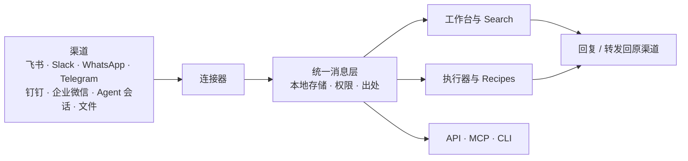

# 产品说明

- **English:** [../en/PRODUCT.md](../en/PRODUCT.md)
- **相关：** [路线图](ROADMAP.md) · [消息编排](MESSAGE_ORCHESTRATION.md) · [连接器目录](CONNECTOR_CATALOG.md) · [从个人到组织](rfcs/personal-to-org.md)

## 一句话

Regenic 是一个开源、本地优先的工作消息平台：连接不同渠道的消息，让你自由组织、检索和处理。

## 要解决的问题

一件工作的上下文，往往散落在多个工具里：群聊里的讨论、客户在 WhatsApp 上的反馈、钉钉里的审批沟通、Agent 会话里的执行记录。每个工具只看得到自己的那一部分。想回答「这个客户之前答应过什么」「这个项目现在卡在哪」，只能逐个翻找、复制粘贴。

Regenic 不替代这些工具。消息仍然在原渠道里产生和回复；Regenic 把它们接进来，变成同一种格式，再交给你、你的执行器或你的系统处理。

## 产品结构

| 组成部分 | 作用 |
| --- | --- |
| **连接器** | 从渠道读取消息，按需写回。内置飞书、DSH、Cursor，其他渠道以插件提供。见[连接器目录](CONNECTOR_CATALOG.md)。 |
| **统一消息层** | 不同来源的消息统一成同一种 Event，保存在本机，保留渠道、会话、发送人和原始消息标识。 |
| **工作台** | 按会话查看当前要处理的工作，回复、转发、置顶、折叠和跟进。 |
| **Search** | 跨渠道检索对话，支持关键词和本地语义检索，可展开上下文、跳回原消息。 |
| **执行器** | 接入 Agent 或模型，基于检索结果回答问题，或执行 Recipes 分派的工单。内核本身不调用模型。见[执行器](EXECUTOR.md)。 |
| **Recipes 与规则** | 定义哪些消息需要关注、交给哪个执行器、何时运行。 |
| **标准与提炼** | 版本化的判断标准、每日摘要和偏差提示，让「什么值得处理」可以被记录和修订。 |
| **集成接口** | 通过 HTTP API、只读 MCP 和 CLI，把消息接入你自己的工具和流程。 |

## 当前能做什么

- **集中查看和回复。** 在一个工作台里处理已接入的会话；连接器支持且已授权时，直接回复到原渠道。
- **跨渠道检索。** 一次搜索覆盖所有已接入来源，结果带出处，可回到原始对话。
- **基于多段对话分析。** 在 Search 中选择执行器，让它根据检索结果梳理进展、核对承诺，并附上引用。
- **跨渠道传递上下文。** 把消息或整段会话转发到另一个渠道，发送前可编辑。
- **把工作交给 Agent。** 用 Recipes 为匹配的工单选择执行器，在工作台跟踪状态、回应确认。
- **跟进与摘要。** 识别未回复的跟进事项，按天生成有出处的摘要。
- **接入自己的系统。** 外部 AI 通过 MCP 检索对话；脚本和服务通过 API、CLI 读写数据或发布 Evidence Bundle。

能力范围取决于具体连接器和授权：有的连接器只读，有的需要额外开启发送。

## 设计原则

1. **本地为准。** 本机或自托管的库是权威数据源，不依赖厂商云。
2. **渠道留在原处。** Regenic 读取并写回，不替代已有的聊天工具。
3. **读写分开授权。** 能读不等于能发；发送需要单独授权，提炼和摘要不会提升权限。
4. **结果可追溯。** 每条检索结果、摘要和结论都能回到原始消息。
5. **处理方式可替换。** 连接器、执行器和模型都可以替换或自己实现。
6. **数据可带走。** 消息可以导出为 JSONL 或 Markdown。

## 我们的方向

当前版本提供了接入、工作台、检索、执行器和集成接口，但还不是完整的自主工作流系统。接下来的方向：

- **可组合的处理流程。** 把筛选、转换、分析、分派和结果回传组合成自定义流程，而不只是检索问答。
- **主动识别与跟进。** 按个人习惯和团队标准，判断哪些消息需要现在处理，提炼结论和待办，交给合适的人或 Agent。
- **从个人到团队。** 在当事人同意的前提下，把多人的消息流合成团队共享的上下文，权限不因汇总而扩大。

阶段和进度见[路线图](ROADMAP.md)。

## 不做什么

- 不做新的聊天工具，也不替代正在使用的消息应用
- 不做通用知识库、笔记或文档套件
- 不做通用 ERP 模块
- 不把个人的 AI 标签直接当作组织事实
- 不运行没有标准和上下文约束的无界 Agent 循环

## 设计文档

| 主题 | RFC |
| --- | --- |
| 接入、分层与回收 | [0005](rfcs/0005-context-storage-lifecycle.md) |
| 事实与快照 | [0002](rfcs/0002-context-graph.md) |
| 判断标准与提炼 | [0001](rfcs/0001-standards-data-model.md)、[0007](rfcs/0007-daily-distillation.md) |
| 协作与交接 | [0003](rfcs/0003-collaboration-objects.md) |
| 人和 Agent 共用的 API | [0004](rfcs/0004-human-agent-api.md) |
| 权限、Agent 身份与发送权 | [0006](rfcs/0006-acl-agent-identity.md) |
| 会话表面：确认、已读 | [0008](rfcs/0008-thread-surface.md) |
| 工单与执行 | [0009](rfcs/0009-work-orchestration.md) |
| 跨渠道转发 | [0010](rfcs/0010-cross-channel-forward.md) |

方法论来源：[regenic-ai/regenic-book](https://github.com/regenic-ai/regenic-book)。
