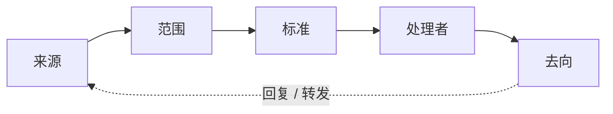

# 产品说明

- **English:** [../en/PRODUCT.md](../en/PRODUCT.md)
- **相关：** [路线图](ROADMAP.md) · [消息编排](MESSAGE_ORCHESTRATION.md) · [连接器目录](CONNECTOR_CATALOG.md) · [从个人到组织](rfcs/personal-to-org.md)

## 一句话

Regenic 把散落在各渠道的工作消息接到一处，按你的标准判断哪些要处理，交给你或 Agent 处理，结果回到原渠道，每一步都有出处。

## 要解决的问题

一件工作的上下文，往往散落在多个工具里：群聊里的讨论、客户在 WhatsApp 上的反馈、钉钉里的审批沟通、Agent 会话里的执行记录。每个工具只看得到自己的那一部分。想回答「这个客户之前答应过什么」「这个项目现在卡在哪」，只能逐个翻找、复制粘贴。

Regenic 不替代这些工具。消息仍然在原渠道里产生和回复；Regenic 把它们接进来，变成同一种格式，再交给你、你的执行器或你的系统处理。

## 核心能力：一条消息处理链路

Regenic 只提供一种能力：一条可追溯的消息处理链路。消息从渠道进来，经过判断和处理，结果回到渠道。所有使用方式，都是这条链路的不同配置。

链路由五个环节组成，每个环节都可以替换和组合：

| 环节 | 回答的问题 | 可以是 |
| --- | --- | --- |
| **来源** | 从哪里读消息 | 飞书、Slack、WhatsApp、Telegram、钉钉、企业微信、Agent 会话、导入文件。由[连接器](CONNECTOR_CATALOG.md)提供。 |
| **范围** | 这次关心哪些消息 | 指定会话、时间窗口、新到的消息、关键词或语义检索的结果。 |
| **标准** | 什么值得处理、怎么判断 | 规则、版本化的判断标准，或由执行器给出的判断。没把握时暂缓，交给人。 |
| **处理者** | 谁来处理 | 你自己；接入的 Agent 或模型（[执行器](EXECUTOR.md)）；通过 API 或 MCP 接入的外部系统。 |
| **去向** | 结果去哪里 | 回复或转发到渠道、待办和提醒、摘要、附引用的答案、交给外部系统。 |

无论怎样配置，以下四点始终成立：

1. **同一种消息格式。** 不同来源的消息统一成 Event，保留渠道、会话、发送人和原始消息标识。
2. **结果可追溯。** 每个判断、答案、摘要和动作都能回到原始消息。
3. **读写分开授权。** 能读不等于能发；发送需要单独授权，判断和提炼不会提升权限。
4. **数据在本地。** 本机或自托管的库是权威数据源，可以导出为 JSONL 或 Markdown。

## 场景：同一条链路的不同配置

Regenic 不为某个场景单独设计功能。场景由用户用五个环节编排出来，可以保存、复用和分享。下面同时列出当前能力和目标配置；尚未交付的组合以路线图为准，不代表已有专用功能：

| 场景 | 来源 | 范围 | 标准 | 处理者 | 去向 |
| --- | --- | --- | --- | --- | --- |
| 集中处理消息 | 全部来源 | 最近的会话 | 需要我处理 | 我 | 回复到原渠道 |
| 跟进承诺 | 全部来源 | 我发出或收到的承诺 | 仍在等回复，或已超时 | 我 | 提醒，再回复 |
| 跨渠道查问题 | 全部来源 | 检索结果 | — | 执行器 | 附引用的答案 |
| 每日摘要 | 全部来源 | 当天的消息 | 值得关注 | 执行器 | 有出处的摘要 |
| 回复客户 | 客户所在的会话 | 新到的消息 | 问题类型与可引用的证据 | 执行器，发送前人工确认 | 回复客户 |
| 工作交给 Agent | 指定会话 | 匹配规则的消息 | 规则 | 执行器 | 执行结果回传到会话 |
| 跨渠道同步上下文 | 某个会话 | 选中的消息 | — | 我 | 转发到另一个渠道 |
| 外部 AI 查对话 | 全部来源 | 检索结果 | — | 外部 AI（MCP） | 外部工具 |

工作台里的默认视图，也只是其中一种配置，没有特殊地位。

## 现有功能在链路中的位置

| 现有功能 | 在链路中的位置 |
| --- | --- |
| 连接器 | 来源 |
| Search | 范围（检索），配合执行器即「跨渠道查问题」 |
| 工作台 | 处理者为「我」时的处理界面，以及回复、转发这类去向 |
| 判断标准与分拣 | 标准 |
| 执行器 | 处理者 |
| Recipes | 把五个环节组合起来并按条件或定时运行的编排方式 |
| 判断标准 + Recipes | 未来可组合出「仍在等回复 → 提醒」等跟进场景 |
| 定时 Recipes + 执行器 | 未来可组合出「当天的消息 → 有出处的摘要」等场景 |
| API、MCP、CLI | 外部系统作为处理者或去向的接入方式 |
| Evidence Bundle | 交给外部系统时的去向格式 |

内核、同步进度、诊断等基础设施不属于链路，默认不出现在用户面前，只在影响使用时提示。

## 新功能的准入

判断一个新需求时，按这个顺序：

1. **能用现有环节配出来，就做成配置。** 不新增功能入口。
2. **配不出来，就补环节的能力。** 补的能力要能服务至少两个场景，例如新的来源、新的标准类型、新的去向。
3. **不为单一场景写专用逻辑。** 只服务一个场景的代码、页面或概念，不进入产品。

用户面对的概念只有五个环节。其他名词如果必须出现，应当能解释成某个环节的一部分。

## 设计原则

1. **本地为准。** 本机或自托管的库是权威数据源，不依赖厂商云。
2. **渠道留在原处。** Regenic 读取并写回，不替代已有的聊天工具。
3. **读写分开授权。** 能读不等于能发；判断和提炼不会提升权限。
4. **结果可追溯。** 每条结论都能回到原始消息。
5. **环节可替换。** 连接器、执行器和模型都可以替换或自己实现。内核本身不调用模型。
6. **能力通用，场景由用户编排。** 产品提供环节，不提供写死的场景。
7. **数据可带走。** 消息可以导出为 JSONL 或 Markdown。

## 方向

当前版本已经具备五个环节的基本能力，但编排方式还不完整，部分功能仍以独立页面的形式存在。接下来的方向：

- **完整的编排。** 让五个环节可以自由组合、保存和复用，现有的独立功能逐步收拢为配置。
- **更强的标准。** 按个人习惯和团队标准判断哪些消息需要现在处理，可以修订，没把握时暂缓。
- **从个人到团队。** 在当事人同意的前提下，把多人的消息流合成团队共享的上下文，权限不因汇总而扩大。

阶段和进度见[路线图](ROADMAP.md)。

## 不做什么

- 不做新的聊天工具，也不替代正在使用的消息应用
- 不做通用知识库、笔记或文档套件
- 不做通用 ERP 模块
- 不为单一场景设计专用功能
- 不把个人的 AI 标签直接当作组织事实
- 不运行没有标准和上下文约束的无界 Agent 循环

## 设计文档

| 主题 | RFC |
| --- | --- |
| 接入、分层与回收 | [0005](rfcs/0005-context-storage-lifecycle.md) |
| 事实与快照 | [0002](rfcs/0002-context-graph.md) |
| 判断标准与提炼 | [0001](rfcs/0001-standards-data-model.md)、[0007](rfcs/0007-daily-distillation.md) |
| 协作与交接 | [0003](rfcs/0003-collaboration-objects.md) |
| 人和 Agent 共用的 API | [0004](rfcs/0004-human-agent-api.md) |
| 权限、Agent 身份与发送权 | [0006](rfcs/0006-acl-agent-identity.md) |
| 会话表面：确认、已读 | [0008](rfcs/0008-thread-surface.md) |
| 工单与执行 | [0009](rfcs/0009-work-orchestration.md) |
| 跨渠道转发 | [0010](rfcs/0010-cross-channel-forward.md) |
| 对话生命周期与策略钩子 | [0011](rfcs/0011-conversation-lifecycle.md) |

方法论来源：[regenic-ai/regenic-book](https://github.com/regenic-ai/regenic-book)。
