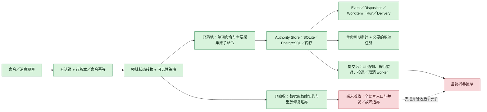

# RFC 0011 — 对话生命周期与策略钩子

- **状态：** Accepted（设计定稿，分阶段实现中；实际进度见第 12 节）。
- **日期：** 2026-11-09
- **依赖：** [RFC 0008](0008-thread-surface.md)、[RFC 0009](0009-work-orchestration.md)
- **定位：** 重构的产品与架构规格；目标设计不代表运行代码已经完成迁移。
- **公开边界：** 只描述渠道无关的协议与抽象，不包含私有连接器的身份、业务场景、配置、接口或实现细节。

## 1. 最终决策

| 关注点 | 决策 |
| --- | --- |
| 对话模型 | 不新增 Conversation 实体或万能 `conversation.status`；沿用 `(org_id, thread_id)` |
| 状态归属 | 对话是容器；WorkItem 是工作单元，WorkRun 是执行尝试，WorkDelivery 是渠道投递 |
| 自动隐藏 | 成功且本次必要投递已确认、没有其他待办时折叠；失败、待投递和发送不确定保持可发现 |
| 人工意图 | 人工隐藏不被策略展开；人工重新显示保护当前工作，下一工作单元／显式重试重新进入自动策略 |
| 解耦方式 | 纯状态转换、纯可见性策略、原子提交端口、提交后通知和有限的耐久任务；不将所有钩子异步化 |
| 一致性 | 工作状态、必要投递入队、显示偏好和耐久列表投影同事务完成 |
| 生命周期新增表 | 两张：生命周期审计事实、耐久副作用任务；不是通用订阅框架。Blob 安全回收是独立的存储支撑协议：新增引用边表并扩展现有 `blobs`，不能借生命周期审计表实现 |
| 耐久任务范围 | 第一版只有 `cancel_execution`；不为隐藏、列表刷新或进程内取消订阅创建持久任务 |
| 投递身份 | 改为每次运行最多一条不可变投递；一个工单可以保留多条历史投递 |
| 并发 | 对话级串行化 + 行版本 CAS + 每次认领独立 claim token |
| 业务办结 | 不新增持久办结枚举；从当前运行、投递、人工确认与其他工作组合推导 |
| 迁移发布 | 先兼容迁移，再通过一次明确的版本化发布启用最终可见性策略，不长期维护两套产品行为 |

本文取代先前草案中“所有处理器入队”“投递每工单一行”“人工意图与策略共用版本”等建议。下文无待选方案；实现偏离本规格时需修订 RFC。

## 2. 现状及重构边界

当前执行监督入口同时更新运行、安排回写、更新工单、释放监听、折叠来源及执行器对话和通知列表。人工确认／忽略也包含类似副作用。

已核实的关键事实：

- 非活跃 WorkItem 包括 `done / failed / skipped`，并不都代表成功。
- 当前执行完成即可进入 `done` 并折叠，实际投递在另一条 worker 路径执行。
- 当前 `work_deliveries.status = acked` 可能搭配 `sent` 或 `skipped`；不能仅凭 `acked` 判断发送成功。
- 一个来源对话可对应多个工单，一个工单可对应多次运行；只查询前台一项不足以决定整条对话折叠。
- 当前执行器内部对话还有根据运行关联推导的列表排除机制，不等同于用户的 Hidden 偏好。
- 普通聊天可以没有工单。生命周期不能强迫它进入“已办结”状态。

保留 RFC 0008／0009 的消息、Prompt、Attention、发送授权和类型边界。本文明确调整两项旧行为：失败不再自动隐藏；需要投递时不再把执行完成当成可折叠条件。同步节奏、执行失败重试次数、上下文读取范围不因此改变。

## 3. 产品语义

### 3.1 状态权威

| 对象／维度 | 权威 | 禁止混淆 |
| --- | --- | --- |
| 消息证据 | `events`、`source_heads` | 不存生命周期通知为聊天 Event |
| 当前工作面 | `message_dispositions`、`thread_heads` | current_work 不等于未读、未完成或显示 |
| 工作单元 | `work_items` | 不是对话身份 |
| 执行尝试 | `work_runs` | 执行结束不是投递成功，也不是外部系统办结 |
| 渠道投递 | `work_deliveries` | 发送确认不是所有外部业务流程的终态 |
| 显示偏好 | `conversation_prefs` | Hidden 不等于取消、确认或删除 |
| 人工介入 | 耐久 `waiting_human` 和 live surface | Prompt 仍不写入聊天消息表 |
| 审计／副作用 | 新增生命周期表 | 不是业务状态权威或事件溯源数据库 |

### 3.2 可见性决策表

“保持可发现”指不由自动策略隐藏；不强制撤销人工隐藏。Pinned 继续只影响排序，不作为永久显示承诺。

| 情况 | 来源对话 | 执行器与资源 |
| --- | --- | --- |
| 普通聊天，无受管工作 | 只走人工偏好及既有消息编排，不因生命周期折叠 | 不干预用户自行打开的执行器对话 |
| `open / running / waiting_human` | 保持可发现 | 保留当前尝试需要的监听和交互同步 |
| 当前尝试成功且不要求投递 | 无其他待办且人工意图允许时折叠 | 释放结束尝试的资源 |
| 当前尝试成功且要求投递 | 排队、发送中、不确定或失败时保持可发现 | 不因等待投递继续占用执行资源 |
| 当前必要投递为 `acked + sent` | 无其他待办且人工意图允许时折叠 | 不恢复结束尝试 |
| 执行失败／投递 dead | 显示失败与重试入口，不自动隐藏 | 释放结束尝试资源 |
| 明确忽略当前工作 | 该项不再阻止折叠；其他工作仍阻止折叠 | 本地停止跟随；远端取消单独确认 |
| 确认当前结果 | 确认的是指定结果，不等同于跳过必要投递 | 不复活执行 |
| 新 current_work／新工作单元 | 策略隐藏展开；人工隐藏保持 | 有新运行才建立执行资源 |
| 人工重新显示 | 保护当前已存在工作，不能被旧结果或重复观察重新隐藏 | 不复活执行 |

跨对话回写只影响来源工作的投递条件，不自动隐藏结果目的地。目的地按自己的消息／注意力规则处理。

### 3.3 人工命令与转换矩阵

所有命令带稳定 `command_id`、`issued_at`、精确对象 ID 和期望版本。重试同一命令返回原语义结果；同一 ID 携带不同参数报冲突。不能用“当前最新项”替代用户操作时看到的对象。

| 命令／事实 | 前置条件 | 原子业务修改 | 明确不做什么 |
| --- | --- | --- | --- |
| 接纳新 current_work | 消息修订及 disposition 有效 | 写消息／编排版本，必要时展开策略隐藏；派发仍按原规则 | 不把上下文证据都当成新工单 |
| 建立工作单元 | `(org, thread, unit_key)` 未存在 | 建 WorkItem、捕获人工意图版本 | 不复活已完成旧工单来承载新触发消息 |
| 开始／重试执行 | 无活跃或启动不确定的前次尝试；没有未闭合旧投递 | 建新 Run、更新当前运行引用、冻结本次投递决策，捕获本轮人工意图版本 | 不复用旧运行 ID；不绕过现有并发上限 |
| 执行观察 | 指定 Run 仍是本项当前尝试；状态转换合法 | 更新 Run 和 Item；成功时按快照创建投递；重算可见性和资源投影 | 重复 completed 不创建第二份投递 |
| 重试投递 | 指定 Delivery 为可重试失败，且原工作未忽略 | 重置该投递的重试资格，保留身份／目标／payload | 不重新执行任务，不生成新发送身份 |
| 核对不确定投递 | 精确 Delivery 仍为 uncertain、无可靠 accepted receipt，且客户端所见 WorkItem／Delivery 快照匹配 | 审计用户选择；确认已发送则结算为 sent 但不伪造渠道回执；确认未发送则若工作未忽略，复用同一 Delivery 排队重试，否则结算为 skipped | 不把 unknown 当成失败；不生成新投递身份；确认未发送不会复活已忽略工作 |
| 确认结果 | 指定当前 Run 及结果版本一致、无活跃尝试；必要投递已成功 | 设置该结果的确认引用，移出其确切触发证据的 current_work，重算可见性 | 不把失败标成功；不放弃待投递 |
| 确认已查看失败 | 指定当前失败 Run、无活跃尝试 | 记录确认并停止该次失败的自动重试；保留失败状态；移出其确切触发证据 | 不伪造成功；未闭合投递存在时仍不得折叠 |
| 忽略工作 | 精确 WorkItem 及版本匹配 | Item 置 `skipped`；未发送投递明确放弃；已发起投递请求停止重试；需要时建立取消任务 | 不宣称远端已经取消，不删除已有回执 |
| 人工隐藏／显示 | 线程身份及人工意图版本匹配 | 更新偏好并增加人工意图版本，即使 hidden 值未变化 | 不改工单、投递或执行状态 |
| 投递结果 | 精确 Delivery 及 claim token 匹配 | 保存此投递回执／失败／不确定状态，重算来源可见性 | 不将旧回执贴到另一条投递 |

确认失败和忽略的区别：前者确认一个失败结果并保留失败语义，后者停止处理整个工作单元。失败自动重试流程必须检查确认引用，不能确认后又自动开跑；手动重试建立新 Run 并清空旧结果确认。

忽略后仍可能收到远端完成通知：可补记实际 Run 结果，但 Item 保持 `skipped`，不得安排新投递。若远端 spawn 已成功返回、但忽略先于外部身份检查点提交，检查点只接受精确的当前 pending Run 与刚返回的身份，原子保存身份并创建取消任务；后续任务输入会因已忽略而停止。远端取消不支持或失败时显示“本地已忽略，远端取消未确认”，不伪造 WorkRun.cancelled。前次远端运行仍活跃或启动不确定时，不能重新执行同一工作单元。

## 4. 架构与钩子边界

**解耦不等于异步化。** 第一版不实现通用事件总线、任意订阅注册、每个状态一个类或完整工作流引擎。

```text
命令／观察
  → 事务中取得对话级写锁，加载当前事实
  → 校验状态、版本、命令幂等性和关联
  → 纯转换函数 + VisibilityPolicy + 本地资源／列表投影计划
  → 原子保存业务状态、投递、偏好、投影、审计和必要取消任务
  → 提交后通知：更新页面、释放本进程订阅
  → 现有投递 worker 发回渠道；取消 worker 处理远端取消
```

| 类型 | 执行方式 | 失败处理 |
| --- | --- | --- |
| 工单／运行状态、投递入队 | 事务内 | 全部回滚 |
| 可见性、耐久列表投影、结束运行的同步工作释放 | 事务内，由领域策略产生计划、存储端口执行 | 全部回滚，不留下成功状态＋旧列表 |
| 页面刷新、preferred thread、本进程等待订阅 | 提交后幂等通知 | 记录错误；轮询／启动恢复按耐久事实重建 |
| 渠道发送 | 现有投递 worker | 独立发送账本、回执、不确定处理和重试 |
| 远端取消执行 | 有限的耐久 job | 租约、重试、可查询失败；不阻塞其他工作 |

领域层负责纯策略和转换；应用层负责授权、组装、唤醒与网络调用；Authority 负责原子提交和并发协议。不同模块通过显式端口协作，不相互调用庞大的服务类。

启动时只为仍被跟随的活跃尝试重建资源；`skipped`、已确认失败和已结束尝试不得重新抢交互优先权。运行结果补充导致行版本增加，不是拒绝必要资源清理的理由；清理应验证运行身份、结束／停止跟随事实及资源当前归属。

## 5. 已有表结构

以下来自当前公开代码，不是本机运行数据库的现场检查。SQLite 的时间／JSON 为 TEXT、布尔为 INTEGER；PostgreSQL 为 TIMESTAMPTZ／JSONB／BOOLEAN。

| 表 | 当前主键／唯一约束 | 当前字段 |
| --- | --- | --- |
| `conversation_prefs` | PK `(org_id, thread_id)` | `org_id, thread_id, title, pinned, hidden, hidden_reason, visibility_version, last_read_at, last_read_external_id, updated_at` |
| `work_items` | PK `id`；UNIQUE `(org_id, thread_id, unit_key)` | `id, org_id, thread_id, unit_key, head_event_id, record_class, thread_facet, status, recipe_id, current_run_id, acknowledged_run_id, version, visibility_intent_version, created_at, updated_at` |
| `work_runs` | PK `id`；UNIQUE `(org_id, id)` | `id, org_id, work_item_id, recipe_id, executor_type, executor_config_json, include_context, external_run_id, agent_thread_id, status, start_state, result_json, version, write_back_required, write_back_target_json, trigger_kind, completion_policy_version, created_at, updated_at` |
| `work_deliveries` | PK `id`；部分 UNIQUE `(org_id, run_id)`，run_id 非 NULL；历史 NULL run_id 部分 UNIQUE `(org_id, work_item_id)` | `id, org_id, work_item_id, recipe_id, kind, unit_key, event_id, status, write_back, attempts, last_error, next_retry_at, payload_json, lease_expires_at, lease_owner, claim_token, cancel_requested_at, idempotency_key, channel_receipt_json, run_id, target_json, created_at, updated_at` |
| `recipes` | PK `id` | `id, org_id, name, match_json, executor_type, executor_config_json, can_write_back, write_back_thread_id, include_context, enabled, trigger_kind, trigger_interval_ms, trigger_at_minute, trigger_weekdays, trigger_timezone, trigger_coalesce, max_concurrent, next_run_at, created_at, updated_at` |

现有状态值：

- WorkItem：`open / running / waiting_human / done / failed / skipped`。
- WorkRun：`running / waiting_human / completed / failed / cancelled`；`start_state` 为 NULL 或 `pending / submitted / uncertain`。
- WorkDelivery：`queued / running / write_back / acked / dead / uncertain`；write_back 为 `pending / sent / skipped / failed`。
- hidden_reason：NULL、`human`、`policy`；Hidden 仍是本地偏好，不推导远端删除。

支撑表及关系：

| 表 | 相关结构 | 用途 |
| --- | --- | --- |
| `events` | sequence PK，id 唯一；来源、修订、线程、时间、正文引用和属性 | 耐久消息证据 |
| `source_heads` | PK `(org_id, source, external_id)`；current_event_id | 来源记录的当前修订，不是整条对话头 |
| `message_dispositions` | event_id PK／FK；org_id、disposition、layer、reason_codes、score、decided_at | 当前工作编排 |
| `thread_heads` | PK `(org_id, thread_id)`；face_event_id、face_occurred_at、has_current_work | 列表派生投影 |
| `connector_sync_work` | UNIQUE `(installation_id, stream_key, lane, generation)`；状态、优先权、租约等 | 执行器同步资源；其 run_id 指同步运行，不是 WorkRun |
| `context_projection_outbox` | 消息 event_id 唯一；状态、租约、重试等 | 消息上下文投影；不复用作生命周期队列 |

当前 schema 为 77。合并主干后保留已发布的 56（搜索 scope）、57（Recipe 固定回写目标）、58（Recipe 隐藏开关）；本 PR 尚未发布的迁移从 59 起重排，历史验收记录中的旧编号不代表已发布数据库需要改号。

当前 `work_runs.work_item_id` 和 `work_deliveries.work_item_id` 引用 WorkItem；`head_event_id` 引用消息 Event。对话通过 `(org_id, thread_id)` 逻辑关联，没有独立 Conversation 表。自 SQLite／PostgreSQL schema 57 起，Recipe 固定回写目标已覆盖保存、读取及两种数据库映射，既有导入导出继续保留该字段。Schema 59 增加 WorkItem 的 `current_run_id` 与 WorkItem／WorkRun 行版本；历史行从版本 0 起。只有活跃工单恰好只有一条同租户运行，且该运行仍活跃、规则归属一致时才恢复运行指针；其余保留 NULL，不按时间或最新运行猜测。设置页现可查看当前活跃工单的身份异常及可能匹配的 Run ID；该入口只读、不自动修复或推断历史关联。Item 与 Run 分别读取，诊断可能与并发生命周期转换短暂不一致，须刷新核实后再采取其他操作。

Schema 60 增加运行级投递义务、安装／目标快照与触发类型，以及按 Run 保留的投递账本；Delivery 使用 `(org_id, run_id)` 复合 FK 关联同租户 Run，原子写端口同时校验所属工单与目标。新运行在调用外部执行器前持久化这些字段，历史值保持 NULL。历史投递原 ID、正文、幂等键与回执原样迁移，不猜测 Run／目标；NULL run_id 的历史记录保留每工单最多一条的限制，不能换 ID 覆盖。此阶段仍保留旧运行／投递兼容收尾，不代表历史未知授权核对及最终发送协议已启用。

Schema 61 增加 `lease_owner / claim_token / cancel_requested_at`；已有请求与回执不改写，不为旧 worker 伪造 token。投递 worker 通过 `transitionWorkDelivery()` 原子认领／续租／结算／记录回执／恢复过期租约／请求停止投递。SQLite 使用 immediate 事务与单次写 RPC；PostgreSQL 按 Item、Delivery 顺序锁行；内存同步准备并提交。新认领分配新的 token，正常结算及续租同时匹配 ID、owner、token 与有效租约；已认领记录不能通过普通 put 接口覆盖或清掉 token。

Schema 63 为 WorkItem 增加 `visibility_intent_version`。执行预留读取来源对话当前 `conversation_prefs.visibility_version`，并在预留事务内核对后写入 WorkItem；SQLite immediate 事务与 PostgreSQL 共用对话偏好 advisory lock，偏好在读取与预留间变化时拒绝启动。结束后的兼容策略折叠用同一锁实现期望版本 CAS，仅在 WorkItem 捕获版本仍等于当前对话版本时作用于来源对话；策略折叠不会递增人工版本。执行器内部对话继续独立处理。历史 WorkItem 从版本 0 起，偏好或版本不确定时保守不折叠。本切片不意味着对话级写协议已覆盖采集、观察、投递和所有其他写入口。

Schema 64 建立 `conversation_lifecycle_events`，Schema 65 为每组织的非空 command_id 增加唯一约束，Schema 66 增加 `work_items.acknowledged_run_id`。人工显示／隐藏、普通工单忽略、手动启动、失败投递重试及不确定投递核对携带 `command_id` 与 `issued_at`；业务状态与事件同事务提交。相同命令 ID 与相同参数重放不会重复应用状态转换、取消远端、启动执行器或再次触发发送；相同 ID 参数不同返回冲突。手动启动以 `work_run_transitioned` 事件记录预留的 Run 身份，投递重试／核对以 `delivery_transitioned` 记录原 Delivery 身份及命令结果；重放只读取原命令结果，不触发外部副作用。API 拒绝超过 90 天或未来超过 5 分钟的命令。运行观察提交会同事务审计实际 Run 状态转换，并在创建结果投递时记录 `delivery_created`；投递认领、可靠回执、发送结算、失败、不确定及停止请求也由转换端口同事务记录 `delivery_claimed / delivery_transitioned`，审计不包含 claim token、回执原文或结果正文。指定结果确认已接入：命令须匹配 WorkItem 与 Run 版本及精确触发事件，且只允许当前 completed Run、done 工单及有冻结回写义务时已确认 sent 的 Delivery；同事务记录 Run ID、把该触发事件从 `current_work` 移出并写入 `work_acknowledged / current_work_changed`。仅当线程没有其他当前工作、未完成／未确认工单或未闭合投递，且人工可见性版本未变化时才策略隐藏，并同事务写 `visibility_changed`；人工隐藏／重新显示优先。相同命令重放幂等，新 Run 预留时清除旧确认。消息收尾与确认已原子化，但其他接纳消息、观察、投递等所有写入尚未统一迁移到对话级写协议，不能据此宣称全生命周期写入已整体原子化。

Schema 76 增加可空的 `work_runs.completion_policy_version`，当前合法值只有 `1`。SQLite 单实例 API／Electron 的新用户 Run 在预留时冻结为 `1`；历史 Run 保持 NULL，不扫描旧完成记录、不合成用户确认、不更改历史发送授权。系统后台工作不设置该版本；PostgreSQL 仅同步字段迁移与读写映射，运行时仍不启用版本 `1`。版本 `1` 的当前 completed Run，在冻结义务明确为无需写回或本次 Delivery 已 `acked + sent` 后，才在观察／投递结算的同一事务将精确当前来源触发移出 `current_work`、更新列表头、记录审计并尝试折叠；人工意图变化或其他待办仍阻止折叠。自动收尾不写 `acknowledged_run_id`，该字段只记录实际用户确认；已自动收尾的结果不再提示确认。每个 Run 的收尾审计使用稳定去重键，重复观察及投递命令重放不会再次处置用户重新纳入工作的旧触发。

Schema 77 增加可空的 `work_runs.hide_on_success`，在每次 Run 预留时冻结规则隐藏开关。`false` 不阻止成功自动收尾：仍退出当前工作、变为 quiet、不要求结果确认，但完成结果必须可从 Showing 列表找到；阅读／确认不能绕过该冻结值再次隐藏。规则执行中修改开关不影响当前 Run。历史 NULL 不回填，实际结果确认时回退 Recipe 设置，再回退旧默认 true；新建规则默认 false。

显式规则命中的自动 `pending` 普通消息保留主干的自动执行能力。接纳与消息提交同事务完成，启动时仍要求同租户、特定来源、启用的 push 规则及原子快照校验；采集和启动不会把其分类伪造为 `current_work`。人工 pending／排除、人工隐藏及 outbound／assistant／system 回声不能因此执行。成功收尾依据精确当前 Run 的冻结 push 身份，将原自动 pending 来源转为 `outside_current_work`，再按冻结隐藏开关处理；不恢复后台 `reconcileInbox` 扫描或旧 raw writer。

## 6. 最终表结构变更

### 6.1 现有表增补

| 表 | 新增字段 | 约束／语义 |
| --- | --- | --- |
| `conversation_prefs` | `visibility_version` | 非负整数，NOT NULL DEFAULT 0；**仅人工显示／隐藏命令递增**，策略、已读、标题、置顶不递增 |
| `work_items` | `version` | 非负整数，NOT NULL DEFAULT 0；业务行 CAS |
| `work_items` | `current_run_id` | 可空，指向当前尝试；新执行路径不再通过“最新时间”猜当前运行 |
| `work_items` | `acknowledged_run_id` | 可空，明确已确认的完成或失败 Run；新 Run 预留时清空 |
| `work_items` | `visibility_intent_version` | 非负整数，NOT NULL DEFAULT 0；建立工作／显式重试时捕获来源人工意图版本 |
| `work_runs` | `version` | 非负整数，NOT NULL DEFAULT 0 |
| `work_runs` | `write_back_required` | 可空 BOOLEAN；新运行必填；NULL 只表示历史未知，不能解释为 false |
| `work_runs` | `write_back_target_json` | 可空 JSON；要求投递的新运行必填，保存规范化 installation／source／target 身份，无凭据 |
| `work_runs` | `trigger_kind` | 可空 TEXT，`push / pull / manual`；新运行冻结触发类型，保证 Recipe 被删除后仍能记录投递来源；历史 NULL 不猜填 |
| `work_runs` | `completion_policy_version` | 可空 INTEGER；新用户 SQLite Run 冻结为 1，历史及尚未启用的运行时保留 NULL |
| `work_runs` | `hide_on_success` | 可空 BOOLEAN；新 Run 冻结规则值，NULL 仅用于历史兼容 |
| `work_deliveries` | `version` | 非负整数，NOT NULL DEFAULT 0；行 CAS，不作为投递身份 |
| `work_deliveries` | `run_id` | 可空，历史未知保留 NULL；新执行结果投递必填 |
| `work_deliveries` | `target_json` | 可空 JSON；新投递必填，从 Run 快照复制，不跟随 Recipe 后续编辑 |
| `work_deliveries` | `lease_owner, claim_token` | 可空 TEXT；每次认领生成新 token |
| `work_deliveries` | `cancel_requested_at` | 可空 timestamp；停止新发送／重试，不代表已经撤销在途请求 |
| `message_dispositions` | `version` | 非负整数，NOT NULL DEFAULT 0；实际编排字段变化递增，不按重复扫描递增 |
| `recipes` | `write_back_thread_id` | 可空 TEXT；沿用既有对话身份格式，已在 schema 57 实现；历史行保留 NULL，不猜填目标 |
| `recipes` | `hide_on_success` | BOOLEAN；schema 58 保留旧默认 true，新建规则默认 false；只影响后续 Run 的隐藏快照 |

`current_run_id / acknowledged_run_id` 必须属于同一个 org 和 WorkItem。新关联采用同租户物理 FK：相关业务表增加 UNIQUE `(org_id, id)`，配合复合 FK；WorkItem 与 Run 循环关联通过可空指针及一个事务中的插入／更新建立。所属工单一致性还必须由原子端口校验。

WorkRun 的投递快照在外部启动前冻结；试跑关闭投递时明确写 false。执行器观察不能改写这份快照。发送前仍须检查当前授权和安装可用性，快照不是永久发送许可。无权限时显式失败，不换目标或静默跳过。

进入 completed 后冻结用于确认／投递的结果；不同结果必须来自新的显式尝试。补充非结果元数据可以增加行版本，但不能更改已确认内容或产生第二次完成。

此约束同样作用于普通 `putWorkRun`，不能只保护观察入口。completed 的 summary／content／evidence 不允许改写、删除或在历史未知结果上补填；对象键顺序不视为内容变化，但内容及证据数组顺序仍属于结果。completed／failed／cancelled 不能通过普通写入转换为其他状态；重试建立新的 Run。普通写入不隐式结算 Item 或补建投递，完整业务转换仍必须使用原子观察／生命周期端口。

### 6.2 投递账本改为按运行保留

移除覆盖全部记录的 UNIQUE `(org_id, work_item_id)`；新建唯一索引 `(org_id, run_id)`，条件 `run_id IS NOT NULL`。历史 NULL run_id 记录保留部分唯一索引 `(org_id, work_item_id)`，防止没有运行证据的新 ID 替换旧请求。每次运行最多创建一条结果投递，旧运行的记录不覆盖、不借用。增加 `(org_id, work_item_id, created_at, id)` 查询索引。

- Delivery.id 就是不可变的投递身份，不再增加 delivery_generation。
- `run_id / target_json / payload_json / idempotency_key` 创建后不可修改；发送状态、租约、回执独立更新。
- 幂等键包含投递身份并在首次发送前持久化；重试不换键。不能只用内容 hash，否则不同合法运行的同样结果会被错误合并。
- 已确认运行结果不因后续重复观察改写投递正文。纠正内容通过新的显式执行产生新投递，不覆盖发送历史。
- 工单层展示根据 `current_run_id` 定位当前投递，同时单独展示任何未闭合的历史投递异常。
- 重跑执行前，旧投递必须已经成功或明确放弃；在途／不确定投递阻止重跑，防止连续产生外部重复结果。
- 原来的“按工单取一条投递”接口必须替换为精确 ID／run 查询及历史列表，批量扫描和 UI 都要同步迁移。

投递状态新增 `uncertain`，write_back 仍保留原枚举；uncertain 使用 `pending` 并提供错误原因，不能伪装成 sent。

| 场景 | 状态与处理 |
| --- | --- |
| 确定未被渠道接受的失败 | 按既有回退和次数限制重试，耗尽为 dead |
| 已有可靠 accepted receipt，本地后处理失败 | 保存回执，只重试本地后处理，不再次发送 |
| 发送超时／进程退出，是否接受未知 | 进入 uncertain；优先查回执；渠道明确支持稳定幂等时允许原键重试 |
| 渠道无回执查询且无幂等保证 | 不自动重发 uncertain，显示“需核对”；用户明确确认已发送或确认未发送后才结算／重试，并记审计 |
| 未在途且确定未发送的投递被忽略 | `acked + skipped`，记录放弃事实 |
| 在途投递被忽略 | 设置 cancel_requested_at；不再启动重试，保留回执结算路径；不能声称已撤回 |
| 忽略后收到发送成功 | 仍记录 sent，Item 保持 skipped；显示结果可能已送达，不复活工作 |

租约到期本身不能证明发送失败。过期 worker 返回的回执不得直接覆盖当前状态；通过独立回执归并端口，校验同一 Delivery、原 token 的已认领审计和不可变请求身份后接受可靠证据。不可靠或冲突的证据保留为需核对异常，不能简单丢弃，也不能嫁接到新投递。

### 6.3 新表：`conversation_lifecycle_events`

用途是审计、幂等和取消任务的来源追踪，不用于重放整套业务。事件主体允许 `work_item / work_run / work_delivery / conversation / source_event`。

| 字段 | 逻辑类型／约束 | 含义 |
| --- | --- | --- |
| `id` | TEXT PK | 事实 ID |
| `org_id, thread_id` | TEXT NOT NULL | 租户与来源线程 |
| `aggregate_type, aggregate_id` | TEXT NOT NULL | 状态主体类型与身份 |
| `aggregate_version` | 非负整数 NOT NULL | 转换后的主体版本 |
| `event_type` | TEXT NOT NULL | 封闭类型，见下文 |
| `command_id` | TEXT NULL | 人工／API 命令身份；无命令的观察可空 |
| `dedupe_key` | TEXT NOT NULL | 确定性幂等键 |
| `schema_version` | 正整数 NOT NULL | 最小快照解码版本 |
| `payload_json` | JSON NOT NULL | 前后状态、关联对象、原因、必要 claim 证据；不重复保存正文、完整结果或凭据 |
| `occurred_at, created_at` | timestamp NOT NULL | 事实与记录时间 |

事件类型：`work_item_transitioned / work_run_transitioned / work_acknowledged / delivery_created / delivery_claimed / delivery_transitioned / cancellation_requested / visibility_intent_changed / visibility_changed / current_work_changed`。具体状态放入有类型的 payload，避免为每个状态建一个处理框架。

唯一约束 `(org_id, dedupe_key)`、`(org_id, id)`；审计索引 `(org_id, thread_id, created_at, id)`、主体索引 `(org_id, aggregate_type, aggregate_id, aggregate_version)`，命令查询索引 `(org_id, command_id)`。

去重键由主体类型、ID、转换版本和事件类型组成；命令以 command_id 关联原结果，并验证参数摘要，拒绝同 ID 不同参数。消息编排使用 disposition.version，不使用轮询时间。策略事件版本由触发转换及其语义子键确定，不借用只计人工操作的 visibility_version。

业务对象引用放在有类型 payload 中，由提交端口检查同租户关系；审计对业务表不建 FK，避免阻止正常数据清理。生命周期事实本身没有 processed 字段。

### 6.4 新表：`conversation_lifecycle_jobs`

第一版唯一 job_type 是 `cancel_execution`。每个需要远端取消的尝试有一个可独立恢复的任务，不为可见性、列表刷新和本地订阅复制任务。

| 字段 | 逻辑类型／约束 | 含义 |
| --- | --- | --- |
| `id` | TEXT PK | 任务 ID |
| `org_id, event_id` | TEXT NOT NULL | 同租户复合 FK 指向 lifecycle_events |
| `job_type, run_id` | TEXT NOT NULL | 取消操作与精确运行 |
| `schema_version` | 正整数 NOT NULL | 操作参数版本，不是订阅算法版本 |
| `status` | enum NOT NULL | `pending / running / succeeded / failed / dead` |
| `attempts` | 非负整数 NOT NULL DEFAULT 0 | 认领次数 |
| `lease_owner, claim_token` | TEXT NULL | 当前认领者及本轮不可复用 token |
| `lease_expires_at, next_retry_at` | timestamp NULL | 租约与重试时间 |
| `last_error_code, last_error, outcome_code` | TEXT NULL | 脱敏失败与明确处理结果 |
| `created_at, updated_at` | timestamp NOT NULL | 入队与更新时间 |
| `completed_at` | timestamp NULL | 闭合时间 |

UNIQUE `(org_id, job_type, run_id)`；pending、failed 到期、running 过期分别建立部分索引；另建 `(org_id, status, updated_at, id)` 运营索引。job 与事件同租户通过复合 FK 约束，业务 Run 引用由端口校验。

### 6.5 Blob 引用登记与安全回收

Blob 是跨消息、附件和上下文产物共享的内容寻址对象。物理对象写入与 Authority／产物记录不属于同一事务；因此不能在一次写入失败后立即删除刚写入的对象，也不能只凭 `events.content_hash` 判断附件 blob 是否无引用。回收必须由一个全局、可恢复且与写入互斥的协议执行；在该协议完整部署之前，物理 blob 一律不自动删除。

#### 表结构

现有 `blobs` 是全局内容寻址对象目录，按 hash 唯一；新增字段用于写入预留和回收状态，不代表活跃引用：

| 字段 | 逻辑类型／约束 | 含义 |
| --- | --- | --- |
| `state` | enum NOT NULL | `reserved / available / deleting / protected`；`available` 可正常新增引用；迁移期允许给 `protected` 新增引用但不得解除保护；`reserved / deleting` 拒绝普通引用；`protected` 永不自动回收 |
| `generation` | 非负整数 NOT NULL DEFAULT 0 | 对象生命周期代数；每次新 reservation 或进入删除态时递增，拒绝旧操作 |
| `write_lease_owner, write_claim_token` | TEXT NULL | 当前写入预留身份；每次接管生成新 token |
| `write_lease_expires_at` | timestamp NULL | 预留过期时间；仅过期不授权立即删除，仍须走回收状态机 |
| `unreferenced_at` | timestamp NULL | 新 reservation 建立、最后一条持久引用移除或写入失败后开始的保留期起点；新增引用时清空 |
| `gc_claim_token, gc_started_at` | TEXT／timestamp NULL | 当前删除尝试身份及开始时间；失败或进程退出后可由新 GC worker 接管 |

新增 `blob_references` 保存完整引用边；hash 在不同组织间可共享，只有全局引用边数为零时才可回收。

| 字段 | 逻辑类型／约束 | 含义 |
| --- | --- | --- |
| `owner_org_id` | TEXT NOT NULL | 引用所属租户 |
| `owner_type` | TEXT NOT NULL | 封闭类型；Schema 71 覆盖 `event / context_artifact / outbound_attempt` |
| `owner_id` | TEXT NOT NULL | 精确的持有对象 ID；不能用“当前 head”等可变查询代替 |
| `reference_kind` | TEXT NOT NULL | `body / attachment / artifact_body / evidence / reply_recovery` 等稳定字段身份 |
| `content_hash` | TEXT NOT NULL FK `blobs(content_hash)` | 被引用对象 |
| `created_at` | timestamp NOT NULL | 引用建立时间 |

主键 `(owner_org_id, owner_type, owner_id, reference_kind, content_hash)`；按 `content_hash` 建回收查询索引，按 `(owner_org_id, owner_type, owner_id)` 建所有者清理索引。Owner 是多态引用，不加阻碍正常业务删除的多态 FK；提交端口必须验证租户、持有对象存在以及引用内容与对象快照一致。对象目录是全局的，不能按单租户清理。

引用覆盖全部持久化用途，不仅是当前消息正文：每个 Event 的主内容及其 canonical 内容中引用的附件 blob、持久上下文产物的 body 和 evidence blob，以及后续任何需要跨进程保留的 BlobStore 使用。普通内存临时值不登记持久引用。所有写入方必须提供明确 owner；不允许无 owner 的“永久 put”。内容整理／repoint 在同一 Authority 事务中更新 owner 的引用边，旧对象只进入未引用候选，不再直接调用物理 `delete`。

#### 写入与回收协议

1. **Reserve：** AuthorityStore 按 hash 排序锁定对象行。新 hash 创建 `reserved` 对象并生成新的 generation 与 write token；现有 `available` 对象不重复上传，并由后端确认对象存在且内容 hash 正确。遇到 `reserved` 时在 lease 过期后换 token 接管；遇到 `deleting` 时等待删除完成后再 reserve。迁移期的 `protected` 对象可在后端校验存在后增加引用，但继续保持 `protected`，不能因新引用自动解除保护；缺失对象只能经受控写入修复，不能因此开放回收。
2. **写对象：** 仅对新建／接管的 `reserved` 对象持 token 上传到后端。BlobStore 增加对象枚举与带 generation 的条件发布／删除能力；不支持 generation 围栏或等价 per-object 原子锁的后端不得启用 GC。所有读写错误显式返回，不把缺失对象当成功。
3. **提交引用：** 业务记录、`blob_references`、对象状态 `available` 和写入 lease 清除，在其 Authority／Artifact 提交事务中原子完成；上传对象须核验 reservation token/generation，复用对象须在锁内核验状态与引用目标。`protected` 引用提交只增加引用边并保持原状态。提交失败只释放当前 token 或等待 lease 过期；物理对象成为延迟候选，绝不在错误处理器中立即删除。
4. **选择候选：** GC 使用数据库时钟，按 `state IN (reserved, available)`、`unreferenced_at` 超过保留期、无引用边、无有效 write lease 选择小批次；同一事务锁定对象行并改为 `deleting`、递增 generation、换发 gc token。新引用／reservation 与此步骤串行化，deleting 状态不能提交业务引用。
5. **条件删除与完成：** 后端先在 per-object 原子临界区持久化新的 generation fence，使之后到达的旧 generation 发布都被拒绝，再删除物理对象；随后 Authority 以 token CAS 删除对象目录行。删除失败或进程退出时保留 `deleting` 行，后继 worker 幂等重试；不能先删目录行再删文件。旧 GC token 不能删除新一代对象。
6. **再使用：** deleting 完成后，同一 hash 可用更高 generation 重新 reserve 和发布。后端必须保证已失效的旧写入／删除不能在新一代对象之后落盘；不具备此保证时只能永久保留对象，不能启用自动物理回收。

写入 lease 与 GC 状态机解决已登记写入的竞争，但单靠数据库 lease 不能围栏一个在 lease 失效后仍继续运行的旧进程。因此 generation 必须由 BlobStore 后端实际执行（或由它提供的跨进程 per-object 原子锁执行）：回收先推进持久 fence，再删除；较旧 generation 的发布必须失败。不能只在 Authority SQL 中比较。进程内锁、宽限期或“旧 worker 通常很快结束”都不构成充分保证。

#### 上线与兼容

- 先为所有持久写入方接入 owner、reservation、引用事务和 BlobStore 围栏；至少覆盖采集、附件、上下文产物与内容整理。期间 GC 保持关闭。
- 回填引用时扫描全部持久 owner，包括历史 Event 主内容及解析出的附件哈希、ContextArtifact body；执行全存储对账并修复缺失对象／引用。迁移前已有对象默认标为 `protected`；只有完整核对出的对象才转为 `available` 或无引用候选。不能证明引用完整的历史 hash 永久保持 `protected`，不参与回收。
- BlobStore 提供流式对象枚举，仅用于受控盘点和 dry-run；枚举出来但没有目录／引用记录的 legacy 对象先以盘点时刻作为 `unreferenced_at`，经过完整保留期与重复对账后才可成为候选。枚举不执行删除；fenced store 仅报告当前可见 generation，reserved／deleted 及临时文件不作为可见对象。
- dry-run 输出 hash、字节数、候选原因和跳过原因；启用顺序为只读盘点 → 候选标记但不删 → 小批量删除 → 扩量。提供按 hash 保留／恢复引用入口和卡住的 deleting 对象告警。
- 保留期是上线配置的固定下限，任何 worker lease、上传超时、事务重试期限或恢复窗口都必须短于它；这只用于降低误删影响，正确性仍由 token/generation 与引用事务保证。

所有持久化 owner 与引用边必须处在可共同原子提交的 GC catalog 事务边界内；若某个 ArtifactStore／部署使用独立数据库，必须先增加受围栏的跨库登记协议，否则该存储后端及其对象不得参与 GC。上述结构是本 RFC 的新增存储支撑设计，不属于生命周期审计或取消任务的通用扩展。实际落地前需对 SQLite、PostgreSQL、内存实现及写 RPC 分别验证等价的行锁／CAS 行为；在引用回填和后端 fencing 完成并验收前，全局自动 GC 必须关闭。

租约 30 秒，至多每 10 秒续租；单次调用须在可续租且有超时约束的执行边界内。自动尝试上限 5 次，失败间隔为 5 秒、30 秒、2 分钟、10 分钟；上限后进入 dead 并显示可操作错误，不冒充取消成功。支持取消的适配器必须可重复取消同一运行或先查询状态；超时后先核实，不盲目重复非幂等操作。

批量认领的任务并行执行，各任务从开始处理时即独立续租；不得先认领整批再串行等待，否则批次尾部任务可能在开始处理前失去租约。批次等待所有任务处理结束，再报告未能结算的存储错误。

远端已结束可记 `already_finished`；不支持取消记 `unsupported` 并展示本地忽略与远端状态的区别。人工重试 dead 任务增加审计、重置重试预算并产生新 claim token，不重放已完成任务，也不因代码升级自动重跑。

仅远端明确确认取消或查询证实取消时，才通过原子工作转换写 Run.cancelled；若查询发现实际 completed／failed，记录该实际状态。以上都不撤销 WorkItem.skipped。不确定启动没有可证明的外部运行身份时，任务必须先沿启动确认协议查证，禁止猜测目标取消。

## 7. 并发与事务协议

### 7.1 对话级串行化

只加业务行 version 无法保护并发插入的新消息。所有影响来源可见性的写路径，包括采集、编排、建单、开跑、观察、人工操作、投递结算与恢复，必须遵守同一对话写协议：

- SQLite：在同一个写 worker RPC 内使用 `BEGIN IMMEDIATE` 事务，读取与写入都在该事务内完成。禁止在外部读快照后拼多个 put RPC。
- PostgreSQL：事务中先取得基于 `(org_id, thread_id)` 的 transaction-level advisory lock，再读取并计算；默认读已提交隔离，锁在读取前取得。锁键由统一、无歧义编码和固定哈希产生；碰撞只增加串行化，不降低正确性。
- 多对话写入按统一锁键顺序取得所有锁，避免交叉回写／采集死锁。不能绕过该锁直接写影响可见性的业务表。
- 内存实现按相同对话键串行化，失败时全有或全无。

纯策略在拿锁后读取的事实中计算；事务内无网络调用。CAS 校验防止陈旧命令覆盖，独立对象版本不互相比大小。所有写入口迁移完成后才启用新策略，不能让旧 put 路径绕过协议。

### 7.2 原子提交端口

提供专用领域端口，不提供任意业务回调穿过写 RPC：

- `commitWorkTransition`：工作／运行、必要投递入队、消息工作面、可见性、资源／列表投影、事件和取消任务。
- 迁移期的 `commitWorkObservation`：原子保存 Run／Item／投递观察；仅当 Run 事实发生变化时写 `work_run_transitioned`，首次创建结果 Delivery 时写 `delivery_created`。事件与业务行同事务提交，payload 不复制结果正文。
- 迁移期的 `checkpointWorkRunStart`：对已原子预留的当前 Run，提交会话绑定、启动提交确认、明确未启动失败或启动不确定；同一事务校验 Item／Run 快照并更新配套状态，不产生新 Run 或结果投递。若忽略已先提交，只有精确当前 pending Run 的 bound／submitted 检查点可以保存刚确认的外部身份；它保持 Item 为 skipped，并在同一事务创建耐久取消任务。
- 迁移期的 `recordWorkRunStartFailure`：尚未预留运行的配置校验失败，核对 Item 完整快照、规则存在性、旧活跃运行和未闭合投递，再原子写入失败尝试与 Item 版本。自动失败更新 failed 与当前 Run；手动／辅助失败保留原业务状态和当前运行指针，不把配置校验失败当作重新执行成功或远端失败。
- 迁移期的 `dismissWorkItem`：核对期望 Item 完整快照与当前 Run 归属，原子写入 skipped／行版本、本工单所有未闭合投递的停止请求、生命周期审计及必要的取消任务；不改写任何 Run 的实际执行状态。仅对启动已确认且外部身份明确的活跃 Run 建立任务。搜索回答超时可携带期望回答元数据，在同一事务校验并保存 timed_out 原因；不向通用工单状态机添加回答专用状态。
- 迁移期的 `createWorkItem`：只创建尚不存在、无当前 Run 的 open Item；同事务核对规则完整快照并保存规则与工单，已存在的工单即使终态也不重置。允许复用除时间戳外配置等价的共享规则，避免相同配置的并发准备互相冲突；不等价规则更新必须匹配期望快照。搜索回答可携带新 SearchAnswerRecord，在同事务校验归属并只插入不覆盖；元数据失败时连同工单和规则一起回滚。该端口不创建 Run 或执行外部调用，现用于辅助准备、规则试跑新建及定时 pull occurrence 建单；运行预留仍为独立事务。
- 迁移期的 `observeWorkItem`：将采集事件生成的新工作单元与对既有活跃工作单元的元数据合并作为 CAS 写入；新行仅允许 fresh/open，旧行更新必须匹配完整快照并保持状态、current_run_id、确认引用及触发身份不变。SQLite／SQLite writer RPC、PostgreSQL 与内存实现同事务写入 `work_item_transitioned`，冲突保守跳过本轮观察，不覆盖并发启动／忽略结果。消息接纳、disposition 与工作单元仍是不同事务，未取得对话级锁。
- 迁移期的 `claimWorkRunStart`：新调用传入期望 Item 快照与明确的手动／自动重试意图；事务内校验后直接由原状态进入 running 并建立新 Run，不先在事务外把终态改为 open。显式 `rebind` 意图允许在同一预留事务内绑定所选 Recipe；手动不能抢占其他规则仍为 open 的工作，自动仅允许 open／failed。容量按所选规则核对，所有旧活跃 Run 和未闭合投递仍阻塞。无快照的旧调用仅支持同规则既有 open 启动，不能用于重试终态或规则重绑定。
- `claimDelivery / commitDeliveryTransition / reconcileDeliveryReceipt`：精确投递身份、认领及回执归并。
- `commitConversationIntent`：人工显示意图与偏好。
- 既有采集／编排提交端口：接纳消息、disposition.version、展开及相关投影。
- `claimCancellationJobs / renewCancellationJob / settleCancellationJob`：带 owner、claim token 与有效期的取消任务租约；`commitCancellationJobObservation` 将准确 Run 的终态观察及任务成功结算原子提交。

端口返回 `applied / already_applied / conflict` 等明确结果；冲突重新读取计算或返回用户刷新提示，不吞成成功。业务写入、审计和必要任务必须同事务；处理未知版本／非法状态失败并回滚。

### 7.3 可见性策略的精确条件

输入是同一对话锁下的耐久事实，不是事件快照。只有以下条件同时成立才自动折叠：

1. 存在有效的工作收尾触发，不能因为“扫描发现空闲”就反复折叠。
2. 没有其他活跃、未确认失败或未闭合投递；明确忽略的项不再要求执行成功，但其在途发送异常必须保留可发现的独立警示。
3. 不存在尚未被处理的 current_work 触发证据。只有准确绑定的 head_event_id／工作单元触发身份可认定已处理；上下文 evidence IDs、时间早晚和 `has_current_work` 布尔值不能替代覆盖关系。
4. 当前结束尝试确属 current_run_id，必要投递满足本次冻结的要求；不读取最新 Recipe 猜测历史义务。
5. 没有人工隐藏需要保持，且触发工作的 visibility_intent_version 等于当前人工 visibility_version。人工重新显示后当前工作不再自动隐藏；下一新单／显式重试捕获新版本。

失败重试中的工作仍视为未闭合；确认当前失败可解除这一阻塞，但不把状态写成成功。新工作到达先展开策略隐藏，不要求等待 WorkItem 建立。无法证明触发证据已覆盖时保守保持显示并提供诊断原因，不用时间推测。

人工隐藏只影响可见性，不作为取消执行、停止投递或停止后台运行的开关。执行器内部对话的产品排除继续按运行归属处理，不借用来源对话的人工偏好。

live Prompt 不属于同一数据库事务，不以“此刻远端没有 Prompt”作为折叠的强原子条件。已跟随运行进入 waiting_human 时必须耐久更新再呈现；普通非受管会话的 live attention 继续按 RFC 0008 工作。

内部系统规则沿用既有“不自动折叠普通来源对话”的边界；执行器内部对话只能按精确运行归属清理。生命周期策略不得把后台系统工作当成用户确认或折叠触发。

### 7.4 租约与资源归属

续租、任务结算和投递正常结算匹配对象 ID、owner、claim_token 及有效租约。同一 worker 再次认领也必须更换 token，旧执行不能结算新租约。业务 version 与认领 token 不可互换，续租不会改变投递身份。

释放资源验证 run_id 及 agent thread／同步 generation 当前归属；旧运行不能清除新运行的监听、preferred thread 或同步工作。重复执行已经完成的本地清理是明确的幂等 no-op；失败要记录，不用 broad catch 静默忽略。

## 8. 生命周期审计与运维

- 生命周期事实记录保留至少 90 天；成功／明确无需执行的取消任务保留至少 30 天。事件仍被任务引用，或仍为未闭合投递提供认领／回执证据时不能删除。
- pending、running、failed、dead 任务和 uncertain 投递不自动清理；dead 需要人工处理或明确放弃并留审计。
- 投递历史作为业务账本，不适用短期 job 清理；正常数据删除遵守业务保留策略及 FK 清理顺序。
- Blob 物理对象只有在全局 `blob_references` 为空、无有效写租约且经过保留期后才可回收；deleting 状态必须可恢复。引用目录不完整或对象归属未知时永久保护，不按年龄猜测删除。
- 事件命令幂等保证窗口为至少 90 天；API 根据 issued_at 拒绝超过 90 天或不合理未来时间的命令，要求重新核对，不承诺永久保留命令回执。事件内标识／版本仍用于业务状态校验。
- 管理面提供取消失败、投递失败／不确定的计数、详情和精确重试／核对入口；不把这些错误只写进日志。
- 本地任务不承诺分布式 exactly-once；外部副作用依赖稳定身份、渠道能力、查证及显式不确定状态。
- 安装卸载／授权撤销不静默丢弃任务：转为可见的不可执行状态；恢复后只重试被明确允许的原对象。

## 9. 实施与发布顺序

1. 为现有完成、失败、回写、人工操作和新工作展开补特征测试。
2. 增加表迁移、版本字段、不可变投递、运行决策快照及精确查询；覆盖 SQLite、PostgreSQL、内存和写 RPC。
3. 全面迁移对话写协议及原子端口，保持结构迁移期原有折叠触发；先消除旧调用绕过和并发竞态。
4. 拆出纯状态转换、可见性策略及事务内投影计划，接入取消任务和提交后通知；移除原服务重复副作用。
5. 完成消息编排、手动／定时／试跑、自动重试、等待通知、恢复、跨对话回写及系统规则入口。
6. 接入管理面错误与不确定处理，然后以统一策略版本启用第 3 节最终行为。不得提前启用“等回写成功才折叠”却没有对应错误入口。
7. 通过验收后结束兼容阶段；不保留长期面向用户的旧／新策略选项。

历史迁移：版本置 0，不合成旧完成事件、不重发旧投递、不改变人工偏好。Delivery.id、已有幂等键和回执原样保留。历史 run_id／目标／当前运行只在能唯一证明时补齐，否则保留未知并阻止自动发送或自动认定办结，提供核对入口；不通过“最近一条”猜测。

进行中的旧运行在启用新语义前完成决策快照核对，或继续按已知旧义务收尾；不能用当前 Recipe 静默替代历史授权。SQLite 移除原唯一约束需要重建投递表并核对索引、FK、行数与回执一致性。迁移后不回滚运行旧二进制；需要功能回退时使用理解新账本的代码，不能丢弃历史投递。

Schema 69 同步租约升级必须串行替换 worker：停掉拉取调度，等待在途 poll 完成或被 shutdown abort/drain，确认旧进程退出后再让新版本启动迁移；禁止新旧 owner-only worker 并行，也不能把启动迁移当作旧进程的 fencing。当前 Sealos manifest 明确保持单副本 `RollingUpdate`，Pod termination grace 为 30 秒；API 已启用 Nest shutdown hooks，连接器停止流程的 deadline 为 11 秒，SQLite 迁移随新 Authority 打开执行。这个保障只适用于该单副本 StatefulSet；若改为多副本或独立 worker／PostgreSQL 拓扑，部署必须先暂停所有旧 worker，再以单个新版本执行迁移，最后只启动新版本。回退只能使用理解 claim token 的代码。

Blob 回收有独立启用门槛：先新增引用表和对象状态字段，再迁移所有写入方到 reservation／owner 引用协议；停用旧写入方后回填并对账历史引用，先运行 dry-run 与候选观察期。只有每种存储后端均通过 stale writer 与 stale GC token 的并发测试、引用完整性核验及故障恢复测试后，才可逐步启用物理删除；任一条件未满足则保持 GC 关闭。

### 9.1 多副本／独立 worker 的 Schema 69 发布门禁

当前 Sealos 单副本 SQLite 发布继续使用 StatefulSet 串行 RollingUpdate；以下步骤用于 PostgreSQL 多副本或与 API 分离的 worker，不代表这些拓扑已部署验收。

1. 盘点所有可能访问该 Authority 数据库的进程，包括 API、副本外的同步 worker、定时任务和人工维护进程；冻结新 poll、cursor reset 及其他旧版本 Authority 写入。
2. 停止并排空所有旧版本进程，等待每个进程完成 shutdown hook 并确认旧版本进程数为零。不能只等 cursor lease 到期：续租中的 poll 可延长租约；数据库迁移 advisory lock 只串行化迁移，不围栏仍存活的旧二进制。
3. 只启动一个新版本迁移实例，确认迁移成功、schema 版本已推进且健康检查通过；迁移失败时保持旧版本停机，修复后仍由理解 claim token 的版本重试。
4. 再启动其余新版本 API／worker，确认所有进程使用兼容 claim token 的同一发布版本后，恢复流量和 poll 调度。
5. 回退时只能部署理解新 schema 与 claim token 的版本；禁止恢复 owner-only 旧 worker。若未能确认旧进程归零，不得执行迁移或开放新 worker。

## 10. 必须通过的验收

| 场景 | 要求 |
| --- | --- |
| 原子提交中途故障 | 状态、投递、偏好、投影、审计与取消任务全提交或全回滚；blob 引用与 owner 同事务，失败不立即删物理对象 |
| 重复完成／重复命令 | 无重复执行或发送；同命令 ID 不同参数明确冲突 |
| 并发接纳新消息与完成旧工作 | 任一提交顺序都不最终隐藏新待办；覆盖 PostgreSQL 插入幻读场景 |
| 新工作未建 WorkItem | 旧完成不能盖住未处理 current_work |
| 一对话多工单 | 一项完成不掩盖其他未闭合项 |
| 旧运行结果晚到 | 不更新 current_run_id 指向的新工作，不创建旧结果的新投递 |
| 人工显示／隐藏及重复同值命令 | 意图版本正确；已读、标题、置顶不影响它 |
| 修改 Recipe／临时关闭试跑投递 | 不改变已建立运行的义务和目标 |
| 同内容的不同运行 | 独立合法投递；重试同投递不换幂等键 |
| 旧发送回执晚到／租约续期 | 回执只归属原 Delivery；不把行版本变化误当新请求身份 |
| 发送超时且无幂等能力 | uncertain，无盲目重发，有核对入口 |
| 忽略时正在发送／执行 | 不伪造撤回／取消；保存实际回执，工作不复活 |
| 确认失败与自动重试竞争 | 同一原子协议下只有一个转换生效，不确认后偷偷开跑 |
| 同 worker 的旧 job 返回 | 旧 token 不结算新认领 |
| 进程提交后退出 | 状态和显示已一致；取消任务恢复，本地资源不复活结束运行 |
| 执行资源被新运行接管 | 旧清理不伤新监听／同步 generation |
| 普通聊天／系统规则／跨对话回写 | 不错误隐藏、取消或污染结果目的地 |
| 历史数据／全存储实现／全 API 与 UI 表面 | 约束、错误、查询、导入导出及并发契约一致，无静默默认成功 |
| Blob 引用回填与回收 | 包含附件、上下文产物、跨组织共享、旧 worker 迟到写、GC 迟到删、进程退出恢复及后端不支持 fencing 时禁用 GC |

## 11. 实施核对入口

- [SQLite 迁移](../../../packages/authority-store/src/sqlite/migrations.ts) · [PostgreSQL schema／迁移](../../../packages/authority-store/src/postgres/schema.ts)
- [SQLite 工单存储](../../../packages/authority-store/src/sqlite/work.ts) · [PostgreSQL 工单存储](../../../packages/authority-store/src/postgres/work.ts)
- [SQLite 写 RPC](../../../packages/authority-store/src/sqlite/sqlite-write-rpc.ts)
- [工单模型](../../../packages/domain/src/work.ts) · [运行协议](../../../packages/connector-contract/src/executor.ts)
- [投递转换](../../../packages/domain/src/work-delivery.ts) · [可见性策略](../../../packages/domain/src/list-surface.ts)
- [采集路径](../../../packages/domain/src/ingestion-service.ts)
- [执行监督](../../../apps/api/src/personal-work-supervise.ts) · [人工操作与重试](../../../apps/api/src/personal-work.service.ts)
- [投递 worker](../../../apps/api/src/personal-work-flush.ts) · [执行派发](../../../apps/api/src/personal-work-dispatch.ts)
- [同步规划](../../../packages/domain/src/sync-work-planner.ts) · [同步 due work](../../../apps/api/src/personal-connector-due-work.ts)

当前实现与本文不同之处是明确的迁移工作，不代表已经完成。本 RFC 不包含任何连接器特定分支或私有实现要求。

## 12. 实施进度

### 当前盘点与下一步

当前启用范围：**SQLite 单实例 API／Electron 的新用户 Run 已切换到自动完成策略 v1**，不是所有存储／部署拓扑整体切换。历史 Run 继续走既有确认收尾；PostgreSQL、独立 worker／多副本发布和 Blob GC 不在本次启用范围。以下按日期保留的历史验收记录不覆盖这一最新范围说明。

### 主干兼容与隐藏开关主流程验收

保留主干已发布 schema 56–58，并新增 Run 隐藏快照；普通消息回归改用原子接纳、启动与观察端口，不恢复旧扫描器或 raw writer。真实 Electron `--skip-crash` 已通过来源搜索定位、四条自动折叠结果、关闭隐藏后的 Showing 可发现性，以及同 profile 正常全进程重启；原 Run／来源 disposition／投递账本保持不变，不重跑或重发。该结论仍不覆盖 PostgreSQL 实库、实际外部执行器／渠道、部署或默认完整 crash 验收；Blob GC 关闭。

### 合并主干前的自动完成策略 v1 验收

SQLite 单实例 API／Electron 为新用户 Run 冻结 `completion_policy_version = 1`；历史 NULL 保留确认收尾，系统 Recipe 与 PostgreSQL 不启用。当前 Run 成功且冻结投递义务满足后，在同一 Authority 事务移出精确 `current_work`、记录审计并按可见性围栏折叠，不伪造 `acknowledged_run_id`。钩子仅在真正进入 completed 或投递真正进入 acked + sent 时执行；重复终态观察不重新处置用户重新纳入的旧触发。

最终定向验收通过：SQLite／writer RPC 自动策略 12/12，API legacy／v1 × 重试／两种核对组合 6/6。覆盖失败、不确定投递、其他 current_work、没有 current_work 来源头的其他 open WorkItem、人工显示意图和审计失败事务回滚。真实 Electron `--skip-crash` 主流程再次通过：API 显式重试创建的新 Run 无写回成功自动折叠，写回重试、“已发送”与“未发送”核对结算原投递后自动折叠；无需人工结果确认，不留下 needs_ack，隐藏列表仍可查看结果，目的地不折叠，正常退出并释放 store lock。执行器与 sender 为渠道中性的回环测试替身；不代表实际部署、真实外部系统、PostgreSQL 或默认完整崩溃验收通过，Blob GC 仍关闭。

### 升级与正常重启验收（2026-11-16）

SQLite／writer RPC 增加 schema 73 → 74 的兼容主流程：使用保留原有数据、移除新增列的 v73 测试数据库启动 Authority，验证迁移不改变已有 Item／Run／disposition、不补填历史策略版本且外键一致。升级前运行中的历史 Run 在升级后成功完成仍保持 `current_work` 与可见，重启后继续通过精确结果确认收尾；与自动策略组合共 14/14 通过。

真实 Electron 主流程增加正常退出后同 profile／数据库重新启动：无写回成功和三条写回恢复路径的已完成结果仍在隐藏列表，可打开查看且保持 quiet；原终态 Run、disposition 与投递账本不变，不重复执行或发送，旧进程退出释放锁，新进程重新持有锁。重新打开结果仍允许现有“阅读即确认”逻辑记录精确 Run 的真实确认，不要求已被用户查看的结果永远保持 `acknowledged_run_id` 为空，也不让该确认再次改变折叠状态。本轮 `--skip-crash` 主流程通过，未发现新的升级／正常重启阻塞；实际发布、真实外部系统与完整崩溃矩阵仍不在证据范围。

### 主路径验收（2026-11-15）

主路径已通过 SQLite/API 定向验收：新消息生成 WorkItem 并进入 Inbox；启用规则按 push 条件自动启动，定时 occurrence 可正常派发；执行完成后产生结果投递；确认精确的 completed Run；确认失败后允许用户显式启动新 Run；写回目标按配置生效。组合主路径 7 项通过，`recipe-filter.test.cjs` 自动／定时派发套件 20/20 通过。真实 Electron smoke 也已通过 renderer 对结果进行确认并验证确认后的投影。此结论表示主要用户路径可用，不代表第 10 节所有错误注入、并发竞争、PostgreSQL 最新改动、真实数据回填或多副本部署门禁均已完成；当前按用户要求不扩展边缘场景，PostgreSQL 测试与 Blob GC 继续关闭。

2026-11-15（必须写回后的确认与折叠）：补齐 SQLite API 组合验收，使用真实采集与 Authority 生命周期命令、生产投递 flusher、渠道中性测试驱动和回环 HTTP sender，以及公开 Inbox／结果确认／投递重试接口。待投递或明确发送拒绝时，对话保持可见；标记已读不跳过投递义务，精确结果确认返回冲突。发现并修复 Inbox 装饰层丢失工作投影 `waiting_you` 的问题：写回失败已读后不再被降为 quiet；相同修复保留未闭合历史投递等工作提醒。显式重试复用原 Delivery、幂等键和冻结目的地，成功投递后确认精确 Run 才折叠来源；结果目的地不被折叠，命令重放不重复发送。后续新请求展开来源，重放旧确认不会隐藏新请求。相关 API 定向 7/7、写回与 Inbox 回归 29/29 通过。执行完成由 `commitWorkObservation` 提供，后台任务暂停并直接调用生产 flusher；该证据不等于真实执行器／自动调度／Electron 写回的整链路验收。本轮未执行 PostgreSQL 测试，最终全局折叠与 Blob GC 仍保持关闭。

2026-11-15（不确定投递的人工核对与折叠）：在同一组合验收中增加两条主要恢复路径。回环 sender 收到请求后直接断开 HTTP 连接，不返回渠道回执；投递进入 uncertain，已读后仍保留 `waiting_you`，未核对前结果确认和直接投递重试返回 409，再次扫描不发送。用户通过公开核对接口确认“已发送”时，只结算原 Delivery，不再发送且不伪造渠道回执；确认“未发送”时，复用原 Delivery、冻结目的地和幂等键发送一次。测试目的地分别模拟首次确已送达和首次未送达，两种恢复均恰好记录一份结果；核对结算后才允许精确结果确认与来源折叠。核对／确认命令重放不发送、不新建 Run 或 Delivery，原终态 Run 不变；新请求到达仍正确展开。API 组合主路径 9/9、写回与 Inbox 回归 29/29 通过，本轮未发现新的生产代码阻塞。证据范围仍为 SQLite API 组合验收，不扩展进程故障或 PostgreSQL 测试，最终全局折叠与 Blob GC 保持关闭。

2026-11-15（真实桌面写回恢复与折叠）：SQLite/macOS 真实 Electron 主流程验收通过。通过真实 API 安装回环 HTTP 执行器及渠道中性的合成 sender，正常后台监督完成 Run 并执行生产投递 flusher；在 renderer 点击写回重试、“已发送”及“未发送”核对按钮，三条路径均结算原 Delivery，保持冻结目的地与幂等键，测试目的地恰好收到一份结果。投递未结算时，已读仍保留提醒且不出现结果确认按钮；结算后确认精确 Run 才折叠来源，不折叠目的地、不改变原终态 Run。隐藏列表可重新打开结果，不再出现确认按钮。修正测试夹具：数据库提交后等待 renderer 更新确认投影，切换列表后等待偏好保存再重载，合成 sender 明确提供空采集流。本轮未新增生产代码修复或发现新的写回主流程阻塞。验收命令为 `node apps/desktop/scripts/semantic-electron-smoke.cjs --skip-crash`，正常退出并释放 store lock；该参数仅跳过两个完整进程崩溃检查。默认完整 smoke 本轮停在既有 in-flight acknowledgment 崩溃恢复后的行定位超时，不能宣称完整故障验收通过，也不继续扩展该边界矩阵。执行器与 sender 仍为测试替身，证据不包含真实外部系统、PostgreSQL 或部署验收；最终全局折叠与 Blob GC 仍关闭。

| 范围 | 当前状态 | 剩余工作 |
| --- | --- | --- |
| 数据模型与单项命令 | 已实现版本、精确身份、运行快照、投递／取消认领及多项原子生命周期命令；`AuthorityStore`／`WorkStore` 不暴露直接 disposition／WorkItem／Run／Delivery put 端口；`putDisposition` 实现及 SQLite RPC 入口已删除，测试改用 `putDispositionIfAbsent`／`transitionDisposition`。所有测试目录已不再调用 WorkItem／Run／Delivery raw put；Memory、SQLite、SQLite Split 与 PostgreSQL 适配器的 protected 旧写方法及 SQLite writer RPC 入口已删除。仅 SQLite／PostgreSQL 事务内部仍保留 SQL 持久化辅助函数，不作为 Authority 写端口暴露。历史 `current_run_id` 缺失时不猜测归属；身份未知／启动未确认时不应用观察；`current_run_id` 已指向后继时，旧 Run 的迟到观察冲突且不改写任何 Run、Item 或 Delivery。启动与忽略交错时，远端返回的精确身份会与耐久取消任务原子保存 | 继续核对其他非主路径与并发／故障边界 |
| 对话级写协议 | 主要采集写路径已接入统一 Authority 命令：Event、disposition、重放修复、WorkItem 观察、可见性投影及审计由同一事务提交；内存、SQLite、SQLite writer RPC、PostgreSQL 均已实现。重放修复核对全部 source-head identity；若并发人工 disposition 先提交则保留既有决定，不走逐条兼容 fallback。`list-surface` 只生成原子命令的可见性 patch；事务外逐条写入的 `applyListSurfaceAfterIngest`／`foldThreadByPolicy` 兼容入口已移除 | 最新 Authority Store 全套回归 1,067 项中 1,064 项通过、3 项跳过、0 项失败；Domain 699/699、API 534/534 通过。继续验证其他非主路径，确保不重新引入提交后投影或逐条 fallback |
| 同步页采集 | Event、disposition／重放修复、WorkItem 观察、可见性投影、attempt 和 cursor 同事务提交；任一来源头、disposition、WorkItem 或租约围栏失败均回滚整页；内存、SQLite、SQLite writer RPC、PostgreSQL 均实现修复路径；SQLite split-store 与 PostgreSQL 实库均覆盖 Inbox 投影及事务竞争回滚 | 继续覆盖更广的跨写路径并发／故障边界；真实生产数据与部署拓扑仍需独立验收 |
| Blob 生命周期 | Schema 70 建立引用边与保守保护状态；Schema 71 扩展 outbound-attempt 引用类型，并将历史 recovery hash 回填为 `protected` Blob 与精确引用；Schema 72 回填历史 Event 正文引用；Schema 73 回填未分段的历史 ContextArtifact 外部正文与 evidence 引用。相关历史 Blob 保持 `protected`、清除旧无引用时间和 GC claim；缺少 Blob 元数据的已知引用以零字节、受保护记录补齐。Event、ContextArtifact body／evidence、内容整理及 Reply recovery 写入均经 generation reservation／fenced BlobStore 写入，并在 owner 事务校验 token、登记／替换引用；FsBlobStore 与 MemoryBlobStore 已提供只读流式枚举。`blob-gc-dry-run` 只读分页列举对象与 Authority Blob 目录，并分别报告对象目录中的 Authority 缺项和 Authority 记录对应的对象是否存在；SQLite 使用只读连接，PostgreSQL 关闭迁移并强制默认只读事务；两个游标独立续传，不证明跨页快照一致，也不启用回收。`blob-reference-backfill` 按 Event 分页读取正文 Blob、校验正文 SHA-256 后回填附件引用，遇到缺失／损坏数据停在阻塞事件之前并返回可续传游标；`context-artifact-reference-backfill` 按 `(recorded_at, id)` 稳定游标分页，验证不可变 manifest／segments 后幂等登记 evidence 引用，并在 owner 事务内复核 `input_hash`、保护 Blob。三个维护命令均支持 SQLite；PostgreSQL 通过 `REGENIC_AUTHORITY_DRIVER=postgres` 与显式 `DATABASE_URL` 配置，跳过启动迁移。两个回填命令尚未完成全量运行；完整对象目录对账和保留期评估仍未完成，GC 保持关闭 |
| 同步租约 | Schema 69 增加独立 claim token；SQLite／PostgreSQL 认领时换发 token，释放、续租和结算按 token 围栏，页面提交在事务内再次检查真实租约有效期。Runner 约每个租期的 1/3 续租，提交前强制续租；token 不匹配、租约过期或续租存储错误时中止 poll 并返回 `lease_unavailable`，存储续租异常另计 `lease_renewal_errors`。Memory、SQLite、SQLite writer RPC 与 PostgreSQL 均实现续租端口。Sealos 单副本 StatefulSet 已明确串行 RollingUpdate 和 30 秒 termination grace；RFC 第 9.1 节补齐多副本／独立 worker 发布门禁 |
| 管理面与发布验收 | 身份诊断、结果确认及不确定投递核对入口已实现；SQLite 单实例 API／Electron 新用户 Run 已按冻结策略 v1 自动收尾，无写回成功和写回重试／两种核对路径已通过真实桌面主流程验收；历史 Run 保留确认收尾 | PostgreSQL 尚未切换新策略，完整崩溃恢复与真实部署拓扑仍需独立验收；这些限制不与 Blob GC 门禁混用，也不阻止已验收范围内的 SQLite 策略切换 |

下一步顺序：在已验收的 SQLite 单实例范围验证实际发布及已有运行按冻结版本收尾，不继续扩大边缘故障矩阵或恢复 raw writer 入口。PostgreSQL 与多副本／独立 worker 的策略切换单独按第 9.1 节门禁验收，不能将本次 SQLite 证据当作这些部署的授权。Blob 物理回收是独立工作：在受控环境获取真实数据库和对象目录，完成两个历史引用回填、完整对象对账、dry-run 与候选观察期；满足其独立门禁前 GC 保持关闭，不以这些数据维护步骤阻塞不删除内容的列表折叠。



截至 2026-11-14，黄色主要写路径已改为 `commitConversationIntake`：消息接纳、disposition、WorkItem 观察、可见性投影和生命周期审计在同一 Authority 事务内提交；同步页还将 attempt／cursor 纳入事务。主流程不再在冲突后逐条 fallback，API 的周期性收件箱扫描也不再承担 WorkItem 创建职责。同步页要求 ingest Authority 与 runtime 是同一个声明支持 `atomicSyncPage` 的存储；分离存储的页面在任何事件写入前拒绝，不再走非原子 fallback。另修复原子同步页冲突后的重放 disposition 修复：页面事务失败时不再事务外补写 disposition／可见性，内存回归已覆盖。Domain／Authority Store／API 构建通过；使用与 `better-sqlite3` ABI 匹配的 Node 22.23.4，Authority Store 的 `port-contract`、`sqlite-split-store`、`work-observation` 三套 SQLite 测试均通过。PostgreSQL 实库尚未配置验收，且所有写入口的并发／故障边界尚未完整覆盖，因此黄色仍标记为“验收中”。2 项红色均未完成：其一是全部边界的跨存储并发／故障验收；其二是最终折叠策略，必须等前者完成并验收后才允许启用。

图中“单项生命周期原子命令”指忽略、启动预留、执行观察、投递转换、结果确认等各自的事务。黄色所指的主要采集／同步页数据库故障契约与重放修复边界现已通过验收；全部写入口的并发／故障边界仍属红色未验收范围，最终折叠策略保持关闭。

2026-11-15（黄色验收完成）：使用隔离 PostgreSQL schema 验收消息接纳、disposition／策略展开、同步页回滚、租约接管和重放修复；`postgres-store` 定向 6/6、`work-observation` 跨内存／SQLite／SQLite writer RPC／PostgreSQL 28/28、`port-contract` SQLite／PostgreSQL 16/16 通过。Node 26.13.0 下完整 `pnpm test:ci` 通过。此结论仅关闭黄色定义的数据库故障契约与重放修复范围，不代表全部生命周期写入口、生产数据或部署拓扑已验收；红色范围和最终折叠策略仍未完成。

2026-11-15（红色并发验收切片：新消息与旧结果确认）：`work-observation` 新增 22 项验收，覆盖内存 Authority、SQLite、SQLite writer RPC、PostgreSQL 的两种提交顺序（16 项），SQLite 独立 writer 并发（2 项），以及 PostgreSQL 实际事务交错（4 项）。分别验证新消息仅有 current_work、尚未建立 WorkItem 和同时建立新 WorkItem 的情况；旧结果精确确认后，新消息仍在 Inbox、保持 current_work 且对话不隐藏，重放旧确认不会再次折叠。SQLite 顺序用例关闭并重开存储后复核持久化结果。PostgreSQL 用例将先行事务暂停在实际写入后、COMMIT 前，核验其他连接看不到未提交结果，并通过 `pg_locks` 确认竞争事务等待共享 advisory 对话锁，而非以延时或行锁等待代替插入幻读验收。隔离 schema 上 PostgreSQL 8/8 通过；完整本地 `work-observation` 518 项通过、3 项按定义跳过。此切片未暴露需要修改核心实现的问题，也不代表全部红色范围验收完成；其他跨入口并发／故障边界、真实数据和部署拓扑仍需继续验收，最终全局折叠与 Blob GC 保持关闭。

2026-11-15（红色并发验收切片：失败结果确认与自动重试）：`work-observation` 新增 16 项验收，覆盖内存 Authority、SQLite、SQLite writer RPC、PostgreSQL 的确认先提交、重试先提交和同时发起（12 项），SQLite 独立 writer 的两种提交发起顺序（2 项），以及 PostgreSQL 实际事务交错的两种提交顺序（2 项）。确认先提交时不创建自动重试 Run；重试先提交时旧结果确认返回 `stale_result`，不清除新运行指针、不将触发事件移出 current_work。两种结果均只推进一次 WorkItem 版本，保留原失败 Run、不产生 Delivery，且仅成功确认写入一次确认命令审计；重放旧确认、重新读取快照后再次请求自动重试也不产生额外转换。SQLite 顺序及同实例并发用例重开存储后复核结果；PostgreSQL 复用上一切片的提交前屏障并直接检查 advisory 锁等待和未提交数据隔离。新增本地 11/11、PostgreSQL 5/5 通过；重构共用屏障后，上轮 PostgreSQL 接纳／确认交错 4/4 仍通过；完整本地 `work-observation` 529 项通过、3 项按定义跳过。本轮无需修改核心实现。此结论仅覆盖失败结果确认与自动重试的存储原子协议，不代表全部写入口、API／UI 或部署门禁完成；整体红色范围继续验收，最终全局折叠与 Blob GC 保持关闭。

2026-11-15（红色 API 验收切片：失败确认与自动执行副作用）：在 `personal-api-work` 增加两种确定性交错验收，使用真实 SQLite 数据、原生任务接纳生成的 WorkItem、公开执行器安装接口及回环地址上的 HTTP 执行器。确认先提交的用例将自动调度暂停在预留 Run 之前，真实确认请求返回 201，恢复调度及再次扫描均不向执行器发送请求；自动重试先预留的用例暂停执行器启动响应，旧结果的真实确认请求返回 409／`work_acknowledgment_conflict`，执行器仅收到一次 POST，幂等键与新 Run ID 一致，Inbox 展示新运行。两者都核对旧失败 Run 不变、确认重放结果稳定、无额外 Run／Delivery 和触发事件 disposition 一致。测试仅暂停自动定时扫描来控制交错，仍执行实际调度扫描、Authority 命令和 HTTP 协议，不以模拟存储返回值代替竞争。定向 2/2、完整 `personal-api-work` 11/11 通过；执行器只监听随机本机端口，不连接外部服务。本轮无需修改生产代码；桌面交互、PostgreSQL API 运行及其他生命周期入口仍不由此推定完成，最终全局折叠与 Blob GC 保持关闭。

2026-11-15（红色并发验收切片：人工可见性意图与旧结果确认）：`work-observation` 新增 22 项验收，覆盖内存 Authority、SQLite、SQLite writer RPC、PostgreSQL 的人工显示／隐藏与结果确认两种提交顺序（16 项），SQLite 独立 writer 竞争（2 项）及 PostgreSQL 提交前屏障与 advisory 对话锁等待（4 项）。人工显示包含初始已经可见的同值操作；无论谁先提交，最终可见性及 human 隐藏原因都保留人工选择，旧结果仍精确确认，触发事件正常移出 current_work。人工新命令推进 visibility_version，同命令重放不重复推进；再次提交相同值的新命令继续推进版本，旧确认及旧可见性命令重放不覆盖当前状态，持有旧意图版本的策略折叠明确冲突。SQLite 顺序用例重开存储后复核；新增本地 14/14、隔离 PostgreSQL schema 8/8 通过。`personal-api-inbox` 扩展已有真实 HTTP 用例，验证连续同值显示推进版本、历史显示命令重放不撤销后来的人为隐藏，以及旧版本新命令返回 409，该定向用例通过。本轮无需修改生产代码；此结论不涵盖所有 API／桌面交互、跨进程故障及生产部署，整体红色范围继续验收，最终全局折叠与 Blob GC 保持关闭。

2026-11-15（红色进程故障验收切片：忽略提交后退出与取消任务恢复）：`personal-work-start` 新增 4 项真实进程强制退出验收，覆盖 SQLite 直接写入／writer RPC 两个入口，以及取消任务尚未认领／已认领后租约到期两个检查点。父进程关闭原存储连接，独立子进程执行实际忽略事务；仅在收到提交完成的 IPC 消息后发送 SIGKILL，不执行存储 close 或应用清理。随后重开数据库，验证 WorkItem 已忽略、策略隐藏及版本已持久化、原运行仍保持实际 running 状态，没有伪造远端取消。新的取消 worker 恢复同一个耐久任务；已认领场景按实际 lease_expires_at 等待过期再接管，执行器确认后才将原 Run 与任务同事务结算为 cancelled／succeeded，并触发一次提交后通知。重放忽略命令、旧 token 迟到结算及再次扫描均不新建 Run／Delivery／取消任务，也不重新启动执行或附加等待。4/4 定向验收及完整 `personal-work-start` 114/114 通过。本轮验证的是 SQLite 写进程退出后的持久化与取消 worker 恢复，执行器响应使用测试替身；PostgreSQL 进程故障、整套 API／桌面进程重启及真实部署拓扑仍需独立验收，最终全局折叠与 Blob GC 保持关闭。

2026-11-15（红色进程故障验收切片：PostgreSQL 提交后退出）：沿用 SQLite 的真实 SIGKILL 验收协议，`personal-work-start` 增加 PostgreSQL 待处理取消任务、已认领任务租约到期两个检查点。每个用例创建独立随机 schema，关闭父进程原连接后由子进程完成忽略事务；收到提交完成 IPC 后强制终止子进程，再通过新连接验证忽略状态、策略隐藏、精确运行指针及耐久任务完整保留。连接配置仅通过子进程环境传入，不写入仓库或命令参数；子进程及重连均跳过已完成的 schema 迁移。恢复的取消 worker 只处理同一个任务一次，真实租约到期后增加认领次数；执行器确认后才持久化 cancelled／succeeded，旧 token 结算、命令重放和再次扫描均不引入重复执行、投递或任务。PostgreSQL 定向 2/2、SQLite 强制退出回归 4/4 通过；配置 PostgreSQL 后完整 `personal-work-start` 116/116 通过。清理先关闭本用例存储，再删除仅由本用例创建的 schema，不处理其他 schema。本轮无需修改生产代码；验收对象是应用侧 PostgreSQL 写进程退出，不涉及共享数据库服务端重启。整套 API／桌面进程重启及既有部署门禁仍需独立验收，最终全局折叠与 Blob GC 保持关闭。

2026-11-15（红色进程故障验收切片：整套 API 进程重启）：`personal-api-work` 增加 SQLite 下两个完整 API 子进程强制退出场景，分别覆盖忽略已提交但取消任务尚未认领，以及已认领并向 HTTP 执行器发出取消请求、尚未收到响应。子进程实际初始化 Nest 应用、监听随机回环端口，并通过公开接口安装 HTTP 执行器和提交忽略命令；只有待认领场景在首个进程使用维护暂停屏障，重启后的进程不暂停、不直接调用取消 worker，依靠正常后台调度恢复任务。在途场景等待真实 30 秒租约到期后由新进程接管，核验第二次取消请求不早于原租约截止时间；不缩短生产租约或篡改数据库时间。忽略响应和独立只读数据库连接均证明未提前伪造运行终态；新进程处理执行器终态后，原运行变为 cancelled，同一任务成功结算。默认 Inbox 不显示已忽略对话，隐藏列表仍呈现原工单与运行指针，人工意图版本和策略隐藏保持不变。任务完成后再次强制退出并启动第三个 API 进程，重放原忽略命令并执行正常工作 tick，即使 Recipe 仍启用，也不重新启动／恢复执行、不新增投递或取消任务。完整 `personal-api-work` 13/13 通过。本轮未修改生产代码，执行器为受控回环 HTTP 服务；此证据不涵盖 PostgreSQL 完整 API 重启、Electron 交互或实际部署拓扑，最终全局折叠与 Blob GC 保持关闭。

2026-11-15（红色进程故障验收切片：PostgreSQL 整套 API 进程重启）：`personal-api-work` 将上一切片的待认领／在途取消两个场景扩展到 PostgreSQL，使用相同的真实 HTTP 忽略请求、SIGKILL、正常后台任务恢复及第三次启动后命令重放协议。PostgreSQL 后台领导锁按数据库而非 schema 隔离，因此每个用例创建独立随机临时数据库，避免测试进程竞争共享库的后台领导锁；未注入假领导租约，也未直接调用取消 worker。首个 API 进程退出后，新进程通过实际 PostgreSQL 领导锁启动后台调度，恢复原任务；在途场景严格等待原 30 秒取消租约到期，不篡改数据库时间。只读连接独立复核忽略状态、运行指针、策略隐藏及版本；实际 HTTP 执行器确认终态后才结算原运行与任务。再次启动后，即使 Recipe 仍启用，重放忽略命令及正常工作 tick 也不复活工单、不新建 Run／Delivery／取消任务。测试配置只经隔离环境传给子进程；退出诊断会遮蔽完整连接串。清理先结束本用例 API 进程并确认临时库连接归零，再删除仅由本用例成功创建的数据库，不终止其他会话、不重启 PostgreSQL。`docs/en/TESTING.md` 已说明可选 `TEST_DATABASE_URL` 和临时建库权限要求；PostgreSQL 定向 2/2、启用 PostgreSQL 后完整 `personal-api-work` 15/15 通过、零跳过。本轮无需修改生产代码，结论仅覆盖受控环境下的单实例进程重启与领导锁接管，不代表 Electron 交互、第 9.1 节多副本部署或真实数据门禁已完成；最终全局折叠与 Blob GC 保持关闭。

2026-11-15（红色桌面验收切片：精确结果确认与内核重启）：扩展既有真实 Electron smoke，经公开 API 安装受控回环 HTTP 执行器，分别覆盖完成结果与失败结果的显式确认按钮。夹具先准备 running 工作，由真实 renderer 打开并等待已读游标持久化，再让 HTTP 执行器报告 completed／failed；正常后台监督更新终态后，确认尚未被确认，再点击对应按钮。该时序保留既有“打开终态会话随已读确认结果”的兼容语义，不修改产品行为。独立读取 Authority 验证 acknowledged_run_id 精确指向原运行、WorkItem 版本仅推进一次、终态 Run 事实不变、触发事件移出 current_work、人工可见性版本不变，且没有新增 Run／Delivery／取消任务。随后通过桌面权限操作真实重启其自有 API kernel，重新加载 renderer，在隐藏列表重开已完成对话，复核确认引用和策略隐藏持久化且不再次出现确认按钮。完整 `pnpm test:desktop` 通过，包含 375/375 单测、构建、真实 Electron 交互及干净退出和存储锁释放；本轮无需修改生产代码。此证据覆盖隔离 SQLite 环境中的桌面交互与桌面触发的 API 内核重启，不等于 Electron 整进程强制退出重启、PostgreSQL GUI、多副本部署或真实数据门禁已完成；整体红色范围继续验收，最终全局折叠与 Blob GC 保持关闭。

2026-11-15（红色桌面故障验收切片：Electron 崩溃与自有内核回收）：在真实按钮确认已提交后，先停止受控托管模型，再按直接父进程 PID 和精确启动命令识别本用例 API kernel，仅对本用例 Electron 发送 SIGKILL。API sidecar 监测记录的父进程 PID 变化，关闭 Nest 应用并退出；验收不手工终止内核、不删除或修补真实遗留的存储锁／数据库。使用同一配置目录和数据路径重启 Electron，确认新桌面自动接管旧锁、API 可用，两个原运行的终态事实、精确确认引用及 WorkItem 版本不变，且没有重复执行、投递或取消任务。完成结果仍可从隐藏列表打开且不再出现确认按钮；已确认失败保留未隐藏的人工可见性，但精确触发事件不重新进入 current_work。重启桌面最后正常退出并释放新锁。隔离 Electron smoke 通过，既有权限恢复、桌面触发内核重启和语义检索检查同时通过；本轮新增 Unix/macOS 父子进程退出联动，Windows 明确跳过依赖 POSIX 进程检查的断言。本轮修改 API／桌面进程协调，不涉及生命周期领域写路径。该切片覆盖确认提交后 Electron 丢失及其内核回收，不涵盖确认提交中崩溃、PostgreSQL 桌面或第 9.1 节部署／真实数据门禁；整体红色范围继续验收，最终全局折叠与 Blob GC 保持关闭。

2026-11-15（红色桌面故障验收切片：Electron 在途结果确认）：真实 Electron renderer 点击完成结果的确认按钮后，测试专用 Node preload 在 API 的 SQLite writer 中暂停最后一条 `work_acknowledged` 审计 INSERT，保持事务未提交；独立 Authority 读连接确认仍看到确认前快照，再对 Electron 进程发送 SIGKILL。此时发现 API 的父进程监测虽调用 `app.close()`，但 SQLite writer 若卡在事务中会使 close 永久等待，留下孤儿 kernel。修复 sidecar 父进程丢失关闭路径：`app.close()` 最长等待 5 秒，超时记录错误并退出进程，由 SQLite 回滚未提交事务。真实 smoke 随后验证 kernel 退出、同 profile 重启后快照仍未确认且 UI 可再次确认；重试仅推进一个版本、Run 保持唯一且没有 Delivery／取消任务。真实 Electron smoke（含既有按钮、权限、语义和提交后崩溃场景）通过。本切片仅在隔离 SQLite 环境覆盖 Electron 在途确认及 sidecar 卡住时的有界回收；PostgreSQL 桌面及多副本部署仍未验收，最终全局折叠与 Blob GC 保持关闭。

2026-11-15（红色 API 故障验收切片：确认已提交但响应丢失）：`personal-api-work` 在 SQLite 与可选 PostgreSQL 上，通过真实 API 进程调用完成结果确认接口；仅在 HTTP 响应阶段增加测试屏障，待 endpoint 返回且独立 Authority 连接读到 `acknowledged_run_id`、精确版本和投影后才发送 SIGKILL。因此屏障覆盖的是“数据库已提交、客户端尚未收到响应”，不伪造事务内崩溃。重启 API 后重放同一 `command_id` 与原版本参数，验证幂等重放返回原确认结果，不再次推进 WorkItem 版本、不新建 Run／Delivery／取消任务，终态 Run、策略隐藏及触发事件 disposition 均保持不变；客户端在进程被杀时确实未收到原响应。SQLite 定向验收通过；完整 `personal-api-work` 14 项通过、3 项按环境跳过，其中 PostgreSQL 相关用例因本轮未配置 `TEST_DATABASE_URL` 未执行。此切片不证明提交前或事务中断电原子性，也不涵盖 Electron UI 发起请求期间的崩溃；整体红色范围继续验收，最终全局折叠与 Blob GC 保持关闭。

2026-11-15（红色 API 故障验收切片：确认事务提交前进程退出）：`personal-api-work` 通过真实 API 端点提交结果确认；测试专用 Node preload 只在本用例 SQLite writer worker 中拦截包含目标 `command_id` 的 `work_acknowledged` 最后审计插入，并在该 INSERT 完成、SQLite transaction callback 返回前暂停。此时 disposition、thread head、WorkItem 和策略隐藏等写入均已在同一未提交事务内执行；独立 Authority 连接在屏障期间读取，仍只能看到完整事务前快照。对本用例 API 发送 SIGKILL 会同时终止 worker，重开 Authority 后再次确认全部状态与事务前逐项相同，没有部分确认。随后启动新 API，以原版本参数和相同 `command_id` 重试，确认请求正常应用一次、WorkItem 只推进一个版本、Run 仍唯一且终态不变，无额外 Delivery／取消任务，并正确更新 disposition 和策略隐藏。屏障按审计命令 ID 精确匹配，不依赖延时排序；屏障用例先连续 3 次通过，加入提交中独立读断言后再次通过；完整 `personal-api-work` 15 项通过、3 项跳过（PostgreSQL 场景因未配置 `TEST_DATABASE_URL` 未执行）。这验证 SQLite writer 进程退出后的事务回滚、读隔离及可重试性，不代表 PostgreSQL 提交前崩溃或 Electron 在途确认已验收；整体红色范围继续验收，最终全局折叠与 Blob GC 保持关闭。

2026-11-15（红色 API 原子故障验收切片：最终审计写失败）：`personal-api-work` 在真实 API 确认请求中，通过 SQLite `BEFORE INSERT` trigger 仅拒绝目标 `command_id` 的 `work_acknowledged` 最终审计写入。此前同一事务已执行的 disposition、thread head、WorkItem 与策略隐藏更新全部回滚，独立快照与事务前完全一致、命令审计为零条，HTTP 明确返回 500。移除测试 trigger 后原命令可重试并成功，WorkItem 只推进一个版本、Run 唯一且终态不变，无额外 Delivery／取消任务，命令审计恰为一条。该用例与提交前强杀验收共同覆盖最终写入阶段的 SQL 错误及进程退出；新增定向 1/1、完整 `personal-api-work` 16 项通过、3 项按环境跳过（PostgreSQL 未配置）。仅验收 SQLite；PostgreSQL 同类注入、全局折叠及 Blob GC 仍未开放。

2026-11-15（红色 API／桌面故障验收切片：失败确认、自动重启与显式重试）：`personal-api-work` 增加真实 SQLite API 进程验收：为启用状态的 Recipe 准备已失败 Run，并明确将失败时间设为超过最长自动重试退避，确保重启扫描确实具备重试资格；首个 API 进程暂停自动调度，提交失败结果确认后在 HTTP 响应前被 SIGKILL。独立连接确认命令、`acknowledged_run_id`、版本及精确触发事件处置已提交；新 API 进程不暂停，先幂等重放原命令，再显式执行正常后台工作 tick。最终数据库快照与确认提交后逐项一致：失败 Run 仍唯一且终态未变，没有新 Run、Delivery 或取消任务，Inbox 仍展示已确认失败结果。另通过真实 API 和 DSH 测试替身验证，用户明确发起新运行时会创建不同 Run、清除旧确认；重放启动命令不会创建第二个 DSH session，重放旧失败确认也不会复活旧确认标记或覆盖新 Run，原失败 Run 保持不变。真实 Electron smoke 进一步点击“停止自动重试”及随后出现的显式运行按钮，验证只发送一次 HTTP executor 启动请求、新 Run 保持 running、旧确认清除且原失败 Run 不变。完整 `personal-api-work` 21 项中 18 项通过、3 项因未配置 `TEST_DATABASE_URL` 跳过，真实 Electron smoke 通过。此验收仅覆盖 SQLite API 与单进程重启，不构成 PostgreSQL 覆盖；最终全局折叠与 Blob GC 保持关闭。

2026-11-15：修正 Context Engine 回归夹具：摘要损坏由只读故障注入模拟，不再尝试把 hash 不匹配的字节写入受校验 BlobStore；缺失／无关 Blob 场景不再绕过 generation fence 直接删除。Context Engine 168 项、Blob Store 12 项测试通过；Node 22.23.4 下 API 534 项、Authority Store 818 项通过，Authority Store 另有 4 项按测试定义跳过。桌面端 `predev` 现先校验实际用于本地 kernel 的 Node 版本及 `better-sqlite3` 初始化；仅接受 CI 已验证的 Node 22.12+／24.12+，不再尝试无工具链的原生重建。Node 26.13.0 默认运行时会在启动 Electron 前给出明确提示；通过 `NODE_BINARY` 指向 Node 22.23.4 后，Node 26 桌面主进程的 predev/API 构建检查通过。Node 22.23.4 下 predev、类型检查、生产构建及桌面测试 375/375 通过。黄色仍需继续覆盖其他写路径；红色跨存储／并发／故障验收及最终折叠策略仍未完成，折叠保持关闭。

2026-11-15（Node 26 兼容补充）：按用户要求将 Node 26 纳入支持范围，不再由桌面 `predev` 拒绝。Authority Store、Lexical Index 与 Vector Index 统一升级 `better-sqlite3` 至 13.1.1；该版本发布包包含平台原生模块，Node 26.13.0 下 clean frozen install 后实际打开内存 SQLite 成功。CI 增加 Node 26.13.0 核心矩阵及 macOS Node 26 `predev` 检查，并将工作区 pnpm 固定版本统一到 12.16.1。Node 26 下 Authority Store 818 项、Lexical Index 8 项、Vector Index 25 项、Context Engine 168 项、API 481 项测试通过（Authority Store 另有 4 项按测试定义跳过）；桌面 `predev` 的 SQLite 校验及 API 构建通过。完整 `test:ci` 当前被 `connector-host/test/dsh-host-services.test.cjs` 的“repeat receive”断言阻断（实际 0、预期 2），独立重跑同样失败。

2026-11-09：已合入上游回写目标选择与连接器表单更新，开始兼容阶段。
2026-11-10：Schema 64 与精确结果确认落地。确认按 WorkItem／Run 版本和 head_event_id 核验；完成结果确认需满足必要回写已发送，失败结果确认保留 failed 状态并停止该次运行的自动重试。两者均同事务更新 acknowledged_run_id、将精确触发事件移出 current_work、刷新 thread head 并写生命周期审计；只有完成结果在无其他待处理工作、未闭合投递且人工 visibility_version 未变化时才策略隐藏。自动扫描只跳过 acknowledged_run_id 精确指向 current_run_id 的失败；历史缺少明确 current_run_id 的失败仍按兼容路径参与重试。手动新 Run 预留会清除旧确认。该切片没有使采集、观察、投递等所有对话写入统一串行化。
2026-11-10：事件接纳事务继续扩展到直接修订、墓碑及 create-after-tombstone 入口：Event、source head、disposition、thread head／上下文投影及必要的 `current_work_changed` 审计在 SQLite immediate 或 PostgreSQL 事务内提交；内存 AuthorityStore 也同步提交 disposition 与审计。修订会比较父 Event 的 disposition，记录 current_work 的进入／退出；墓碑必须匹配采集时看到的 source head。墓碑后重新出现的来源记录，将新 Event 与新的 tombstone、最终 disposition 一起经单次 `commitIngest` 提交；批次冲突后的逐条恢复也使用同一原子端口。中途冲突或 disposition 写入失败会回滚整个事件链／记录，source head 保持原 tombstone 或原快照。存储端口仍保留不带 disposition 的兼容调用；该改动仍未把消息接纳、WorkItem 观察及其他生命周期写入合并成完整对话事务。
2026-11-10：Schema 65 与耐久 `cancel_execution` 任务落地。忽略事务在有已确认启动且外部身份明确的活跃 Run 时，同事务写入取消请求审计和任务；SQLite、SQLite writer RPC、PostgreSQL 与内存存储均实现任务租约、claim token 围栏、过期回收、重试及 dead 状态。API worker 在提交忽略后并行处理已认领任务，并通过终态句柄或状态查询核实；只有可核实的 `cancelled / completed / failed` 才与任务成功结算原子提交，单纯取消调用成功、超时或响应丢失都不伪造 Run 终态。批次处理等待所有任务结束，避免提前返回造成任务租约失去续租；任务可在进程重启后恢复。契约覆盖终态句柄、空取消响应后的状态核实、租约过期接管、旧 token 拒绝、五次失败转 dead、Run 观察与任务结算原子性及重启恢复；真实 PostgreSQL 仍需 `TEST_DATABASE_URL` 验收。
2026-11-11：PostgreSQL 对话锁开始统一为唯一的 `(org_id, thread_id)` advisory-lock 编码，并按组织／线程稳定排序后批量获取。消息接纳、直接追加／修订／墓碑、disposition 写入与人工转换、WorkItem 建立／观察／补偿、Run 启动／检查点／观察／失败记录、忽略与取消结果核对、Delivery 转换，以及偏好与策略可见性写入已接入该锁；普通 WorkItem／Run／Delivery put 在独立事务时也先解析所属线程并获取锁。`commitSyncPage` 将该页采集线程和策略可见性线程合并排序后一次取得锁。SQLite 对应写路径继续在 immediate 事务／单写 RPC 中串行化。仍需迁移剩余的跨对话恢复／列表投影及偏好、工作、投递等事务组合；消息接纳、工作观察与可见性也尚未合并为一次业务提交，因此不能宣称并发折叠竞态已整体关闭或最终策略已可启用。新增测试验证锁顺序、去重和身份检查；真实并发行为仍需数据库契约验证。
2026-11-10：triage、reset 与 policy reapply 在 CAS 基础上补齐 `command_id` 去重和同事务生命周期审计。重复同命令返回原 disposition 结果且不重复发通知；同 ID 改做其他操作返回 409；成功业务更新与 `current_work_changed` 审计事件原子提交。事件仅保存处置元数据，不含消息正文；SQLite、writer RPC、PostgreSQL 与内存实现保持同一协议。
2026-11-10：设置页取消任务管理入口已接入；失败／dead 列表在存储层限态并设 100 条上限，dead 重试以 `command_id` 幂等审计，事务中核对组织、状态和尝试次数，再重置预算、错误及租约。未知启动查证增加了一个保守恢复边界：对仍活跃且有持久外部身份的 `uncertain` Run 查询执行器；仅当响应身份匹配且状态带有正向证据（活动 turn／activity、明确等待人工或终态）时才通过原子启动检查点确认并继续观察。无身份、身份不匹配、查询异常、无证据的 running 或含糊 failed 均保留原事实；skipped Run 不查询、不猜测。该路径的确认审计已与检查点同事务提交；仍无法核实没有可查询外部身份的未知启动。

启动检查点、普通运行观察和取消任务观察现在共同保护已绑定的执行器身份：外部运行 ID 不匹配，或响应提供了不同的执行器对话 ID 时，返回冲突而不更改 Run、WorkItem、投递或任务；响应省略可选对话 ID 时保留已绑定值。取消任务仍要求对应运行身份的终态证据，不因身份冲突结算成功。这是单个运行的身份围栏，不改变未知启动恢复边界，也不代表完整对话级事务已经落地。

未知启动的监督查证按身份字段分别匹配，不能把运行 ID 与对话 ID 交叉比较，也不能在任一已绑定身份冲突时提交检查点或结果；仅保存对话身份的历史 Run 必须由匹配对话的响应提供实际外部运行 ID，不再把对话 ID 猜作运行 ID。`pending / uncertain` Run 不能直接通过观察端口消除启动阶段或创建投递，必须先完成启动检查点。缺少明确身份或正向证据仍保留未知状态。

启动预留拒绝携带执行结果的新 Run，避免旧结果被当作本次执行的观察结果；明确的启动前失败仍由独立失败命令保存诊断结果。普通 Run 状态写入另有下述围栏；预留输入的其他历史字段仍需继续梳理。

PostgreSQL schema 复用优化后，身份围栏修改前的工作观察及触发证据契约共 120 项已完整通过；修改后另验证了启动检查点、运行观察及取消任务的身份冲突与正常路径。该结果不代表身份围栏修改后的 PostgreSQL 全套契约或完整对话生命周期协议已经验收。

本机可用 Node 22 和匹配的 `better-sqlite3` 原生模块执行 SQLite 验证：SQLite／写入 RPC 的工作观察与触发证据契约通过，Authority Store 端口契约通过。API `personal-work-start.test.cjs` 的共享夹具使用持久化快照，启动、忽略竞争和已完成运行的切换使用生命周期命令，投递重试使用带版本快照和真实认领／失败转换；保留需要历史无指针场景的初始数据。该文件 103 项现已通过，不代表 API 全套或完整对话协议已经验收。默认 Node 26 仍与当前 `better-sqlite3` 版本不兼容。

| 阶段 | 状态 | 已落地内容／剩余边界 |
| --- | --- | --- |
| 现有行为特征测试 | 已完成首批 | 覆盖完成、失败、等待人工、试跑回写开关、重复观察、人工隐藏、系统工作、忽略竞争及错误传播 |
| 纯状态转换 | 已接入 | `planWorkObservation()` 计算运行、工作项和投递动作，不读写存储、不分配发送身份；存储层提交其计划 |
| 共享收尾边界 | 已接入兼容实现 | 自动收尾、人工确认与忽略使用 `personal-work-lifecycle.ts`；现阶段保留旧折叠时机，不宣称已完成策略解耦 |
| 取消状态映射 | 已修正普通与辅助本地停止 | 执行器明确返回 cancelled 时保存 cancelled；普通人工忽略、辅助系统取消与搜索回答超时均不凭取消调用返回值伪造 Run.cancelled。Schema 65 耐久任务负责有身份、已确认启动的普通及辅助取消；启动身份已知时可通过监督查询保守查证部分 uncertain Run，无外部身份的未知启动仍不能确认或取消 |
| 原子观察提交 | 已接入兼容实现 | `commitWorkObservation()` 在一次提交中保存 Run、Item、投递变更及有限的生命周期审计：真实 Run 状态变化记录 `work_run_transitioned`，首次结果投递记录 `delivery_created`，不复制结果正文；SQLite 使用 immediate 事务，PostgreSQL 在同一连接锁定相关行并提交，内存无 await 地准备后提交，SQLite split 通过单个写 RPC 执行 |
| 陈旧观察与忽略保护 | 已接入兼容实现 | 比较事务内完整快照而非只比时间；冲突明确返回，已忽略项不再被观察路径伪造远端取消，终态尝试不能被观察改回活跃 |
| 完成结果观察保护 | 已接入兼容实现 | 完成后的观察不能改写 summary／content／evidence；冲突明确提示新建尝试。重复完成不再入队或放弃投递，不因规则修改或试跑开关释放而改变已完成义务；首次完成缺少结果时使用 Run 已有结果，历史未知结果不补造 |
| 普通 Run 写入 CAS 与身份保护 | 部分接入 | 普通 put 更新已有 Run 时，以输入的 Run `version` 对当前行做 CAS；陈旧版本拒绝且不写入。已绑定的执行器身份不可清除或换绑，已有 Run 的 `status` 和 `start_state` 不可通过普通 put 改变，终态及完成结果保护继续生效；同状态元数据写入和历史行首次插入仍兼容。Run 级 CAS 不涵盖 Item、Delivery 或同事务业务联动 |
| 当前运行身份与行版本 | 已接入兼容实现 | Schema 57 为 WorkItem 增加 `current_run_id`、为 WorkItem／WorkRun 增加单调行版本；内存、SQLite、PostgreSQL、SQLite 写 RPC 的启动事务写入当前 Run 并递增 Item 版本，观察以明确当前 Run 与版本快照围栏；只恢复可唯一证明的旧活跃运行关联，歧义指针保持未知；旧 Run 在新 Run 启动后不能再结算 Item |
| 启动阶段原子检查点 | 已接入已预留运行 | `checkpointWorkRunStart()` 覆盖会话绑定、提交确认、明确启动失败和未知启动结果；同事务核对同租户身份、current_run_id、Item／Run 完整快照和启动阶段，提交 Run／Item 匹配状态。已有外部身份或 submitted／uncertain 不得改作“确定未启动”；冲突返回明确 409，不重发启动／stdin。普通 Run 写入也不能清空或改绑已记录的 `external_run_id / agent_thread_id`；身份更新仅允许首次绑定或生命周期观察／检查点证实，避免普通 `putWorkRun` 抹去后续核对所需的耐久身份。监督轮询可对有身份的 uncertain Run 查询，只有匹配身份与正向状态证据才通过 submitted 检查点继续观察，并同事务写入 `work_run_transitioned` 审计；审计写入失败时检查点整体回滚。无身份或状态含糊则保留原状态，无法查询外部身份的恢复协议仍未实现 |
| 重试与启动预留合并 | 已接入直接手动／自动重试 | `claimWorkRunStart()` 校验 Item 完整快照与版本，再于同事务保存新 Run、更新 current_run_id 和 running；不再先写 open。对带消息触发 Event 的 push 自动启动，事务还会重新校验 Event 的同对话身份及 `current_work` disposition；PostgreSQL 共享行锁与人工处置互斥，SQLite immediate 事务串行化，避免预检查后 disposition 改变仍启动。无消息头的显式准备任务及 pull 计划不套用此消息触发条件。自动仅允许 open／failed，手动可显式重试已结束／已忽略项，但所有旧活跃尝试及未闭合历史投递仍阻塞。竞争／容量不足不改变原状态；手动重试不再伪造取消旧活跃 Run |
| 试跑与启动时规则绑定 | 已接入复用工单及过滤规则自动启动 | 试跑直接使用选定 Item 快照与所选 Recipe，不经普通 put 重开或绑定，也不重新读取工单后猜测执行意图；`rebind` 在启动事务内更新 Recipe／current_run_id／running，旧 Run 与结果不变。过滤规则自动重绑定也只在预留成功时提交；试跑开关由调用参数冻结到本次 Run，不再借助共享覆盖表。试跑不自动放弃旧投递；未闭合历史投递、旧活跃运行和陈旧快照保持阻塞 |
| Run 执行配置快照 | 已接入首版 | Schema 66 为 `work_runs` 增加可空 `executor_config_json / include_context`；预留时冻结实际执行器类型、配置与上下文选择，后续 Recipe 编辑不改变已预留尝试，普通 Run 写入也不能重绑 Recipe／执行器或改写快照。历史未知值保持 NULL；实际数据库端口验证见环境限制 |
| 启动前配置失败 | 已接入未知执行器入口 | `recordWorkRunStartFailure()` 在同事务保存失败 Run 与 Item 版本，自动失败更新当前指针与 failed；手动／辅助失败不改变原状态、绑定或当前指针，但递增版本以拒绝同快照的并发启动／失败。仅接受无外部身份、无启动标记且明确无需投递的新失败尝试；忽略、旧活跃运行、未闭合投递或规则缺失冲突不写入失败历史 |
| 普通人工忽略与手动执行 | 忽略、手动启动与失败投递重试已有客户端版本围栏和命令审计 | `dismissWorkItem()`、手动 `runWorkItem()` 与独立 `retryWorkDelivery()` 命令均使用客户端 WorkFace 版本及稳定命令身份；SQLite、内存、SQLite 写 RPC 和 PostgreSQL 以事务保存状态与事件。手动启动重放返回原 Run，不刷新执行器；失败／dead 投递重试只把同一 Delivery 重置为 queued，记录其 ID 和原目标／payload，不创建发送身份或新 Run；相同命令重放不再次 flush，参数不匹配冲突。普通 retry 不接受 uncertain，未知接受状态仍必须走独立核对流程。忽略事务原子提交 skipped、当前／历史未闭合投递停止请求、生命周期审计及必要的耐久取消任务，不改写 Run、结果、运行指针或回执；后台取消仅在明确终态证据后提交 Run 观察。dead 取消任务可通过设置页管理面人工重试；这不覆盖其他生命周期错误处置 |
| 人工对话显示／隐藏版本围栏 | 已接入兼容实现 | Schema 60 为 `conversation_prefs` 增加 `visibility_version`；只有明确人工显示／隐藏命令通过专用 CAS 端口递增，标题、置顶、已读及其他普通偏好写入保留版本。收件箱返回版本，桌面及专用 fold／unfold 路由提交所见版本、`command_id` 与 `issued_at`；重复命令返回原结果，缺失／非法版本返回 400，陈旧版本返回 409。内存、SQLite 及 PostgreSQL 均实现存储围栏，SQLite 写 RPC 已接线；真实 PostgreSQL 契约仍需 `TEST_DATABASE_URL` 验收。该版本只围栏人工可见性，不代表对话所有写入已原子化 |
| 人工命令幂等与审计 | 已接入显示／隐藏、忽略、手动启动、投递重试／核对及成功／失败结果确认 | Schema 62/63 建立生命周期事件与组织级命令 ID 唯一约束，Schema 64 增加精确确认引用。显示／隐藏记录 `visibility_intent_changed`，忽略记录 `work_item_transitioned`，手动启动记录 `work_run_transitioned`，投递重试／核对记录 `delivery_transitioned`，结果确认记录 `work_acknowledged`；确认还同事务记录 `current_work_changed` 和必要的 `visibility_changed`。同 ID、同参数重放原结果，不同参数冲突，业务状态与审计同事务提交。运行观察提交同事务记录 `work_run_transitioned`，首次入队记录 `delivery_created`；投递认领记录 `delivery_claimed`，回执、结算、失败、不确定及停止请求记录 `delivery_transitioned`，均不复制结果正文或 claim token。SQLite 回滚／审计回归已覆盖，PostgreSQL 真实契约仍需 `TEST_DATABASE_URL` |
| WorkItem 人工可见性意图快照 | 已接入兼容实现 | Schema 61 的 `visibility_intent_version` 在执行预留事务中捕获并验证当前对话版本；对话偏好在读取后发生变化会拒绝预留。结束策略折叠以相同期望版本 CAS 保存 policy hidden，不增加人工版本，避免并发人工显示被旧完成覆盖；执行器内对话继续单独折叠。历史版本默认为 0。采集／编排和其余对话写路径尚未统一串行化，因此最终策略仍未启用 |
| 人工收件箱处置命令 | 已接入兼容实现 | triage、reset 与 policy reapply 通过 `transitionDisposition({ expected, decision, command })` 同事务核对完整 disposition 快照、持久化新决定并追加 `current_work_changed` 审计；command_id 按组织去重，同命令重放返回原决定但不重复通知，参数不匹配返回 409。SQLite immediate／writer RPC、PostgreSQL 行锁与命令 advisory lock、内存实现共用协议。兼容 `putDisposition` 现仅允许首次插入或内容完全相同的幂等重放；尝试覆盖既有决定会明确报错，变更必须使用 CAS transition。此切片仍不把消息接纳、disposition 与 WorkItem 合并为同一对话事务 |
| 辅助取消与回答超时 | 已原子保存本地停止与超时原因 | 活跃系统 Item 通过相同期望快照提交 skipped，再清除该 Run 等待订阅；搜索超时同时核对回答元数据完整快照，在同事务写 timed_out，与工单／投递停止和必要的取消任务一起成功或回滚。共享的耐久 worker 处理有明确外部身份的辅助取消；回答展示保持本地 cancelled／timed_out，迟到真实结果只进入 Run，不复活回答或投递 |
| 成功／失败结果确认与 current_work 收尾 | 已接入原子切片 | `/work-items/:id/acknowledge` 同时核对 WorkItem 版本、Run 版本、当前运行身份、结果状态和精确 head_event_id；完成结果还要求冻结回写投递已 sent。SQLite immediate、SQLite writer RPC、PostgreSQL 同事务更新确认引用、触发 disposition、thread head、必要的来源线程策略隐藏、审计及收件箱已读游标；不可确认／冲突时仍原子保存已读游标，事务失败则全部回滚。失败确认保持 Item／Run 的 failed 语义，阻止同一失败的自动重试；用户显式手动重试可创建新 Run 并清除旧确认。仅成功结果在无其他 current_work／未闭合 WorkItem／Delivery 且 visibility intent 未变化时策略隐藏。人工隐藏优先。真实 PostgreSQL 契约仍需 `TEST_DATABASE_URL`；全系统对话级写协议不在此切片 |
| 辅助启动异常 | 已移除旧快照回写与历史猜测 | 只有本次成功预留的准确 Run 才能在异常后返回耐久事实，且仍须为当前运行；未获预留、容量不足和启动前异常不改写 Item，也不收养其他尝试。明确失败沿原子失败协议保存，未知启动不伪造失败；返回前再次核对当前指针，初次回答也遵守本地停止状态 |
| 原子建单入口 | 已接入辅助准备、规则试跑新建与定时 pull occurrence | `createWorkItem()` 原子保存新工单、规则及可选回答元数据；重复工单或回答 ID 不覆盖原记录，也不留下新工单／规则。等价规则并发复用，配置变化须核对完整快照并保留原创建时间；冲突返回明确错误，竞争失败不启动执行器或推进 pull 时间表。容量拒绝及预留前异常可用完整准备快照原子删除本次新工单与回答；存在 Run／Delivery 或快照冲突时不删除，并保留可恢复回答 ID。启动预留仍是独立命令，未成为完整创建命令 |
| 已忽略运行的实际结果 | 已接入身份明确且启动已确认的当前 Run | 重新加载 skipped 快照后仍沿 `commitWorkObservation()` 保存原 Run 的真实 running／waiting_human／completed／failed／cancelled；Item、指针、版本和投递证据不变，不创建或放弃投递。后台轮询覆盖这些已忽略运行，但不重建等待、追踪或 reap，不因实际结束再次折叠；已结束运行不再轮询。未知启动、缺失外部身份和非当前运行仍保守拒绝 |
| 原子端口与存储迁移整体 | 未完成 | 新建消息的 Event／disposition 与必要审计、直接修订／墓碑／create-after-tombstone 入口的 Event／source head／disposition 与 current_work 进出审计，均已在 SQLite／PostgreSQL 同一事务提交；内存实现保持同步提交。审计或 disposition 写入失败会回滚相应 Event 和 head。采集事件生成／合并 WorkItem 已通过 `observeWorkItem()` CAS 并同事务审计；观察事务核对触发 Event 属于同一对话且持久 disposition 仍为 `current_work`，拒绝缺失、墓碑、跨对话或已被人工移出的旧扫描结果。SQLite immediate 事务和 PostgreSQL 共享锁／统一 `(org_id, thread_id)` advisory lock 使观察与人工处置按提交顺序串行化；WorkItem 的 inbox 同单元重启及 open-slot 恢复也先通过该原子观察围栏，无触发 Event 的显式准备任务保持原路径。triage、reset 与 policy reapply 已有 disposition CAS、命令去重及审计；对话级锁目前接入消息接纳、处置、可见性、工作建立／观察／启动／忽略、运行观察、取消结果核对和投递转换，普通 WorkItem／Run／Delivery 独立事务也先取所属线程锁。普通 WorkItem put 更新已有行时现校验调用方版本，避免陈旧快照覆盖较新字段；该行级 CAS 不替代状态转换命令或 Item／Run／Delivery 组合事务。消息接纳、disposition、WorkItem 观察与可见性仍可能分开提交；其他普通写入口、跨对话恢复、列表投影和业务写组合尚未统一，完整对话级 CAS 与原子端口未完成，最终策略不得启用 |
| 规则回写目标持久化 | 已完成 | schema 56 补齐 SQLite／PostgreSQL 新建与升级、写入／读取映射；覆盖 writer RPC、重启、API 局部更新／清除及既有导入导出；旧版 SQLite 修复先恢复至 v55 再执行后续迁移，历史目标保留未知 |
| 运行投递快照 | 已接入新运行路径 | Schema 58 在外部启动前冻结投递开关、installation／source／target 与触发类型；试跑保留本地明确写 false；规则修改／删除及重启不改变新运行义务；发送限定原安装并检查当前可用性，不自动换连接器 |
| 按运行保留的投递账本 | 已接入兼容实现 | 新投递按 `(org_id, run_id)` 唯一，正文／目标／请求身份不可修改；不同 Run 的同内容结果有不同 Delivery.id／幂等键；回执与结算按原 Delivery.id 读写，不按当前工单找行；未闭合历史投递阻止重跑，列表不把旧投递当成当前结果 |
| 投递认领与普通写围栏 | 已接入 | Schema 59 与 `transitionWorkDelivery()` 将认领检查及状态写入放入同一事务；每个 worker 实例使用独立 owner，每次认领使用新 token，正常结算和续租要求有效租约；同 worker 的旧 token 不能操作下一轮。Run-backed Delivery 只能以 queued/pending 初始态创建，既有状态、尝试次数、错误、重试时间及渠道回执只能经原子 Delivery 命令改变；普通 put 仍按版本 CAS 保护非状态字段。历史无 Run ID 的投递保留兼容写入边界 |
| 失败投递人工重试 | 已接入失败／dead 重试 | 独立 API 命令携带 WorkItem 版本、Delivery ID／状态／回写状态／尝试次数快照及命令身份；事务中核对版本和失败资格，保留原 Delivery、幂等键、目标及 payload，只复位同一投递的重试资格并写 `delivery_transitioned`。首次提交后才尝试 flush；重放不再次 flush，命令参数冲突拒绝。uncertain 不可由此入口解锁；PostgreSQL 真实数据库契约仍需 `TEST_DATABASE_URL` 验收 |
| 不确定投递人工核对 | 已接入“确认已发送／确认未发送” | 独立命令核对 WorkItem 版本、Delivery 快照及当前 uncertain 状态，拒绝已有可靠 accepted receipt 的人工覆盖。确认已发送结算为 `acked + sent` 并记录用户命令，不伪造 `channel_receipt`；确认未发送时，仅对未忽略工作复用同一 Delivery 排队并首次提交后尝试 flush，若工作已忽略则结算 `acked + skipped`，不重发。命令重放不重复 flush；旧结果不覆盖新状态。桌面要求再次确认操作；PostgreSQL 真实数据库契约仍需 `TEST_DATABASE_URL` 验收 |
| 未知接受状态 | 已启用保守停止与人工核对入口 | 发送超时、租约过期或无法证明未被接受的发送异常进入 uncertain，不自动重发；确定发送前失败仍沿原退避重试。已有 accepted 回执只恢复本地后处理，不再次调用外部发送。桌面显示“投递需核对”，用户确认已发送仅结算状态，确认未发送才允许同一投递重试；普通 retry 不解锁 uncertain |
| 投递忽略与迟到回执 | 已接入有限协议 | 未发送的队列可明确放弃；在途／uncertain 只记录 cancel_requested_at，不伪造撤回，实际成功仍归原投递且不复活 Item。仍保留的原 token 可合并 accepted 回执；token 已更换则明确冲突，矛盾回执不覆盖已存证据。尚无历史认领审计和跨旧认领的独立证据归并 |
| 人工核对与投递审计 | 用户核对命令及当前投递转换审计已接入；可靠证据自动核对仍未完成 | “确认已发送／确认未发送”现按 WorkItem／Delivery 快照去重并审计，确认后不伪造 channel receipt；accepted receipt 与人工判断冲突时拒绝覆盖。运行观察及投递认领／回执／结算现同事务审计状态元数据。渠道回执查询、稳定幂等能力驱动的未知状态恢复和历史 claim 证据归并仍待实现 |
| 管理面与最终可见性策略 | 部分完成 | 设置页可查看失败／dead 取消任务的运行 ID、错误与尝试次数，并仅对 dead 任务提供人工重试；也可查看活跃工单的当前运行身份异常及候选 Run ID，不提供自动修复，报告可能与并发生命周期转换短暂不一致。普通 WorkItem 忽略及成功结果确认的来源线程策略折叠现随其 WorkItem／确认变化和审计在 Authority 事务内提交；忽略仅从本次折叠检查中排除该项仍为 current head 的精确触发事件，不改写其 disposition，其他 current_work 仍阻止折叠。tombstone 触发的折叠也在采集事务内提交。折叠仍会复核未完成工单及未闭合投递，并保留人工显示／隐藏版本围栏。执行器对话的 preferred-thread 清理仍是提交后处理；其他消息接纳／工作观察／可见性组合仍未全部合并为一个事务，全局最终策略尚不能整体切换 |

原子观察提交已覆盖内存、SQLite 直连／写 worker 和 PostgreSQL 的实现与契约用例；当前环境没有 PostgreSQL 测试连接，真实 PostgreSQL 契约用例需通过 TEST_DATABASE_URL 执行，不能将类型检查当成真实数据库验收。

当前运行身份与行版本已覆盖原子启动、观察、配置失败及普通忽略围栏；普通忽略的耐久取消请求现由 Schema 65 任务队列处理。其他直接更新路径尚未全部迁移为版本 CAS，也不解决对话新消息插入与折叠的竞态。后续必须将对话级锁及全部写入口共同迁移，才能启用最终可见性策略；不得把本次 Run／Item／投递事务宣称为整个生命周期已原子化。

完成结果冻结及终态保护已覆盖纯观察计划、原子观察和普通 Run put，包括 SQLite 写 RPC。普通 put 更新已有 Run 时按行版本 CAS，不能清除／改绑已记录的执行器身份，也不能改变 `start_state` 或 `status`；同状态元数据写入及新建历史 Run 的兼容写入仍可用，后者不等同于启动预留。Run CAS 只保护 Run 行，不覆盖 Item／Delivery 联动或跨行事务；其它工作及投递写路径仍须分别依据其版本协议迁移。运行投递快照与新投递不可变字段已由内存、SQLite、PostgreSQL 端口校验；重复完成只保留原投递，不推断历史未知义务。旧 receipt 只更新原 Delivery.id 并匹配保留的原 owner／token；跨已替换 token 的回执不盲目接受，完整 claim 证据审计与人工核对后的渠道证据自动归并仍待实现。普通人工忽略已移除直接取消 Run 的写入；Schema 65 将本地忽略与远端取消解耦，并在明确身份及已确认启动时耐久入队。取消 worker 只在终态句柄或状态查询提供证据后提交实际 Run 结果，调用成功、超时或响应丢失不等于取消成功。对有外部身份且状态返回正向证据的 uncertain 启动，监督轮询会以完整快照原子确认后继续观察，并在同一事务写入不含执行结果正文的 `work_run_transitioned` 审计事件；无身份和含糊状态仍保持不确认。不能把本地 skipped 或取消请求成功当作实际退出证明。

Schema 58 的 SQLite 表重建覆盖 v57 原始投递行、正文／幂等键／回执保留及 FK 核对；新增运行快照、同内容跨 Run 投递、不可变字段拒绝、重启恢复、未闭合投递禁止重跑和迟到回执隔离均有回归用例。列表使用 current_run_id 关联 Run／Delivery，并将未闭合历史投递保留为需关注；完整历史异常管理入口仍未完成。

Schema 59 覆盖双 worker／同 worker 并发认领、续租不换 token、过期正常结算拒绝、重启保留未知接受状态、原 token 的迟到 accepted 回执、本地恢复不重发、在途忽略与真实送达并存，以及普通 put 禁止绕过认领围栏。新增保守停止不等于已完成第 6.2 节全部管理协议，也不启用最终折叠策略。

Run 普通写入加固不新增表结构，不重写历史结果。契约覆盖终态转换拒绝、完整结果及空结果冻结、语义等价结果与非结果元数据更新、并发插入／更新只有一份完成结果获准、SQLite 双写 worker 竞争及重启保持；被拒绝的写入不增加版本、不改变 Item 或投递账本。

启动检查点不新增表结构。SQLite 直连／写 RPC 在 immediate 事务内加载与写入，PostgreSQL 同事务按 Item、Run 顺序锁行，内存无 await 地准备后提交。检查点更新使用同一个时间戳；Run 版本递增，Item 只在业务状态变化时递增。外部调用仍在事务外，不能宣称外部副作用和数据库原子提交或 exactly-once：网络调用成功而检查点失败时保留原耐久启动意图，沿已有未知／已提交恢复协议处理，不自动重启。

契约覆盖提交确认和冻结义务不变、明确失败／未知结果的状态配对、故障全回滚、并发检查点只有一个成功、跨写 worker 竞争、重启恢复、人工忽略／新运行／陈旧版本拒绝和返回值克隆隔离。应用测试另覆盖已知外部身份的 uncertain 启动只在匹配正向状态证据下恢复、失败／身份不匹配／状态查询错误保持原快照，及 ignored Run 不进行未知启动查询；存储契约验证启动确认与 `work_run_transitioned` 审计同事务提交，并验证审计写入失败会回滚确认。无外部身份时的查证仍未实现；耐久取消任务由 Schema 65 单独实现。

重试预留合并不新增表结构，不改变自动退避、重试次数和手动容量覆盖规则。直接手动执行与自动失败重试使用加载到的 Item 快照；终态保持到预留成功才原子变更为 running，版本只增加一次。覆盖同时间戳下的陈旧版本、忽略竞争、手动／自动及双写 worker 竞争、容量／历史投递／旧活跃运行阻塞、写入故障回滚与重启；旧 Run 及原结果保持不变。

试跑与启动时规则绑定不新增表结构。手动允许无规则 open 工单首次绑定，及 failed／done／skipped 工单在无旧活跃运行与未闭合投递时绑定所选规则；已绑定其他规则的 open 工单仍拒绝。过滤规则自动启动只允许 open／failed，保留原退避与容量规则。复用工单的状态、规则、指针与版本只在预留成功时一起变更；原运行的规则、结果与投递证据不变。立即完成的试跑只刷新本次 Run 对应的投递，不借当前工单误发其他尝试。

契约覆盖手动／自动绑定的状态矩阵、无规则工单、同时间戳陈旧快照、所选规则容量、缺失规则、旧活跃运行与未闭合投递阻塞、回滚、重启及双 SQLite writer 不同规则竞争。应用覆盖忽略／其他启动竞争不重开工单、不提前绑定、试跑不取消旧投递，以及调用级 keep-local 义务不受共享覆盖值或重启影响。

启动前配置失败不新增表结构，不经过 running 中间态或外部网络调用。失败尝试明确冻结 `write_back_required=false`；不能用这个端口登记已启动、在途未知或已有外部身份的运行。自动失败只适用于当前已绑定规则；过滤规则尚未绑定时失败返回冲突并记录诊断，不借配置错误绑定规则。手动试跑可显式记录所选规则的校验失败，但保留原规则／状态／当前 Run 和已完成结果。所有获准失败都递增 Item 版本一次，包括同状态的手动失败，避免与相同快照的真正启动同时获准。

内存准备后无 await 提交，SQLite immediate 事务及单写 RPC、PostgreSQL 同连接先锁规则再锁 Item，均覆盖该端口。SQL 返回事务内实际写入的 Item／Run，不用输入快照充作持久化返回值。覆盖同时间戳陈旧快照、忽略竞争、真实启动竞争、历史投递阻塞、复用运行 ID 拒绝、故障全回滚、双 SQLite writer 竞争及重启保持；真实 PostgreSQL 仍须有测试连接方可验收。冲突的人工入口返回 409，自动入口保留原事实并显式记录冲突诊断；不能将配置错误写成远端取消或新运行已成功。

普通忽略不新增表结构，不引入网络调用到数据库事务。内存先准备全部写入再一次提交，SQLite immediate／单写 RPC 与 PostgreSQL 同连接按 Item、当前 Run、按 id 排序的投递锁定后提交；失败全回滚。端口处理本工单全部未闭合投递，不仅当前 Run 的一行：确定未发送的明确放弃，在途／uncertain／已接受的保留状态、请求身份、claim token 和回执，仅增加停止请求。当前 Run 和旧 Run 全部不写入，completed 结果保持冻结；重复命令若仍携带旧快照返回冲突，新加载的重复忽略递增 Item 版本一次，不冒充 command_id 去重。

普通 API 的 `/complete` 仍只是 `/dismiss` 的弃用别名，不是“确认指定结果”。指定结果确认通过 `/work-items/:id/acknowledge`，要求 `expected_version`、`expected_run_version`、明确 `run_id` 及稳定 `command_id`／`issued_at`；服务器从耐久 WorkItem 快照解析精确 `head_event_id`，拒绝缺失或不再属于该线程 `current_work` 的触发证据。只有当前 completed Run、done 工单及冻结回写义务已 sent 才可确认。确认事务同时更新精确触发事件 disposition、WorkItem 的 `acknowledged_run_id` 与版本、生命周期事件和 thread head 投影；在没有其他 current_work、活跃／失败／未确认工单或未闭合投递且人工 visibility_version 未改变时，才将来源线程策略隐藏。人类隐藏优先于策略隐藏。相同命令重放返回原确认快照，不同参数复用 ID 返回冲突；创建后继 Run 时原子清除旧 `acknowledged_run_id`，不会把旧 Run 的确认当作新结果已确认。上述收尾仅覆盖结果确认入口，不代表其他消息接纳、观察、投递与偏好写路径已经统一到 RFC 的对话级写协议。普通忽略通过 dismissal 事务一并提交 WorkItem／投递停止请求、审计和必要的来源线程策略折叠；折叠时仅排除该 WorkItem 仍为当前来源头的精确触发事件，不改写其 disposition，其他 current_work、未完成工作和未闭合投递仍阻止隐藏。系统辅助取消明确关闭该折叠。忽略、手动执行、失败投递重试及不确定投递核对 API 要求客户端发送观察到的 `expected_version`、精确 Delivery 快照与稳定 `command_id`／`issued_at`；同一启动命令在预留事务内记录原 Run 身份，重放只返回该 Run，不再次刷新或启动执行器；投递重试／核对命令重放不再次 flush；不同参数复用 ID 返回冲突。显示／隐藏、忽略、手动启动、投递重试／核对及指定结果确认使用生命周期事件表；观察提交对实际 Run 变化及首次创建的 Delivery 同事务记审计。普通及辅助忽略只对启动已确认、外部身份明确的当前活跃 Run 建立耐久取消任务；任务通过租约与 claim token 围栏，在取消调用或响应不确定时查询执行器状态，并仅在确认真实终态时原子提交 Run 观察与任务成功。设置页可查看失败／dead 取消任务并人工重试 dead 任务。监督轮询仅在已知外部身份和正向状态证据下把 uncertain 启动恢复为已提交；审计事件与确认检查点同事务提交，无明确身份不猜测目标。

契约覆盖排队／在途投递、保留原 token 的迟到接受回执、当前及历史投递同时停止、完成结果不变、同时间戳旧版本拒绝、无运行工单、手动重试竞争、SQLite 双写 worker 竞争、回滚及重启。应用覆盖陈旧忽略不调用取消、先提交本地再调用远端、取消异常不伪造退出、未闭合投递不折叠和启动在途忽略不发送 stdin。普通忽略和成功结果确认的来源线程折叠已移入 Authority 原子事务；执行器线程的 preferred-thread 清理仍为提交后处理。该迁移不解决所有新消息／后继运行与折叠的竞态，不宣称全生命周期已原子化。

已忽略运行的实际结果沿原观察事务保存，不新增表结构或投递。必须重新加载 skipped Item 与 Run 完整快照，且 current_run_id、外部执行身份和已确认启动事实一致；忽略发生前在途的旧 Item 观察仍返回 ignored，不把它自动重基到新状态。使用新快照的实际观察只增加 Run 版本，保持 Item／投递完全不变；completed 结果冻结及终态保护不因忽略而放松。真实终态提交后，显式手动重试才可能通过旧活跃运行检查；自动不重试 skipped，未闭合投递仍继续阻塞重跑。

监督轮询从 skipped 工单中只查询当前活跃 Run，不恢复交互优先权、等待订阅、主动追踪、过期 reap 或折叠；结果变化仅发工单更新通知，执行结束后停止轮询。有冻结触发类型和义务的运行不依赖 Recipe 仍存在；历史未知运行仍需原 Recipe，未确认启动及无外部身份的运行不猜测查询目标。此切片不是耐久取消 worker，不补写非当前历史运行，不解决未知启动确认或取消失败的管理面。契约覆盖所有执行状态、陈旧快照／身份拒绝、后继运行隔离、结果冻结、投递不变、故障回滚、重启及双 SQLite writer 互斥；应用覆盖重启轮询、规则删除、无重挂／reap／折叠、真实结束后停止查询和状态查询失败保留原事实。

活跃历史 Run 没有任何已记录的执行器身份时，监督轮询停止查询并记录待核对错误；观察提交也拒绝从返回值首次猜测身份。仅有已记录的执行器对话身份时，普通观察必须返回相同的对话身份才能补录外部运行 ID；已忽略运行仍要求已知外部运行 ID。执行器返回的身份在 follow／reap 等副作用前核对，后续状态查询也重复核对。HTTP 执行器的启动响应必须提供外部运行 ID；状态、恢复和取消请求必须使用已记录的外部运行 ID，不以本地 Run ID 推测远端目标；Session 执行器无身份时明确报错。此身份围栏不提供无身份历史运行的查证或人工修复协议，不改变最终可见性策略的未完成状态。跨内存、SQLite 直连／writer RPC 的观察契约及真实 PostgreSQL 定向契约覆盖无身份拒绝和匹配对话身份的恢复。

已有 Run 的普通 `putWorkRun` 现拒绝修改 `start_state` 和 `status`；启动提交／失败／不确定必须通过检查点，已确认启动的后续观察由观察事务清除启动标记并更新状态。共享存储与 API 测试夹具已迁移到这些命令；仅为验证历史异常数据直接构造旧行。同状态的元数据更新和历史行首次插入仍兼容。内存、SQLite 直连和 SQLite writer RPC 契约覆盖拒绝、快照不变及合法检查点／观察；PostgreSQL 已接入相同校验，但本轮未重新执行真实数据库验证。

墓碑后兼容策略隐藏曾被历史 `current_work` disposition 误阻塞；现在隐藏围栏及结果确认后的剩余工作检查只计算仍被 `source_heads` 引用的事件，并继续阻止未完成工单及未闭合投递。观察工单和消息触发的自动启动在事务内同时核对当前来源头，拒绝墓碑／修订之后的旧扫描；历史缺失 `thread_id` 的事件按现有对话身份规则核对。列表策略使用事件已持久化的 `thread_id`，仅在缺失时回退计算。相同事件仍被任一来源别名引用时，按照现有列表语义仍视为当前头；结果确认仍可确认精确的历史触发事件，不强行要求它是当前头。

内存、SQLite 直连及 SQLite 写 RPC 的契约覆盖旧观察／启动拒绝、墓碑竞争、同线程其他当前工作、历史无线程 ID 和折叠后旧观察；API 墓碑隐藏回归已恢复。PostgreSQL 对跨对话来源头更新按稳定顺序锁定原对话和新对话，锁请求有单元测试；但本轮未配置 `TEST_DATABASE_URL`，真实数据库及并发契约尚未重验。消息接纳、观察与可见性仍未合并为单一业务事务，不能据此启用最终全局折叠。

来源别名绑定现与目标对话的工作及来源头变更串行化：SQLite 使用 immediate 事务，PostgreSQL 先获取该对话锁再重新核对事件与来源头；只有目标事件仍是至少一个来源的当前头，才允许新增别名，避免墓碑／修订后通过新别名重新激活旧工作。已有别名重放和其他事件已占用的身份继续保持不覆盖，陈旧事件请求新增别名返回冲突且不部分写入。内存、SQLite 直连／写 RPC 覆盖正常绑定、重复、身份占用、墓碑竞争及陈旧绑定；PostgreSQL 锁顺序有单元测试，但真实数据库竞争仍待验收。别名绑定仍是独立命令，不与消息接纳及后续通知组成单一对话事务。

内存 AuthorityStore 的结果确认已同步更新精确触发 disposition、工单确认、可见性和对应生命周期审计；成功确认只在没有其他当前工作、未结工单／投递且人工意图未变化时折叠，失败确认不折叠。确认与显示／隐藏、人工处置等命令不能复用同一组织级命令 ID；重放不重复修改或记录审计，清理操作会移除对应内存重放和审计事实。SQLite／PostgreSQL 结果确认现在也递增 disposition 版本，并按现有对话身份规则识别缺失 `thread_id` 的历史触发事件。内存、SQLite 和 SQLite 写 RPC 已覆盖成功／失败、人工意图、其他当前工作、错误对话、陈旧处置与命令冲突；PostgreSQL 实库仍未配置，不能视为已验收。该补齐不代表内存中所有其他命令的组织级去重已统一。

`local-executor-cancellation.test.cjs` 已迁移到内存耐久取消队列及真实 worker：先验证忽略后任务处于 pending、远端未被调用，再执行 worker，验证受管理／旧版执行器的安装绑定、确认取消和不支持取消的处理。取消调用同步抛错时继续查询状态；若仍在运行，任务标记 failed 并保留实际运行状态。该套件不替代 SQLite／PostgreSQL 取消队列及崩溃恢复契约。

辅助系统取消复用 `dismissWorkItem()`，不再单独 put Run／Item：提交后清除原运行等待订阅；对具有外部身份的原活跃 Run，由共享耐久取消队列处理。远端异常不改变本地停止或伪造执行退出。已经非活跃的辅助 Item 保持幂等不操作；取消和刷新返回 current_run_id 指向的准确 Run，不按历史更新时间猜测。辅助取消保留 emit=false，且不参与普通对话折叠。搜索超时携带扫描时的 Item 完整快照，拒绝扫描后完成、重跑或变更的旧意图。API 展示优先 timed_out、其次 Item.skipped 对应的本地 cancelled，实际 Run 可以继续运行或保存迟到 completed 结果，但不重新展示回答文本／引用，也不创建投递。

超时原因使用 `dismissWorkItem({ expected_item, search_answer_timeout, now })` 的窄投影扩展原子提交。`search_answer_timeout` 是扫描时读取的 SearchAnswerRecord 完整快照，不是任意写入内容；必须与当前记录一致、归属同组织同工单、尚无 outcome，且工单与当前 Run 仍活跃。记录被删除、身份不匹配、问题／引用变更、已有结果标记或执行已终态时冲突，不清理等待、不调用远端、不发成功通知。规划器纯计算 skipped、投递停止及 timed_out；内存准备并复制后一次提交，SQLite immediate／单写 RPC 和 PostgreSQL 同连接按 Item、当前 Run、按 id 排序的投递、回答记录锁定并写入。SQL 返回事务内实际保存的回答记录；任意写入失败全部回滚。提交成功后再清理等待与通知；远端辅助取消不撤销已保存的原因。普通忽略与辅助取消所需的耐久取消任务由 Schema 65 提交；进程重启及迟到真实完成后仍展示 timed_out。

普通 `putSearchAnswer` 对已有记录禁止改变组织、工单归属或 outcome；SQL 以单条条件 upsert 与超时更新串行竞争，避免旧元数据清除已提交的 timed_out，也避免同 ID 跨组织覆盖。允许同 outcome 的元数据更新与历史记录首次插入，返回实际持久化快照并保留原创建时间；普通元数据更新和删除仍不是统一 CAS 命令。内存、SQLite 直连与写 RPC 的契约覆盖拒绝、超时竞争和重启；PostgreSQL 已接入相同围栏，真实数据库尚需 `TEST_DATABASE_URL` 验收。

采集创建与修订的 `current_work_changed` 审计现保存事务内实际写入的 disposition 快照，包括其版本，与内存实现一致；审计写入失败仍回滚事件和 disposition。SQLite 历史上下文迁移夹具改为从 v45／v50 迁移序列构建旧库，而非将最新数据库标记为旧版，避免新生命周期列残留导致重复添加。PostgreSQL 相同审计路径已修改，但尚未在实库验收。

新接纳事件或修订在同一提交中成为来源当前头且 disposition 为 `current_work` 时，现原子展开该对话已有的策略隐藏，并写入不含消息正文的 `visibility_changed` 审计；人工隐藏保持不变，人工意图版本不递增。SQLite immediate／写 RPC 与 PostgreSQL 对话锁使该展开与策略折叠按提交顺序竞争：折叠先提交则新工作展开，接纳先提交则当前工作阻止折叠。已被同批次后继事件替换的旧来源头不触发展开，审计失败时 SQL 整体回滚；同步页即使没有预计算偏好补丁也执行此规则。内存、SQLite 直连／写 RPC 已覆盖正常、人工隐藏、过时头、失败回滚和双写竞争；PostgreSQL 实库仍未配置。

对已有当前来源头，`transitionDisposition` 将其置为 `current_work` 和 `putDispositionIfAbsent` 补齐缺失的当前工作处置时，也在同一事务展开策略隐藏并写 `visibility_changed`；人工隐藏、已修订的旧头和墓碑不展开。人工命令重放返回原处置而不再次展开，确保后续人工隐藏不被旧命令覆盖。补齐仅在首次成功插入时执行，原子处置／展开／审计任一失败则回滚。内存、SQLite 直连及写 RPC 已覆盖重放、并发折叠、来源身份与回滚；PostgreSQL 同样接入但实库未验收。其他历史处置写入口、旧列表投影与其余对话写入仍非统一事务，本切片不启用最终全局折叠。

`commitIngest` 的 disposition 只能绑定本批次具有显式非空 ID 的新 Event，组织必须一致，每个 Event 至多绑定一条 disposition，批次显式 Event ID 不能重复；不再支持通过批次写入或覆盖已有 Event 的 disposition。历史缺失决定使用 `putDispositionIfAbsent`，修改已有决定使用 `transitionDisposition`。直接修订／墓碑携带 disposition 时也必须显式指定匹配的 Event ID 和组织；不带 disposition 的兼容调用仍可自动生成 ID。事件 ID 已存在或身份不匹配时整个批次失败，内存实现预先检查冲突并避免自动生成的 ID 与显式 ID 碰撞；SQLite 直连和写 RPC 的同步页也保持回滚。PostgreSQL 已接入相同校验，但实库仍未配置，完整对话级事务和最终全局折叠仍未验收。

来源头跨对话替换时，事件事务会同时刷新旧、新对话的 `thread_heads` 投影，避免旧对话保留过期的当前工作计数；未显式传入 thread ID 时使用事件实际落库的推导身份刷新。刷新失败回滚事件与来源头；SQLite 写 RPC 重启后也保留正确投影。该修复不回填已有脏投影或迁移历史 NULL thread ID，PostgreSQL 已接入但仍需实库验收，其他列表投影与对话级事务边界不变。

PostgreSQL 兼容采集入口在未提供 Event ID 时，现于获取对话 advisory lock 前分配 ID，并将同一 ID 用于锁身份推导和事件插入；覆盖单条创建、修订、墓碑和批量采集。特别是来源身份需要以 Event ID 兜底时，不再锁住与实际写入对话不同的键；批次仍按稳定顺序先获取所有对话锁。无 disposition 的自动 ID 兼容行为保留；调用约束和事务级协议未因此扩大。锁键与插入身份已有独立回归，PostgreSQL 实库仍待验收。

策略隐藏和成功结果确认的剩余工作检查现排除墓碑，即使墓碑存在异常或历史 `current_work` disposition 也不阻止折叠；同线程其他有效当前工作仍阻止折叠。此改动不改写或删除历史 disposition，也未修复所有旧列表投影对墓碑的处理。内存、SQLite 直连与写 RPC 已覆盖结果确认，PostgreSQL 已接入但实库仍待验收；最终全局折叠仍不能启用。

当前工作列表、线程面和摘要现排除墓碑作为工作证据；兼容采集的可见性计算也不会因墓碑上的 `current_work` 重新展开策略隐藏。同线程仍有有效当前工作时继续展示，隐藏／历史查询及原 disposition 保留。Schema 68 修正既有 `thread_heads.has_current_work` 的假阳性：仅当对话没有任何非墓碑当前工作来源头时清除标记；仍被其他来源别名引用的工作保持有效，不修改事件或处置。此迁移不重建缺失或其他类型的列表投影；SQLite 升级与写 RPC 已覆盖，PostgreSQL 实库仍待验收。

PostgreSQL 启动迁移先取得按数据库 schema 隔离的事务 advisory lock，再读取版本，避免多个新版本进程同时执行迁移。Schema 68 回填在事务内先对事件、来源头、处置和线程投影获取写互斥表锁，再读取并修复投影，避免并发写入在回填快照后被覆盖。迁移期间这些表的写入会等待，普通读取不受该表锁阻塞；锁或回填失败则事务回滚且版本不推进。锁只覆盖迁移期间，不能保证仍在运行的旧版本写入遵守新语义；升级需避免新旧写入版本并行。锁顺序、并发启动及失败回滚已有单元覆盖，真实 PostgreSQL 锁竞争仍待实库验收。

兼容采集的策略展开补丁现携带触发它的 Event ID；提交时在 SQLite immediate 事务／写 RPC、PostgreSQL 对话锁或内存提交内，重新核对至少一个指定事件仍属于同组织同对话、是非墓碑的当前来源头且 disposition 仍为 `current_work`。处置或来源头在读取后变化时不展开；人工隐藏及人工版本围栏仍优先，同步页在采集提交后以相同条件核对。仍有效的历史策略隐藏可由重复采集修复；实际展开与 `visibility_changed` 审计同事务提交，记录 `current_work_visibility_reconciled` 和第一个仍有效的候选 Event ID，不含消息正文。重复调用在已展开时不写新事件；每次实际发生的修复使用独立审计去重键，避免历史异常状态再次出现时错误冲突。SQL 审计失败回滚展开及同步页事件、尝试和游标。无事件条件的通用兼容展开入口仍保留原语义；这不是完整对话级事务，也不启用最终全局折叠。SQLite 和内存已有回归，PostgreSQL 对应条件测试仍需实库验收。

兼容采集由墓碑触发的折叠也携带墓碑 Event ID，提交时核对至少一个候选仍是同组织、同对话的当前来源头且操作仍为墓碑；被后继事件替换、属于其他组织／对话或不是墓碑的候选不能折叠。已有的人工意图版本及当前工作、未结工单／投递检查继续生效。实际折叠与 `visibility_changed` 同事务记录 `tombstone_visibility_reconciled`、第一个有效候选 ID，不含消息正文；重复调用不重复记录，审计失败时 SQL 整页回滚。内存墓碑写入也在不让出执行的同一同步步骤中核对和更新来源头，避免两个相同旧头的墓碑同时成功。无墓碑条件的通用策略折叠仍为兼容入口；真实 PostgreSQL 仍需实库验收，完整对话级协议和最终全局折叠仍未完成。

无事件条件的通用策略显隐现也在实际修改偏好时同事务追加 `visibility_changed`，原因只标记为 `policy_visibility_applied`，不臆测触发来源或记录正文；同一状态重放、版本冲突及人工隐藏阻止写入时不产生事件。策略变更不递增人工意图版本，每次实际转换使用独立审计去重键。SQLite immediate／写 RPC 在审计失败时回滚偏好，若该变更来自同步页则同时回滚页内事件、尝试和游标；内存保存可独立复制和清理的对应审计事实。该兼容端口不把完成工单后的独立折叠合并到工单事务，审计失败不能撤销先前已提交的工单状态；真实 PostgreSQL 仍需实库验收，最终全局折叠保持关闭。

辅助启动准备返回实际保存的 Item／Recipe 快照，启动异常不再用准备时的旧 Item 写 failed／skipped，也不取更新时间最新的历史 Run 冒充本次运行。容量不足返回 429，未获预留的 Item 保留原状态；准备和拒绝后的清理仍未纳入统一创建命令。调度器只在预留成功之后捕获本次 Run 的启动异常，按准确 run_id 和当前运行指针恢复仍运行／待人工／已完成的耐久事实，并显式记录原异常；不是重新启动或宣告外部调用已成功。明确启动失败继续由原子失败检查点提交；预留前异常、竞争失败、终态失败／取消和已被后继运行替换的旧尝试继续抛错，不将其他历史运行收养为成功。启动前重新检查本地活跃状态，忽略已生效时不调用执行器。返回层再次核对当前运行指针，初次搜索回答也根据 skipped 显示本地 cancelled 并保留记录。该恢复边界不证明未知启动是否产生外部副作用，不自动重发，不补齐审计或耐久取消。

`createWorkItem({ item, recipe, expected_recipe, search_answer? })` 保存新 open 工单、共享规则及可选回答元数据，不新增表结构，不重置任何既有工单。规则不存在时需期望 null；规则变化时需匹配完整旧快照，并保留原 created_at。若并发准备已保存等价配置，仅复用其实际保存的规则及时间戳；不把无害的同配置并发误报为冲突，也不覆盖并发编辑。任何组织的既有工单 ID 或其他组织占用的规则 ID 都不能被接管。内存先规划并复制后一次提交，SQLite immediate／单写 RPC 同事务保存；PostgreSQL 以规则身份事务锁串行化缺失规则创建，锁定已有规则后校验，工单用只插入不覆盖的冲突保护，插入竞争失败回滚包括新规则在内的全部写入。SQL 返回事务内实际保存的行。该端口现用于辅助准备、规则试跑新建和定时 pull occurrence；试跑及 pull 只在建单成功后启动，pull 建单冲突时不推进计划时间。覆盖陈旧规则、重复工单、配置更新、等价并发、跨组织身份、故障回滚、重启及双 SQLite writer；真实 PostgreSQL 仍需测试连接验收。采集建单／更新仍未迁移，不替代对话级锁或 command_id 去重；共享规则管理仍有普通 put，不能宣称所有规则写入均有 CAS。

截至 2026-11-10，Schema 65 的取消任务管理入口已补齐：`GET /v1/me/cancellation-jobs` 返回组织内最新 100 条中失败／dead 任务；`POST /v1/me/cancellation-jobs/:id/retry` 只接受 dead 状态及匹配的尝试次数快照，使用稳定命令 ID 幂等审计，并在 SQLite、SQLite writer RPC、PostgreSQL 与内存存储中原子重置重试预算、清除旧错误／租约并回到 pending。桌面设置页显示任务状态、Run ID、尝试次数及错误信息，并只为 dead 任务显示重试操作。旧段落中“取消任务人工重试／错误展示尚未实现”的进度描述由此更新；未知启动仍不猜测取消目标，PostgreSQL 真实数据库仍需 `TEST_DATABASE_URL` 验收。管理任务列表仅返回必要展示字段，不向客户端暴露 claim token 或租约身份。

列表查询在存储层先限定 `failed / dead` 再应用 100 条上限，避免新近成功任务挤掉仍需处置的失败任务；人工重试事务校验组织、任务状态、尝试次数和命令身份，并将审计事件与状态复位共同提交。

准备阶段补偿通过 `abortWorkItemCreation({ expected_item, expected_search_answer })` 扩展同一 AuthorityStore，不新增表结构。只有工单仍与准备快照完全一致、保持 open／版本 0／无 current_run_id、且数据库中不存在任何关联 Run 或 Delivery 时，才在一个事务中删除本次工单及其匹配的回答元数据；共享 Recipe 不删除。内存先完成所有校验再同步删除，SQLite immediate／单写 RPC 与 PostgreSQL 事务先核对身份和完整快照再删除，任一删除失败均回滚。容量拒绝及预留前启动异常使用此补偿；若已预留、存在历史执行证据或并发快照变化，补偿明确冲突并保留回答，错误信息包含恢复所需的 answer ID，不伪造失败状态或清除历史。规划器、存储回滚及应用测试覆盖清理成功、冲突保留、删除故障回滚、容量拒绝、预留后失败和预留前异常。真实 PostgreSQL 仍需 TEST_DATABASE_URL 验收；此窄补偿不合并建单与启动预留事务，不提供提交后通知恢复，也不代表完整创建命令或统一 CAS。

搜索回答先生成自身身份、问题和引用快照，再随辅助准备提交 `search_answer`，不再单独 put 回答记录。元数据必须是同组织、同工单、尚无 outcome 的新记录，含有效问题、引用和创建时间；即使另一组织已占用同一个回答 ID，也返回 search_answer_exists 冲突，不覆盖、删除或重绑原记录。规则／工单／回答任一写入失败，三者全部回滚；不存在“新工单已保存但回答索引缺失”的准备中间态。内存返回副本，SQL 返回事务内实际行，服务使用保存后的元数据；准备成功后才预留和调用执行器。覆盖重复回答、跨组织身份、不同工单竞争相同回答身份、每个写入点故障回滚、新／旧规则恢复、重启、双 SQLite writer 以及应用层禁止单独 put 与准备失败不启动。启动预留仍在准备事务之外；容量拒绝及预留前异常仅在准备快照仍有效且没有 Run／Delivery 时原子移除本次工单与回答，冲突时保留回答 ID。提交后通知恢复和统一命令审计尚未纳入，因此不宣称整个功能创建流程原子化，亦不宣称所有管理入口均有 CAS。

此阶段仍保留无期望快照的同规则 open 启动兼容调用、消息接纳与 disposition 的独立提交、非启动规则绑定及其他普通 put 路径；采集生成的 WorkItem 新建／合并已由 `observeWorkItem()` 按完整快照 CAS，但仍在消息接纳之后另行提交。试跑选单、pull 计划推进与建单也未纳入同一对话级锁，不能宣称所有人工或定时命令已完成对话级 CAS。对话级写协议仍需统一采集／编排、观察、投递和剩余偏好写路径；本切片不启用最终折叠策略。

采集列表面的自动隐藏／展开现通过策略可见性 CAS 写入：投影携带读取时的 `visibility_version`，内存、SQLite（包括 writer RPC）及 PostgreSQL 均只在版本仍匹配且当前隐藏状态仍由策略管理时应用，不增加人工版本；`commitSyncPage` 在事件页事务内使用同一围栏，陈旧投影不会覆盖并发人工显示／隐藏。该机制只保护人工可见性意图，不等同于消息接纳、WorkItem 观察与列表投影的完整对话级事务；PostgreSQL 真实数据库契约仍需 `TEST_DATABASE_URL` 验收。

人工隐藏／显示的本地 CLI 命令也改用 `setConversationVisibility`，携带读取到的版本及命令身份，不再经普通偏好写入绕过版本递增和审计。普通 `ConversationPrefPatch` 已不含可见性字段；内存、SQLite、PostgreSQL 的普通写入口拒绝运行时夹带隐藏字段，事件页的策略投影使用单独的 `ConversationPolicyVisibility` CAS 类型。所有已知人工可见性入口因此与普通标题、置顶、已读字段写入分离；对话级锁和完整生命周期事务仍未完成。

本地 CLI 的人工 triage／reset 也改用 `transitionDisposition`：根据读取的完整 disposition 快照比较，并随事务写入稳定命令身份及 `current_work_changed` 审计；并发 disposition 更新返回明确冲突，不再由 CLI 的普通 `putDisposition` 覆盖。普通自动编排写入仍只用于兼容／历史缺失 disposition 的补齐；事件创建／修订／墓碑及同步页已把 disposition 与 Event 放进同一提交。其余人工 disposition 改动已纳入 CAS 与审计，WorkItem 观察仍是后续独立事务，完整对话级事务尚未完成。

完成收件箱注意事项后对已完成 WorkItem 的 `current_work` 收尾，也由读后普通 `putDisposition` 改为 `transitionDisposition`：比较完整快照、记录 `work_acked` 生命周期命令并写 `current_work_changed` 审计；命令身份按组织、WorkItem 版本及触发 Event 稳定生成，可安全重放。若期间人工 triage 或新处置先提交，旧收尾冲突即停止后续折叠，不覆盖该新决定。该通知后处理仍不与“已读”或 WorkItem 完成事务合并。

完成／忽略路径的来源对话策略折叠现在把 WorkItem 预留时捕获的 `visibility_intent_version` 直接作为策略 CAS 的期望版本，不再先检查一次、再用第二次读取到的版本重试折叠；两次读取之间发生的人工显示／隐藏会使旧折叠冲突，避免迟到的完成处理覆盖新意图。执行器对话不另写持久 `conversation_prefs`：`listHiddenExecutorThreadIds` 从 Run 的 `agent_thread_id` 与 WorkItem 来源线程关系即时派生过滤集，因此身份写入随 Run 事务生效，无需异步“折叠”步骤。`preferredThread` 只影响进程内同步调度优先级，完成后在提交成功的通知阶段按 ID 精确清除；它不是用户可见性偏好，不应并入 Authority 事务。

2026-11-11：重复采集对缺失历史 disposition 的兼容补齐改为 `putDispositionIfAbsent`，内存、SQLite、SQLite writer RPC 与 PostgreSQL 在写入前核对 Event 属于请求组织，并使用原子插入且不覆盖已存在决定。读取缺失后若人工处置先提交，补齐只会保留该处置；跨组织或不存在的 Event 明确拒绝，未新增表结构。回归测试覆盖该读写竞态、租户身份及存储端口的并发只插入契约；真实 SQLite 端口测试当前受本机 `better-sqlite3` Node ABI 不匹配阻塞，PostgreSQL 仍需 `TEST_DATABASE_URL` 验收。

对话已读游标更新改为按 `last_read_at` 单调合并：旧请求或缺失／无效时间戳不能回退已保存游标及其配对的外部事件 ID；同一存储写事务内完成比较与更新，标题、置顶、可见性版本语义不变。无 schema 变化；内存与跨存储端口覆盖旧游标不覆盖新游标。真实 SQLite／PostgreSQL 端口验证仍受前述环境条件限制。

Pull 调度时间推进改为 `advanceRecipePullSchedule(expected_recipe, next_run_at, updated_at)`：调度器用执行前读取的 Recipe 完整快照做 CAS，仅改 `next_run_at / updated_at`；并发编辑或另一轮 tick 已改变 Recipe 时返回冲突且不覆盖新配置。内存、SQLite immediate 事务、SQLite writer RPC 与 PostgreSQL 行锁事务实现一致，无 schema 变化；跨存储端口回归验证更新快照成功、陈旧快照拒绝及保留并发编辑。真实 SQLite／PostgreSQL 端口验证仍受前述环境条件限制。

Recipe 创建／编辑 API 也改为 `putRecipeIfUnchanged({ recipe, expected_recipe })`：创建要求 ID 尚不存在，编辑比较完整旧快照；SQLite immediate 与 PostgreSQL 事务行锁并发保护写入，PostgreSQL 对新 ID 另加事务 advisory lock，创建采用 insert-only 以防 ID 竞争时覆盖既有 Recipe。陈旧编辑返回明确 409，跨组织占用的 ID 不可接管。内存、SQLite、SQLite writer RPC 与 PostgreSQL 共用该端口，无 schema 变化；回归覆盖并发编辑、重复创建、陈旧快照及组织隔离。

Recipe 创建／编辑与自动 WorkItem 建立、Run 启动预留是分开的事务；因此调度读取并建单后，Recipe 仍可能在预留前被编辑或删除。自动启动现在将准备执行时使用的完整 `expected_recipe` 快照传入 `claimWorkRunStart`，预留事务锁定并核对当前 Recipe；已删除或已修改时拒绝预留，不写入 Run／Item 状态，防止按陈旧配置启动。手动及其他旧调用仍可省略该字段以保持兼容；需逐步迁移到显式快照。内存、SQLite、PostgreSQL 均已实现同一围栏，领域与存储端口回归覆盖陈旧快照拒绝及当前快照可启动；真实数据库端口验证仍受前述环境条件限制。

Schema 66 为 `work_runs` 增加可空 `executor_config_json` 与 `include_context`；新启动在原子预留时冻结实际执行器类型、完整配置及是否附带对话上下文。执行器启动调用从该 Run 快照构造配置，后续 Run 更新不得修改或补猜这些字段；Recipe 后续编辑不影响已预留尝试。内存、SQLite、PostgreSQL 的共同写入校验及存储映射保持一致；内存回归覆盖预留后 Recipe 编辑及拒绝 Run 配置改写。历史 Run 留空表示未知，不从当前 Recipe 回填；旧调用可继续省略配置。构建及领域测试通过；SQLite 端口集成测试受本机 Node ABI 不匹配阻塞，PostgreSQL 端口验证仍需 `TEST_DATABASE_URL`。

普通 `putWorkItem` 不再允许复用同一 ID 改变组织、对话或 `unit_key`；SQLite／PostgreSQL upsert 将这些身份条件放进冲突更新谓词，内存实现同步拒绝，避免把工作单元迁移到另一对话时只锁新对话。内存普通写同时与 SQL 对齐：保留原 `created_at`、`current_run_id` 和 `acknowledged_run_id`，新建时不接受普通写伪造确认指针。无 schema 变化；内存回归与跨存储端口契约覆盖组织、对话及单元身份冲突，并验证普通写不清除创建时间或生命周期运行／确认指针。真实 SQLite 端口验证仍受本机 Node ABI 不匹配阻塞，PostgreSQL 仍需 `TEST_DATABASE_URL` 验收。

Schema 67 为 SQLite 与 PostgreSQL 的 `work_deliveries`、`message_dispositions` 增加非负 `version` 列，领域映射、持久化读写和 API Delivery 重试／核对快照已接入版本围栏。Disposition 内容未变化时保留版本，内容变化时递增；Delivery 持久化更新递增版本，新建行从 0 开始。内存存储与 SQL 端口保持相同的 disposition 语义。构建和领域生命周期测试通过；SQLite 集成测试仍受本机 `better-sqlite3` Node ABI 不匹配阻塞，PostgreSQL 迁移与并发验证仍需 `TEST_DATABASE_URL`，因此不能视为数据库验收完成。

2026-11-11：复核 Delivery 版本语义时发现，内存存储的忽略和执行观察路径虽保存了正确的状态转换，却未像 SQLite／PostgreSQL 一样递增被更新 Delivery 的版本，也未将持久化后的版本返回给忽略调用方。现已在内存提交前先核对输入版本，再为既有 Delivery 递增一次；新建 Delivery 保持版本 0，忽略返回值与存储快照一致。回归覆盖普通写陈旧版本拒绝、忽略和执行观察递增，以及人工重试命令首次提交递增、命令重放保持原版本。Domain 构建和定向生命周期测试通过；真实 SQLite／PostgreSQL 端口仍需分别解决本机 Node ABI 与 `TEST_DATABASE_URL` 后验证。

2026-11-11：普通 WorkItem upsert 也补齐租户身份围栏：同一 WorkItem ID 不允许从一个组织转移到另一个组织。内存先检查现有记录；SQLite／PostgreSQL 在冲突更新条件中限定原组织，并对无行返回的身份冲突明确报错，避免把跨组织 ID 冲突伪装成成功并返回未持久化的输入快照。跨存储端口契约和内存回归覆盖拒绝及原记录保持不变；构建／领域测试通过，SQLite ABI 与 PostgreSQL 测试连接限制仍适用。

2026-11-12：设置页新增活跃 WorkItem 运行身份只读核对，通过 `/v1/me/work-identity-diagnostics` 报告缺失、失效、错绑或已非活跃的 `current_run_id`，并列出同组织、同工单、同规则且仍活跃的候选 Run。内存中由纯领域函数统一判定；接口分批读取活跃工单及其运行，不执行自动修复，也不把候选当作已确认身份。诊断与 Item／Run 分开读取，可能与并发转换短暂不一致，界面提示刷新核实。Domain 定向测试 99 项、API／Desktop 类型检查通过；API 集成测试仍被本机 `better-sqlite3` ABI 不匹配阻塞，PostgreSQL 仍需 `TEST_DATABASE_URL` 验收。

2026-11-12：策略隐藏提交现在在存储事务／对话锁内再次核对目标对话：只要仍有 `current_work` disposition、open／running／waiting_human／failed 工单、未确认完成工单或未闭合投递，就拒绝策略隐藏。覆盖通用提交后折叠与同步页策略投影，内存、SQLite、PostgreSQL 一致；这修复了“旧完成处理通过 visibility CAS，却在新消息提交后重新隐藏”的竞态窗口。PostgreSQL `commitSyncPage` 将采集与偏好投影所涉对话合并排序后统一加锁；SQLite 在 immediate 事务内提交。内存实现现与 SQL 一致，先校验可见性版本 CAS，再检查未结算工作，避免陈旧命令被误报为 unchanged。策略展开和人工显隐语义不变；这只是持久化层最后一道安全围栏，不代表消息接纳、观察与显示决策已变成同一原子命令，也不启用最终全局折叠策略。新增覆盖完成 Run 尚未确认时禁止隐藏的回归；Domain build 与会话偏好定向测试 10 项通过。SQLite 端口契约仍需在 ABI 兼容环境运行，PostgreSQL 仍需 `TEST_DATABASE_URL`。

2026-11-12：剩余公开 disposition `put` 仍能在事务／对话锁外覆盖已有决定，可能绕过人工 triage 的 CAS 与审计。现将内存、SQLite、PostgreSQL 的兼容写入收紧为 insert-if-absent：完全相同内容的重放幂等，任何对既有决定的不同内容写入均明确要求改走 `transitionDisposition`。新增跨存储契约测试覆盖拒绝覆盖及原决定保持不变；原有生命周期测试中模拟人工处置的路径改为带期望快照和命令 ID 的 transition。缺失 disposition 修复仍通过已有 `putDispositionIfAbsent`，采集与修订路径继续使用事务内写入。Domain 与 Authority Store 构建、API 类型检查及领域定向测试 67 项通过。存储契约和 API SQLite 测试已尝试，但本机 `better-sqlite3@11.10.0` 二进制 ABI 127 与 Node 26 ABI 147 不匹配；重建亦因该版本依赖已移除的 V8 API 失败，因此 SQL 运行时行为仍未由本机验证。尚未证明消息接纳、disposition 与 WorkItem 观察为单一事务。

2026-11-12：普通 `putWorkRun` 原可清空或替换已绑定的 `external_run_id / agent_thread_id`，破坏未知启动与迟到观察的准确身份。现将外部身份围栏置于内存、SQLite、PostgreSQL 的普通写入口；允许首次绑定，之后只允许相同身份，拒绝清除或换绑。生命周期观察和启动检查点仍可通过各自原子转换处理已证实的新身份，通用观察规划不施加此普通写限制。回归覆盖普通写拒绝清除／换绑、原 Run 保持不变，并保留启动检查点对未绑定 Run 的流程。Domain build／转移与编排定向测试通过；SQLite/PostgreSQL 数据库端口测试仍分别受本机 better-sqlite3 ABI 与 `TEST_DATABASE_URL` 环境限制。

2026-11-12：曾尝试禁止普通 `putWorkRun` 改变已有 Run 的 `status / start_state`，但执行完整 Work Observation 存储契约后发现现有兼容调用及大量状态夹具依赖该写法，内存契约即失败。为避免留下破损测试与不完整迁移，当时撤回该状态字段限制；Run 版本 CAS、执行身份不可清除／换绑、终态与 completed 结果保护保留。后续已迁移夹具并重新收紧状态字段，见上述当前进度；历史运行时环境限制不代表当前 SQLite 验证状态。

2026-11-12：为普通 `putWorkRun` 的非生命周期字段补上 Run 行版本 CAS：内存、SQLite immediate 事务与 PostgreSQL 对话锁后行锁均比较调用方版本和当前版本，陈旧写拒绝且不改数据。跨存储契约验证启动检查点递增版本后，旧快照普通写被拒绝；内存回归验证成功写入一次元数据后，同版本旧快照不能覆盖。此 CAS 仅围栏 Run 单行，不替代 WorkItem／Delivery 版本核对或其跨行原子事务。Domain／Authority Store 构建及领域定向测试通过；SQLite/PostgreSQL 运行时契约仍需兼容的 better-sqlite3 与 `TEST_DATABASE_URL`。

2026-11-12：普通 `putWorkItem` 更新已有行时补上 WorkItem 行版本 CAS。内存先比对版本，SQLite 在 immediate 事务中读取并校验，PostgreSQL 在对话锁后 `FOR UPDATE` 读取并校验；陈旧版本拒绝且不覆盖当前行。现再禁止普通 put 改变已有 WorkItem 的 `status`，状态转换须使用观察、启动、忽略或确认等专用生命周期端口；新建兼容写仍可保留原状态，专用存储事务写路径不受此普通入口围栏影响。内存和跨存储契约回归覆盖拒绝状态直写及记录保持不变；领域偏好测试与 API 测试夹具也改用 `dismissWorkItem()` 表达忽略。此围栏仍不替代 Item／Run／Delivery 原子转换。Domain／Authority Store 构建和定向 Domain 测试通过；SQLite 契约运行仍需可加载的原生绑定，PostgreSQL 仍需 `TEST_DATABASE_URL`。

2026-11-12：Run-backed Delivery 普通 put 现不能伪造 queued 以外的初始状态，也不能修改已有投递的发送／回写状态、尝试次数、错误、重试时间或渠道回执；这些状态只通过 `transitionWorkDelivery()` 原子命令改变。现有投递的规则、触发类型、单元键、来源事件及创建时间也不可改写，避免保留相同 Delivery ID 却改换其来源身份；历史无 Run ID 的投递保留兼容路径。版本与请求身份围栏继续有效；内存及存储契约覆盖拒绝伪造初始 ack、直接 sent 和来源身份改写，并将手动改写 sent/dead 的测试改为实际认领、失败和结算命令。SQLite/PostgreSQL 端口仍需可用的 better-sqlite3 与 `TEST_DATABASE_URL` 验收。

2026-11-12：真实 PostgreSQL 生命周期测试发现 `acknowledgeWorkResult` 仍使用 SQLite 列名 `reason_codes_json`，与 PostgreSQL 的 `message_dispositions.reason_codes` 不一致；现已统一 PostgreSQL 查询、映射和更新使用 `reason_codes`。Authority Store 构建通过；真实 PostgreSQL 上确认结果确认／幂等重放用例及普通 WorkItem 组织身份写入契约均通过。完整 Work Observation PostgreSQL 契约尚未在此修复后重跑，且其中部分故障注入用例直接依赖本机不可加载的 `better-sqlite3`，故不据此宣称全套数据库验收完成。

2026-11-12：继续使用隔离 schema 验收真实 PostgreSQL：Authority port contract 28/28、PostgreSQL store 11/11、并发同步认领 1/1、Recipe destination 1/1，以及确认幂等、完成投递、取消作业提交等关键 Work Observation 4/4 通过。测试也修复了 PostgreSQL JSONB 对象键顺序导致 AgentRun Handoff 误判的问题：绑定比较改用 canonical JSON；v23 索引迁移测试改为直接验证迁移 SQL，避免用不完整的 v23 空壳 schema 运行所有后续迁移；PG 临时 schema 在测试结束时清理。完整 Work Observation 首轮运行结果为 75/120：37 项仍用普通 `putWorkItem` 伪造生命周期状态，违反现有写围栏；4 项故障注入依赖本机不可加载的 `better-sqlite3`；另有运行身份或旧快照断言需要迁移。后续定向复测中，完成结果保护和非结果元数据更新两项通过；重复完成投递用例现已改为每种证据状态使用独立夹具，并通过 `transitionWorkDelivery()` 构造状态，真实 PostgreSQL 定向复测 1/1 通过。完整 Work Observation 套件仍未全绿，不能宣称 PostgreSQL 全面验收完成。

2026-11-12：继续迁移 Work Observation PostgreSQL 契约夹具：已有 WorkItem 的完成、失败、忽略及重试准备改用观察／dismiss／start 生命周期命令；新建的未启动 Item 仍可在创建时设为 open。审计断言现在按存储驱动读取事件，在 PostgreSQL 使用独立查询连接和隔离 schema，而不再尝试用 better-sqlite3 打开 PostgreSQL 测试夹具路径。完整 PostgreSQL Work Observation 套件本轮 115/118 通过；剩余 3 项在创建新隔离 schema／迁移阶段遇到 PostgreSQL SQLSTATE 53100（`No space left on device`），对应断言未执行，不计为代码失败。释放测试库空间后仍需重跑这 3 项及完整契约；目前不宣称整套契约全绿。

2026-11-12：PostgreSQL Work Observation 测试改为复用本测试进程创建的隔离 schema。每次释放夹具时清空该 schema 的业务表并重置序列，保留迁移版本；同一测试中同时存在的夹具仍使用不同 schema，整个测试进程结束时删除其创建的 schema。这样无需为每个用例重复执行完整建表 SQL，不修改数据库审计配置或清理其他日志。真实 PostgreSQL 的夹具隔离回归及 19 项生命周期定向用例通过；19 项运行期间数据库日志总大小增加约 3.8 MB（包含同期其他数据库活动，非严格隔离基准）。完整契约尚未在该夹具优化后重跑。

内存 `MemoryAuthorityStore.commitSyncPage` 现将事件接纳和所有策略可见性投影放在同一同步执行段内，不再在两者之间或各投影之间 `await`；公开异步接口保持不变。这样后续来源修订或人工可见性命令不能插入该执行段，受保护的墓碑折叠按页提交顺序生效，人工版本围栏仍然有效。内存实现只返回合成的 attempt，不持久化运行时 attempt 或 cursor，不能等同于 SQL 页事务。

该改动当时只消除了异步交错，尚未实现内存页的异常回滚：例如后续事件的属性无法克隆时，先前事件和 blob 可能已写入。

2026-11-13：内存 `commitIngest` 和 `commitSyncPage` 先复制输入，并在同步执行段内保存本次涉及的来源头、blob、disposition、current-work 证据和对话偏好快照，以及事件／审计长度和 ID 分配位置。任一写入失败时恢复这些状态并向调用方抛出原错误；受影响的来源头和偏好按本次键保存，避免复制整个存储。覆盖不可克隆的事件属性、后续 disposition 失败、无显式 thread ID 的对话身份、策略投影中途失败，以及历史来源头、共享 blob 和既有审计保留。此保证仅限这两个内存 Authority 入口，独立的 `MemoryConnectorRuntimeStore` 不负责提交 Authority 数据。完整对话级事务与最终全局折叠仍未验收，最终全局折叠保持关闭；PostgreSQL 完整契约仍需真实数据库复验。

2026-11-13：独立内存运行时的 `commitSyncPage` 和 `settleAttempt` 现在在同一同步执行段内保存受影响 attempt、cursor／租约和隔离记录长度；异常时全部恢复并抛出原错误，不再遗留本页 running attempt 或已结算记录。覆盖租约不属于调用者、隔离数据准备失败、隔离写入中途失败和游标写入后失败，并验证保留旧 attempt、租约及失败后重试。此事务只覆盖该运行时自己的 attempt／cursor／隔离记录，不接纳 Authority 事件或偏好，也不与独立 Authority 存储组成跨存储事务。

2026-11-13：同步页提交在写入前核对新 attempt 与 settlement 的 attempt ID、installation ID 和 stream key；独立结算也要求对应 attempt 存在、属于同一安装和流且仍为 running。内存运行时拒绝重复 attempt ID，与 SQL 主键约束一致；SQLite immediate 事务／writer RPC 和 PostgreSQL 事务在结算前核对持久化 attempt，PostgreSQL 以行锁串行化同一 attempt 的结算。错误不推进游标或提交本页事件；重复结算不会借用重新取得的租约推进游标。内存 Authority 仅校验同步页身份，不持久化 attempt；此阶段尚未验证 installation 的组织归属，也没有将独立内存存储合并为跨存储事务。

2026-11-13：同步页中的事件、disposition 和偏好必须与 attempt 属于同一组织；创建 attempt 与结算既有 attempt 时，也核对安装实例存在且组织相同，历史错误归属的 attempt 不能结算。SQLite 在 immediate 事务内验证，PostgreSQL 先锁安装实例再写入或锁 attempt，删除安装也先锁同一实例；内存运行时拒绝复用安装 ID，避免覆盖组织归属。独立内存运行时遇到携带 Authority 事件或偏好的页面明确报错，不再忽略数据后返回成功；内存 Authority 不持有安装目录，只能验证页面内部组织一致性。真实 PostgreSQL 的锁竞争和异常记录尚需实库验收，独立内存存储之间仍无跨存储事务，最终全局折叠保持关闭。

2026-11-13：PostgreSQL 重置 cursor 和结算 attempt 时先 `FOR UPDATE` 锁住 cursor 行，再检查租约或读取游标版本，避免重置覆盖并发取得的新租约，或结算将并发写入的游标／版本回退。已增加锁定顺序的单元回归，以及通过独立连接持锁、确认阻塞后提交的真实 PostgreSQL 竞争用例；当前未配置 `TEST_DATABASE_URL`，后者尚未实库运行。此修复不证明租约在实际提交时仍有效：现有 `finished_at` 可能在耗时采集之前生成，且仅靠 owner 不能区分同一 owner 重新取得的租约；过期检查、每次认领的 token 以及 release／settlement 端到端围栏仍需单独设计，不能仅比较该时间戳冒充完整修复。

2026-11-13：`ConnectorRunner` 每次 poll 将调用方 owner 与新 UUID 组合为本轮专用租约身份，贯穿 acquire、空页结算、采集页结算和所有释放路径。同名并发调用不再共享活跃租约；租约过期或被接管后，旧 poll 不能用相同调用方 owner 结算或释放新租约。空页结算遇到租约丢失时与非空页一致返回 `lease_unavailable`，其他错误仍抛出。内存、SQLite 和 SQLite writer RPC 覆盖同名重认领、旧结算／释放及延迟采集；PostgreSQL 契约用例已添加，仍需实库运行。此措施仅保护经 `ConnectorRunner` 发起的调用；底层 owner-only 入口、实际提交时的过期检查以及独立 claim token 协议仍未收敛，不代表租约全局围栏完成。

2026-11-13：`ConnectorRunner` 在 poll 返回后检查本轮租约是否已过期；过期时释放本轮租约并返回 `lease_unavailable`，不开始采集或结算空页。非原子采集返回后也在 fallback 结算前检查；若采集抛错时租约已过期，释放租约并继续抛出原错误，不再创建失败 attempt。此检查使用 Runner 时钟，只是尽早拒绝已知过期的工作：不能撤销非原子采集已产生的写入，也不能防止检查后排队或事务执行期间过期，更不能约束已在采集内部原子提交的页面。底层提交时的可信时钟检查和独立 claim token 仍需实现，完整对话级事务未验收前最终全局折叠保持关闭。

2026-11-13：`ConnectorRunner` 处理 poll 结果时，先读取安装实例并核对页面组织，再开始采集或结算空页；组织不匹配、安装不存在或读取失败时释放本轮租约并抛错，查询完成后再次检查租约是否已过期。覆盖空页、非空页、查询异常、安装删除及查询期间过期；存储契约增加对跨组织修订页的回归。连接器集成测试改用明确独立的内存 Authority 和运行时，走非原子 fallback，不再用代理把两个独立提交伪装成单个事务。安装归属检查仍是采集前的快照，不能防止随后并发删除或重建安装实例；非原子采集也不能回滚已写入的事件。需要事务内安装围栏及完整页面原子化才能消除该窗口；底层提交时租约有效性与独立 claim token 仍未完成，最终全局折叠保持关闭。

2026-11-13：采集服务不再仅凭 Authority 提供 `commitSyncPage` 就报告完整页已提交。`ConnectorRunner` 将本轮运行时存储传给采集服务；只有它与 Authority 是同一实例且明确声明 `atomicSyncPage` 时，create-only 页才走 Authority／attempt／cursor 合一提交。SQLite、SQLite writer RPC 和 PostgreSQL 的合一存储声明该能力；独立内存存储不声明，直接调用采集服务时未传入运行时也不会声称页已结算。两个不同存储实例即使指向同一数据库也保守走非原子 fallback；混合修订页仍走原有 fallback。内存独立存储、两个独立 SQL 存储，以及共享 SQLite writer RPC 的回归覆盖事件和 cursor 的实际结果；测试夹具不再把两个独立内存提交伪装成一个事务。此能力声明依赖存储实现履行其事务契约，不解决 fallback 的部分写入、事务执行时租约过期或安装并发变更；PostgreSQL 新路径仍需真实数据库复验，最终全局折叠保持关闭。

2026-11-13：修复混合页及冲突回退中的待采集状态。待写 create 经非原子路径落盘后清除其内存 overlay，后续修订重新读取实际来源头，避免把回改误判为重复；批量 create 或原子页遇到来源头冲突并逐条重试时，同页中引用预分配事件 ID 的重复项会跟随实际结果重映射，若原记录重试失败则传播失败，避免返回不存在的事件 ID 或错误推进 cursor。冲突回退后的列表投影也重新使用最终结果的事件 ID；存储未返回已创建事件时明确报错。内存和 SQLite writer RPC 回归覆盖混合修订、并发来源头、重复项及重试失败不推进 cursor。混合页和冲突回退仍不是单个页事务，也未解决事务执行时租约过期；最终全局折叠保持关闭。

2026-11-13：具备合一提交能力的同一存储现在也可将**仅含一条修订的页面**作为同步页事务提交，包括显式修订以及由附件补全等采集逻辑识别出的修订。修订事件、前一来源头 CAS、disposition、策略投影、attempt 和 cursor 在同一事务中写入；来源头冲突仍按原始输入重新检查并走非原子回退。SQLite writer RPC 覆盖显式修订、附件补全、来源头竞争，以及租约被接管后事件／disposition／attempt／cursor 回滚；跨存储契约新增对应场景，PostgreSQL 尚需真实数据库运行。此切片不覆盖多条记录的混合页、tombstone、跨存储回退或事务执行时租约过期，最终全局折叠仍保持关闭。

2026-11-13：同一合一存储新增**仅含一条新 tombstone 的页面**事务路径，支持已有来源头和来源头不存在两种情况；事件、来源头 CAS、disposition／相关审计、策略投影、attempt 和 cursor 一起提交。批量采集端口现允许 tombstone 不携带内容哈希或内容元数据，create／revise 仍必须携带；原来源存在时沿用其内容引用和前序事件。SQLite writer RPC 验证无来源头、前序 current-work 审计、租约接管回滚及来源头竞争回退，内存 Authority 验证无内容 tombstone；跨存储契约已加入上述提交与回滚场景，PostgreSQL 尚未实库运行。重复 tombstone 的 disposition 修复、多记录混合页及来源冲突后的回退仍可能涉及非原子写入，事务执行时租约有效性也未完成；最终全局折叠保持关闭。

重放检查现在只读取既有 disposition；若发现缺失，先退出原子页路径，再重新检查并经现有 insert-if-absent 逻辑补写，后续由 Runner 单独结算，不再报告整页已原子提交。普通重复记录、重复 tombstone、外发回声及混合页均遵循此边界；已有 disposition 的重复页仍可走合一提交。此切片只是如实标识非原子回退：补写本身仍发生在 attempt／cursor 结算之前，租约丢失时不能回滚，尚未实现事务内修复或完整页面原子化。

单条重复记录的来源身份与现有事件精确一致，或现有来源头别名仍指向该事件时，具备 `atomicDispositionRepair` 能力的同一合一存储可将缺失 disposition 的修复与 attempt、cursor 和可见性投影一同提交。事务核对组织、全部来源头身份及目标事件仍为当前头、disposition 仍缺失；并发修改来源头或插入处置时拒绝提交，不覆盖人工结果，也不进入非原子冲突回退。多个来源别名指向同一事件时逐一围栏。SQLite immediate／writer RPC 和 PostgreSQL 实现该协议；PostgreSQL 按对话及来源头身份的确定顺序加锁。独立内存存储明确拒绝此端口，不宣称跨存储原子性。

此能力已扩展到只包含新建事件、重复结果和上述 disposition 修复的混合页：新 Event、所有处置、策略可见性投影、attempt 与 cursor 在一个事务内提交；任一来源头、处置或租约围栏失败则全部回滚。页面若包含修订、墓碑或回声匹配，仍走现有非原子回退，不能因一部分记录可原子提交而宣称整页原子。SQLite writer RPC 覆盖混合页成功、租约接管回滚及多个别名；跨存储契约覆盖同事务修复与新建，PostgreSQL 实库仍需真实数据库复验。最终全局折叠保持关闭。

2026-11-13：单条来源头重放的原子 disposition 修复扩展至已绑定的来源身份别名。事务按 `(org_id, source, external_id)` 锁定／核对 source head，并确认仍指向 disposition 所属事件；不要求事件原始 source/external_id 与别名相同，避免拒绝合法的 outbound 别名重放。内容回声匹配不建立 source head 绑定，仍保留非原子回退。随后将该修复与纯 create 重复混合页纳入单次事务，按事件归并 disposition 修复并逐一核验各别名；SQLite writer RPC 覆盖混合提交和租约接管回滚，跨存储契约验证 Authority 数据与 attempt/cursor 同成败。Domain、Authority Store 与定向测试通过；PostgreSQL 实库仍未配置，含修订／墓碑的混合页、内容回声及提交时 lease token 围栏仍未完成。

后续更新（本轮）：重复事件的 disposition 修复及其 WorkItem／可见性效果现统一进入 `commitConversationIntake`；同步页则将修复与新事件、WorkItem 观察、可见性、attempt 和 cursor 一起提交。内存、SQLite（含 writer RPC）和 PostgreSQL 均实现 source-head identity 围栏，Memory 的回滚快照覆盖修复产生的 disposition、current-work evidence、可见性与审计；移除独立的 `atomicDispositionRepair` 能力标记，不再保留旧式非原子补写 fallback。并发人工 disposition 已先写入时，单条重复请求保留该决定并返回 duplicate；同步页仍因冲突整体回滚。Domain 694 项测试通过、Authority Store typecheck 通过；SQLite 定向测试因本机 Node 26 与 `better-sqlite3` 原生模块 ABI 不匹配未能运行，PostgreSQL 实库尚未配置。

2026-11-13：原子页计划扩展到同一合一存储中**不同来源身份**的 create、revise、tombstone 组合；每条修订／墓碑均以采集时看到的 source head 作 CAS，事件、disposition、策略投影、attempt 与 cursor 在同一页事务内提交。SQLite writer RPC 测试覆盖三种操作混合成功，以及租约被接管后新建、修订、墓碑、disposition、偏好、attempt 和 cursor 均未部分提交。来源头竞争使整页事务回滚后，现仍按输入逐条重新检查并走非原子回退；结果不会声称 `page_committed`，但回退本身仍可能部分成功。当前同页重复修改同一来源身份和内容回声也采用保守回退；外部 blob 对象在 Authority 事务之前写入，事务失败可能留下未引用对象。Domain／Authority Store 构建、Domain ingestion／runner、Authority port-contract 与 SQLite split-store 定向测试通过；PostgreSQL 未配置 `TEST_DATABASE_URL`，真实混合页事务仍未验收。最终全局折叠保持关闭。

2026-11-13：同步页 overlay 新增 pending canonical 内容快照，使同一来源身份在本页内连续 revise／tombstone 时，后续规划使用前一条待提交事件作为 `expected_head_id / parent_event_id`，并可从已暂存 canonical blob 保留已解析附件；不依赖尚未写入 Authority 的 blob 元数据。SQLite writer RPC 回归覆盖同一身份 create→revise→revise→tombstone 整链单事务提交，逐条内容继续保留附件引用，并确认没有调用分离的 ingest／revision／tombstone 写端口；存储契约覆盖同身份 create→revise→tombstone→create-after-tombstone 整链。create-after-tombstone 在页内按两条顺序 CAS 的事件提交，返回最终 tombstone ID，同页重放仍映射到该 ID。来源头竞争时，整页事务先回滚，再按最新 head 顺序逐条回退；回归确认连续修订仍按新的 parent 链写入且不声称整页原子成功。完整 SQLite split-store、Domain ingestion／runner 与 Authority Store port-contract 通过；不同来源身份混合页的租约回滚测试仍按上一条记录，无绑定内容回声修复仍走非原子路径。PostgreSQL 尚未配置 `TEST_DATABASE_URL`，最终全局折叠保持关闭。

2026-11-13：原子 sync-page 遇 `AuthorityConflictError` 不再把已规划事件逐条重新提交；整页事务回滚后，将所有缓冲事件及其同页重复映射为 `retryable_failure / concurrent_source_update`，由 Runner 结算失败 attempt 且不推进 cursor。覆盖 create 重放竞争、单修订、墓碑、同身份连续修订和 create/revise 混合页；并发胜出的来源头保留，失败页没有写入任何计划事件或对应 disposition。该行为避免来源头竞态把本应原子的页面降级为可能部分成功的串行补偿；已因其他不兼容记录而提前走非原子路径的批次仍需单独整理。定向来源头竞争、完整 SQLite split-store／Domain ingestion／runner／Authority port-contract、构建和 diff 检查通过；无绑定内容回声 disposition 修复与 PostgreSQL 实库验收仍未完成，最终全局折叠保持关闭。

补记：内容回声命中后若目标外发事件缺少 disposition，修复现在以该事件自身的 `(org_id, source, external_id)` source-head 作为事务围栏，而非错误地要求它等于回声输入的来源身份。事务内仍需确认这个身份当前指向同一事件且 disposition 未被并发创建；外发事件被后继事件取代时，整页回滚且不推进 cursor。SQLite writer RPC 覆盖回声正常修复与 source-head 竞争；Domain、Authority Store 构建及相关定向测试通过。内容回声不再触发此类非原子回退；其他非原子路径、同步提交时 lease token 围栏及 PostgreSQL 实库验收仍未完成，最终全局折叠保持关闭。

以下按实施顺序记录进展；各条中“尚未完成”描述的是该记录时点的状态，当前状态以实施进度表和最后一条记录为准。

2026-11-13：Schema 69 为 `connector_cursors` 增加 `lease_claim_token`，迁移时清除旧 owner／expiry；SQLite 与 PostgreSQL 每次认领（包括同 owner 重认领）生成新 token，释放与结算按 token 围栏；reset 仅允许在实际租约已过期后执行，并清除 token。SQLite／PostgreSQL 在事务内用存储时钟检查租约是否仍有效，页面事件、disposition、偏好、attempt 与 cursor 在过期或 token 不匹配时一并回滚；调用方的 `now` 不再充当存储提交时钟。Runner 将 token 传入空页／非空页结算和释放。SQLite 回归覆盖同 owner 过期接管、旧 poll 不得结算／释放新租约，以及事务提交时租约过期导致整页回滚；相关 Authority Store、Domain、CLI 定向测试通过。旧版本 worker 的 owner-only 写入口不识别新 token，因此升级要求先停止并排空所有旧 worker，再运行迁移并启动新版本；迁移本身不能阻止旧二进制随后继续写入。当前未实现续租／heartbeat，具体部署编排和 PostgreSQL `TEST_DATABASE_URL` 实库验收仍未完成；最终全局折叠继续关闭。

2026-11-13：非原子同步页若在部分逐记录写入后遇到存储错误，现在以 `IngestPageProcessingError` 携带已确认完成的记录结果；`ConnectorRunner` 结算 attempt 时保存这些记录的 accepted／duplicate／quarantined 计数，并额外记录一次 `internal_error` 可重试失败，随后仍抛出原始异常。失败页不推进 cursor，后续重放依靠来源身份识别已落盘记录，不把未确认或未尝试记录报成成功。覆盖批量 create 回退中的首条提交、同页重复映射及后续写失败；Authority 数据保留首条、attempt 计数准确且 cursor 不变。Domain 构建及 IngestionService／ConnectorRunner 定向测试通过。此协议明确允许非原子页部分持久化；未引用 blob 清理、PostgreSQL 实库验收和其余完整生命周期验收仍未完成，最终全局折叠保持关闭。

2026-11-13：评估 Authority 提交失败后的未引用 blob 清理。当前 `BlobStore` 没有枚举对象的能力，Authority `blobs` 表只有对象元数据而非每个对象到所有事件／附件引用的完整关系；文件系统对象在写入时即发布，而引用元数据仅随 Authority 事务提交，因此即时扫描删除会误删尚未提交引用的对象。仅按 `events.content_hash` 清理也无法证明附件等额外 blob 无引用。本次不新增自动删除或事务失败补偿删除；后续必须先有完整引用登记及与并发写入协调的回收协议，再开放清理。相关实现见 `packages/domain/src/ingestion.ts`、`packages/domain/src/ingestion-service.ts`、`packages/blob-store/src/fs-blob-store.ts` 和 `packages/authority-store/src/postgres/schema.ts`。

2026-11-13：经用户确认扩展 RFC，新增 Blob GC 支撑设计：保留全局 `blobs` 目录并扩展对象 generation、写入租约与删除状态；新增 `blob_references` 记录 Event 正文／附件及 ContextArtifact body 的精确持有关系；物理删除改为无引用与无有效写租约后进入可恢复的 deleting 状态，必须由后端 generation fencing 或等价对象锁保证旧 writer／GC 无法迟到覆盖。Legacy 引用不完整时标记 protected；所有 owner 未迁移、历史引用未回填、dry-run 未对账或某个后端不支持 fencing 时，GC 一律关闭。此为 RFC 设计，尚未实现或启用。

2026-11-13：Schema 70 在 SQLite／PostgreSQL 增加 `blob_references`、对象状态与 fencing 所需字段；新 Event 的正文／附件引用及外部 ContextArtifact 的 body／evidence 引用随 owner 事务写入，repoint 同步替换 Event 引用，清理组织数据时移除该组织引用并标记无引用时间。所有迁移前对象保持 `protected`，新目录行也暂保持 `protected`，因为 reservation 与后端 generation fencing 尚未落地，GC 不可运行。PostgreSQL fresh-install baseline 同步包含新结构。内容整理不再直接删除旧物理 blob，`released_bytes` 保持为 0。回归覆盖旧行保护、引用事务失败回滚、repoint、组织清理及 compaction 保留旧对象；SQLite 定向测试和 PostgreSQL schema migration mocks 通过。PostgreSQL 实库未配置 `TEST_DATABASE_URL`，不能视为实库验收完成。

2026-11-13：`FencedBlobStore` 增加 generation 条件写入／删除接口及 stale-generation 冲突类型；`FsBlobStore` 以每个 hash 的持久 marker 和 generation 独立对象路径，使较旧 writer／deleter 不能重新发布、覆盖或删除较新 generation，并在围栏启用后拒绝旧式无 generation 的 put／delete。测试覆盖跨实例 stale token、删除墓碑及旧 API 拒绝绕行，`pnpm --filter @regenic/blob-store test` 通过。此为后端原语，不代表 Authority reservation、所有写入方接入或对象枚举已完成；GC 仍必须关闭，且并发崩溃恢复及真实部署环境验收尚待完成。

2026-11-13：AuthorityStore 在 SQLite／PostgreSQL 增加按 hash 排序的 Blob reservation、过期 reservation generation 接管及 token 条件释放；Event owner commit 同事务校验 write/reuse reservation、清理写 lease 并登记引用。`IngestionService` 的单项及同步页写入接入 `FencedBlobStore`，失败只释放有效 reservation，不做物理补偿删除；已增加 SQLite 用例，覆盖 owner commit 失败后的 token 释放／generation 接管，以及迁移期 `protected` Blob 增加引用但仍保持保护。由于当前 Node 26 与 `better-sqlite3` 的 Node 22 ABI 不匹配，本轮 SQLite 实测未能运行；Authority／domain 构建、BlobStore 测试和内存域测试通过。ContextArtifact、内容整理等其他持久写入方、PG 实库、枚举、回填和 GC 仍未完成。
2026-11-13：ContextArtifactStore 接入 reservation／release 和 owner commit 参数；SQLite／PostgreSQL 的 `putArtifact` 在同一事务核验完整的 body／evidence reservation 集合、完成 token 并登记引用。未携带 reservation 的旧调用会把可安全保护的对象保持为 `protected`，拒绝碰到 `reserved`／`deleting` 对象。ContextProjectionCoordinator 与 DailyDigestProjectionCoordinator 改用共享的 fenced writer，验证已有 body、缺失时 generation 接管修复，并在提交失败时只释放当前 reservation。上下文投影／daily digest 定向测试 15 项、domain context-port 测试及构建通过；新增 SQLite owner-commit stale-token 用例，但仍受 Node ABI 不匹配影响未实际运行。内容整理及其他写入方、对象枚举、回填／dry-run、PG 实库和 GC 仍未完成。
2026-11-13：内容整理将 `BlobStore.putMany` 改为逐对象 reservation／fenced 写入；Event repoint owner 事务核验 body／attachment reservation、登记新引用并更新旧 hash 的无引用时间。SQLite 与内存 AuthorityStore 均支持该 owner commit，未带 reservation 的兼容调用只会保护对象，不会解除保护。Domain 内容整理／采集测试 47 项、ContextArtifact SQLite 测试 31 项、SQLite ingestion/repoint 测试 33 项及上下文投影／daily digest 测试 15 项通过。为实测 SQLite，使用已安装的 Node 22 运行时重建并运行原生模块；Node 26 仍与当前 better-sqlite3 版本不兼容。全仓搜索仍发现 `apps/api/src/personal-reply-recovery.ts` 有一处旧式 Blob 写入，需在后续接入 reservation 和 owner 引用；对象枚举、历史回填、dry-run、PG 实库和 GC 仍未完成。

2026-11-13：Schema 71 为 outbound attempt 增加 `reply_recovery` 引用，并将既有 recovery hash 回填为受保护对象；Reply recovery 写入改用 fenced reservation，认领／替换引用与 attempt 同事务提交。FsBlobStore 和 MemoryBlobStore 新增只读流式对象枚举，返回 hash 与字节数，仅报告当前可见对象；临时文件与 reserved／deleted generation 被排除。对象目录与历史 Event／ContextArtifact 引用仍未完成对账，dry-run 和 PostgreSQL 实库验收未完成，GC 继续关闭；图中黄色对话级统一提交与两项红色验收状态不变。

2026-11-14：AuthorityStore 新增只读 Blob inventory 查询（含状态、generation、无引用时间、写租约与已登记引用数），SQLite／PostgreSQL 均实现；内存 AuthorityStore 对无法证明完整的对象保守标为 `protected`。新增 `regenic-local blob-gc-dry-run`，使用只读 SQLite 连接和 Blob 流式枚举，按 hash 分页输出对象、候选条件及跳过原因。当前命令明确报告引用审计未完成、保留期未评估、回收关闭；不写 DB、不删除对象。历史 Event／ContextArtifact／附件引用回填与目录对账尚未完成，因此这只是受阻的盘点报告，不代表完整 GC dry-run 或候选观察期已完成。

2026-11-14：Schema 72 在 SQLite／PostgreSQL 迁移中幂等回填既有 Event 正文引用；PostgreSQL 迁移对 `events`、`blob_references`、`blobs` 加锁，避免回填窗口中 owner 写入交错。相关 Blob 重新标为 `protected`，清空 `unreferenced_at` 和旧 GC claim。没有回填附件或 ContextArtifact 历史引用，不能据此宣布引用目录完整；GC 继续关闭。

2026-11-14：Schema 73 在 SQLite／PostgreSQL 中幂等补回旧版未分段 ContextArtifact 的外部正文与 evidence 引用；`body_storage='artifact'` 的 manifest hash 不误作外部 Blob。找不到 Blob 元数据的已知引用补建零字节 `protected` 记录，避免缺少 FK 目标使引用丢失。附件 hash 仍需从 Event 正文读取，分段 manifest 的共享 evidence 引用仍未回填，完整对账与 GC 仍关闭。

2026-11-14：新增 `regenic-local blob-reference-backfill`，按组织和有界 Event 页扫描历史正文。仅处理 `content-parts` Blob；回填前验证正文内容的 SHA-256，解析并去重附件 hash，再由 Authority 事务核对 Event 仍指向同一正文 hash、补齐受保护的 Blob 目录行并幂等插入附件引用。缺失元数据、对象不可读、正文 hash 不符或 parts 格式损坏时停止该页并返回阻塞 Event 与续传游标；不删除对象、不启用 GC。SQLite CLI 回归覆盖回填和 inventory 引用计数，相关 Domain／Authority Store／CLI 构建及 SQLite、PostgreSQL migration 定向测试通过；PostgreSQL 实库尚未验收。共享分段 ContextArtifact 的 evidence 引用回填、全量运行该命令、目录对账及 GC 观察期仍未完成。

2026-11-14：新增 `regenic-local context-artifact-reference-backfill`，以 `(recorded_at, id)` 稳定游标分页历史 ContextArtifact；读取路径验证不可变 manifest 与 segments，Authority 写入端在事务中按 `input_hash` 复核 artifact 身份、补齐 `protected` Blob 元数据并幂等登记 evidence 引用。缺失／损坏 segment 或事务围栏冲突会阻止越过对应 artifact；命令不改写 Artifact 状态或 payload、不删除对象。SQLite 覆盖同时间戳分页、幂等回填、过期 input hash 围栏及 CLI inventory；Domain／Authority Store／CLI 构建和定向测试通过。PostgreSQL 实库未验收，历史全量回填、完整对象目录对账与保留期评估仍待完成，GC 保持关闭。

2026-11-14：普通 WorkItem 忽略现在在 dismissal Authority 事务中原子完成停止请求、审计和来源线程策略折叠；仅在折叠检查中排除该项仍为当前来源头的触发事件，不改写其 disposition，其他 current_work 仍阻止折叠。成功结果确认和 tombstone 折叠分别留在各自既有原子事务；执行器线程 preferred-thread 清理仍是提交后处理。修复墓碑预览错误地把即将移除的旧来源头算作仍在 desk。Domain／Authority Store／API 构建通过；SQLite Authority work-observation 511 项及 port-contract 47 项、API inbox／work 23 项、Domain ingestion／list 60 项通过。PostgreSQL 测试因未配置 `TEST_DATABASE_URL` 跳过，最终全局可见性策略仍未启用。

2026-11-14：复核执行器对话后确认，无需新增持久 visibility 写入：隐藏执行器会话的 ID 集合由 WorkRun 身份与 WorkItem 来源线程关系即时派生；`preferredThread` 是带 TTL 的进程内调度焦点，不是用户可见性偏好。完成时仍只在 Authority 提交后清除匹配焦点，持久写失败时保留焦点；API 生命周期测试覆盖提交前保持、成功后清除和失败不清除。该边界与第 4 节的提交后通知设计一致。

2026-11-14：显式忽略 WorkItem 与确认结果在 Authority 提交成功后统一触发 `workUpdated` 和 Inbox digest 刷新；冲突／拒绝路径不会发布通知。API 定向测试覆盖提交顺序和拒绝路径，API 构建及 `personal-work-start` 107 项测试通过。

2026-11-14：SQLite split-store 新增同步页故障注入：Inbox `thread_heads` 投影、重放 disposition 修复或 tombstone 折叠审计写入失败时，页面的 Event、Disposition、偏好、attempt 与 cursor 均不会部分提交；移除故障后同一 tombstone 页面可成功提交。通过 Node 22.23.4 运行完整 `sqlite-split-store` 67 项测试；PostgreSQL 实库验收仍未完成。

2026-11-14：人工投递重试与不确定投递核对在 Authority 提交后触发 `workUpdated`／Inbox digest；投递 worker 在最终状态、过期或取消转换提交后通过注入 hook 通知，通知异常单独记录，不被误判为发送失败。命令重放不重复发通知；API build、`personal-work-start` 107 项和 write-back 生命周期子套件 10 项通过。

2026-11-14：手动启动正常确认仍由 `PersonalWorkSupervise.applyHandle` 发布；启动失败或不确定时，Dispatch 在失败记录／checkpoint 提交后发布生命周期更新，通知异常单独记录且不覆盖启动结果。新增不确定启动回归验证通知发生在 checkpoint 提交后；API build 与 `personal-work-start` 108 项通过。

补记：write-back API 测试替身已补齐 `putRecipeIfUnchanged` 的 CAS 语义及 `createWorkItem` 原子创建契约；此前 recipe destination 子套件受替身接口过期影响失败。完整 `personal-work-write-back.test.cjs` 现 16/16 通过。

2026-11-14：同步租约续期补充 PostgreSQL SQL contract mock，验证单条更新以数据库时钟延长租约，并同时要求匹配 owner、claim token 和未过期条件；Runner 回归覆盖续租失败与安装查询异常并发时优先返回 `lease_unavailable`。修正 SQLite split-store 与 Authority port-contract 旧同 owner poll 用例：heartbeat 后不再依赖租约自然过期，而是明确模拟续租失效，再验证旧 poll 不能影响新 claim；另将续租 contract 的有效期拉长为 2 秒，避免同一毫秒内续租造成时间戳不递增的测试竞态。续租存储错误增加独立 `lease_renewal_errors` soak metric，避免与正常租约争用混淆。Domain ConnectorRunner／sync-readiness 共 50 项、SQLite split-store 68 项、PostgreSQL adapter mock 3 项及 SQLite Authority port-contract 全部 48 项通过；随后完整 Authority Store 套件 825 项中 822 项通过、3 项 PostgreSQL 实库用例跳过。另核对 API shutdown hooks、连接器 11 秒 drain deadline 与 Sealos 单副本 StatefulSet 更新顺序，明确 30 秒 termination grace；其他多副本／独立 worker 拓扑仍须单独安排旧版本排空。PostgreSQL 实库仍因未配置 `TEST_DATABASE_URL` 未验收。

补记：采集新消息时不再把同一对话中缺少 `head_event_id` 的手动／定时 WorkItem 当作可合并的消息工作项，避免定时 occurrence 被错误用作来源头并导致整页采集冲突；原子观察返回 `unchanged` 时也允许 intake／sync 页提交。API recipe-filter 19/19、完整 API 478/478、Domain 697/697 通过；Authority Store 825 项中 822 项通过、3 项 PostgreSQL 实库用例跳过。PostgreSQL 实库验收及真实 Blob 历史回填／目录对账仍未完成，最终全局折叠与 Blob GC 保持关闭。

2026-11-14：在 PostgreSQL 实库契约验收中发现并修复三处问题：PG fresh baseline 漏掉 `connector_cursors.lease_claim_token`；`putDispositionWithinTransaction` 在返回前未刷新 Inbox 投影；v55 migration 测试夹具从最新 baseline 构造历史 schema 时保留了后续版本对象。另将一个依赖真实数据库时钟的并发租约测试改为动态有效期。Authority Store 全套实库回归 1,043 项通过、2 项内存专属用例跳过；API 478/478、Domain 697/697、Local CLI 26/26、桌面端 375/375 通过，桌面端类型检查及生产构建通过。真实生产数据／Blob 对象目录对账及多副本排空仍需单独环境；GC 和最终全局折叠维持关闭。

2026-11-14：为真实数据验收补齐双向只读 inventory：AuthorityStore 提供按 hash 稳定分页的 Blob 目录（状态、generation、租约与引用计数），SQLite／SQLite writer RPC／PostgreSQL／内存均实现；`blob-gc-dry-run` 现在分别分页对象目录和 Authority 目录，能观察 DB 有记录但对象缺失及对象存在但无 Authority 记录两类差异。两个分页游标独立，运行期间不构成跨页一致快照；仍明确标记历史引用审计未完成、保留期未评估且禁止回收。Authority/domain/CLI 构建通过，SQLite split-store 69/69、CLI 21/21、PostgreSQL 查询契约 50/50。此准备工作不访问或修改真实数据。

2026-11-14：删除直接 `putDisposition` 实现及 SQLite writer RPC 入口；Domain／Authority Store／API 测试改用 `putDispositionIfAbsent` 或 `transitionDisposition`，覆盖已有决定不被 put-if-absent 覆写。WorkItem／Run／Delivery 的直接端口此前已从 `WorkStore` 移除，具体适配器方法保留为 protected，仅现有 CJS 测试夹具仍使用；生产 TypeScript 无直接调用。Domain／Authority Store／API 构建与对应 disposition、work observation、port-contract、local-ingestion、split-store 及 PostgreSQL Store 定向回归通过。

2026-11-14：复核历史未知身份与迟到执行结果归属：`current_run_id` 缺失时不从唯一历史 Run 推断；启动未确认或外部执行身份不可验证时拒绝应用观察；旧 Run 的观察在 current pointer 已切换到后继后返回冲突，不更新旧／新 Run、Item 或 Delivery。强化跨存储 `work-observation` 回归，以内容不同的迟到完成结果验证完整无写入。

2026-11-14：修复忽略与外部启动之间的窄竞态：若 `spawnSysout` 已返回，但忽略先于身份检查点提交，Authority 现在只接受精确当前 pending Run 的 bound／submitted 检查点，原子保存已知外部身份和耐久取消任务，保持 Item 为 skipped；不得继续写入任务输入。SQLite、SQLite writer RPC、PostgreSQL 与内存端口复用同一领域规划器；增加跨存储持久化／终态观察及 API 交错回归。API 回归还关闭并重新打开 SQLite Authority，再由取消 worker 认领任务、确认远端取消并提交真实 Run 终态，覆盖此竞态的进程重启恢复。未知身份、已切换 Run 和普通 unconfirmed observation 的拒绝语义不变。

补记：`work-observation.test.cjs` 的共享基础 fixture 已改用 `createWorkItem` 创建合法初始 WorkItem，并以持久化后的 Recipe 快照满足原子创建的 CAS 语义；覆盖内存、SQLite、SQLite writer RPC 与可选 PostgreSQL driver。完整测试 516 项中 514 项通过、2 项因未配置 PostgreSQL 实库而跳过。该文件其余 raw put 场景尚待逐项区分正常生命周期状态与刻意构造的历史／冲突状态后继续迁移；适配器 protected raw put 与 SQLite writer RPC 入口暂不删除。

补记：继续将 `work-observation.test.cjs` 中的普通 WorkItem 更新改为 `observeWorkItem`，将同线程的第二个 current-work 项与未启动项改为 `createWorkItem`。这样测试夹具也经过正式生命周期命令生成，不再依赖 raw put 模拟并发更新或普通创建；跨内存、SQLite 与 writer RPC 的完整测试仍为 516 项通过 514 项、跳过 2 项（PostgreSQL 未配置）。剩余 raw put 仍需逐个判定：直接写入边界断言应随 adapter raw writer 移除，只有无法由合法命令产生的历史状态才保留为专用 test-only fixture。

补记：继续迁移启动检查点与观察冲突测试中的陈旧快照构造，改用 `observeWorkItem`／`checkpointWorkRunStart` 产生版本变化；跨组织 WorkItem 与容量占用 fixture 也改为 `createWorkItem`，容量项再由 `claimWorkRunStart` 建立真实活动 Run。相关 Memory、SQLite 及 SQLite writer RPC 定向用例通过。

补记：创建 WorkItem 的跨组织 answer-ID 冲突用例也不再直接写入无 Recipe 的 WorkItem；改为创建对应组织的 Recipe 与合法 WorkItem，再验证 answer ID 不会被覆盖。该定向用例在 Memory、SQLite 与 SQLite writer RPC 下通过。

补记：对必须模拟“没有 `current_run_id` 的历史 Run”场景，新增 test-only legacy Run fixture：Memory 直接注入测试状态，SQLite／PostgreSQL 通过测试 SQL 插入；相关失败 Run、孤立活动 Run 的夹具不再调用 adapter `putWorkRun`。该组 preflight／retry 定向用例在 Memory、SQLite 与 SQLite writer RPC 下通过；这类不可由正常生命周期产生的状态继续明确隔离为历史测试数据。

补记：将其他三类无法由正常生命周期生成的 WorkItem 夹具也与 adapter raw writer 解耦：缺失 `current_run_id`、跨对话 `head_event_id` 及未绑定 Recipe 的历史项，分别由明确命名的 test-only Memory／SQL helper 构造。相关身份围栏与重绑定用例在内存、SQLite 及 writer RPC 下通过。

补记：继续清理 `work-observation.test.cjs` 中只验证 adapter raw put 拒绝状态／结果／启动状态／身份变更的断言；相关不变式由领域层测试覆盖，测试现在通过生命周期观察和启动检查点验证合法状态迁移及身份冲突。合法的结果投递改由 `commitWorkObservation` 产生；只能表达历史／冲突状态的 Delivery 夹具统一改用明确命名的 `seedTestWorkDelivery` Memory／SQL helper。该文件已无 `putWorkItem`、`putWorkRun` 或 `putWorkDelivery` 调用；完整测试 501 项中 499 项通过、2 项因 PostgreSQL 未配置而跳过。后续可按 RFC §12 继续清理其他测试文件，再删除适配器 protected put 和 SQLite writer RPC 入口。

补记：继续迁移 `work-orchestration.test.cjs`：合法 WorkItem 夹具改走 `createWorkItem`，Run 执行身份通过 `checkpointWorkRunStart` 绑定，合法 Delivery 由完成观察生成；过时的 raw-write 拒绝断言已移除，不可由生命周期命令产生的历史状态由显式 Memory test fixture 构造。该文件已无 `putWorkItem`、`putWorkRun` 或 `putWorkDelivery` 调用，42 项测试通过。

补记：`personal-work-start.test.cjs` 的正常 WorkItem 创建改走 `createWorkItem`，有效状态变化通过生命周期命令产生；仅历史／冲突 WorkItem、Run 与 Delivery 使用明确命名的 test-only SQLite SQL fixture。旧 raw-writer 调用及只验证 raw-writer 的守卫断言已清除；109 项测试通过。

补记：`port-contract.test.cjs` 改用 `createWorkItem` 建立合法工单，并以原子创建命令验证跨组织 ID 冲突；移除只覆盖已废弃 raw writer 的 WorkItem／Run 写保护断言。SQLite port contract 48 项通过，PostgreSQL 实库用例因未配置而跳过；该文件已无 WorkItem／Run／Delivery raw put 调用。

补记：`personal-work-lifecycle.test.cjs` 的正常 WorkItem 通过 `createWorkItem` 建立，Run 启动身份通过 claim／checkpoint 命令推进；只有生命周期无法表达的历史 Delivery、部分身份 Run 与陈旧 WorkItem 快照使用显式 Memory test fixture。该文件已无 WorkItem／Run／Delivery raw put 调用，35 项测试通过。

补记：`personal-work-write-back.test.cjs` 的回写成功场景改由正常 WorkItem 创建、Run claim／checkpoint 及完成观察生成 Delivery；服务替身通过生命周期端口创建工单，并删除只为旧 raw writer 保留的 Delivery 写入口。新增结算后通知断言，定向测试 16 项通过；该文件已无 WorkItem／Run／Delivery raw put 调用。

补记：`personal-context-api.test.cjs` 的 agent 访问令牌 fixture 通过 `createWorkItem` 与 Run claim 建立活动 Run；只用于拒绝测试的已完成／过期历史 Run 集中到 `seedTestHistoricalAgentRuns` SQL fixture。该文件已无 WorkItem／Run／Delivery raw put 调用，35 项测试通过。

补记：`local-executor-cancellation.test.cjs` 中不再由任何执行路径使用的 mock `putWorkItem`／`putWorkRun` 入口已删除；取消场景依旧通过生命周期创建、启动及取消命令运行。该文件已无 WorkItem／Run／Delivery raw put 调用，28 项测试通过。

补记：`context-sqlite-store.test.cjs` 的运营数据清理场景改用 Recipe 快照与 `createWorkItem` 建立搜索答案工单；其搜索答案关联及清理断言保持不变。该文件已无 WorkItem／Run／Delivery raw put 调用，31 项测试通过。

补记：`local-ingestion.test.cjs` 的清理用例将工单关联到被保留的 Recipe，并通过 `createWorkItem` 创建合法开放态，以继续验证清理仅删除运营数据而保留 Recipe／Connector。该文件已无 WorkItem／Run／Delivery raw put 调用，目标测试通过。

补记：`sqlite-split-store.test.cjs` 的并发预留与审计启动重放场景现以 `createWorkItem` 建立基础 WorkItem，后续仍使用独立读写进程的生命周期 claim／replay 命令。该文件已无 WorkItem／Run／Delivery raw put 调用，两个目标用例通过。

补记：生命周期测试目录全局已无 WorkItem／Run／Delivery raw put 调用；Memory、SQLite、SQLite Split 与 PostgreSQL Authority Store 的 protected raw-writer 覆盖已移除，SQLite writer RPC 不再接受 `putWorkItem`／`putWorkRun`／`putWorkDelivery`。SQLite／PostgreSQL SQL 层仅保留不导出的模块私有 `putWork*` 函数，供事务化生命周期命令在同一原子边界内持久化多表变更。Domain 与 Authority Store 构建通过；相关 5 个 Domain／Authority Store 测试文件 759 项中 757 项通过、2 项 PostgreSQL 实库用例因未配置而跳过。生产历史数据回填、Blob GC、PostgreSQL 实库验收及最终全局折叠仍未完成。

补记：进一步将 SQLite／PostgreSQL 文件内 `putWorkItem`、`putWorkRun`、`putWorkDelivery` SQL 函数收窄为模块私有，不再从工作存储模块导出；Authority Store 构建通过，且全仓测试／Authority Store 接口扫描未发现旧写入口。

补记：Authority `port-contract` 新增公开端口回归，断言 WorkItem／Run／Delivery raw put 方法不存在；SQLite 全套 port contract 49/49 通过，PostgreSQL 仍因未配置实库而未运行。

补记：收件箱确认已读与已完成／失败结果确认现共用 `acknowledgeWorkResult` 的 Authority 事务；只在 WorkItem 可确认时更新其确认引用、触发 disposition、策略折叠和已读游标，否则仍在同一事务提交已读游标。游标复用单调合并规则，命令重放可推进较新的游标且不因旧游标回退；内存 Authority、SQLite 直连／writer RPC 与可选 PostgreSQL 共用该语义，SQLite 故障注入验证审计失败时游标、工单和 disposition 一起回滚。Domain／Authority Store／API 构建通过，Work Observation 507 项中 503 项通过、4 项跳过（PostgreSQL 未配置及非 SQLite 故障注入），Inbox API 15/15 通过并覆盖完成工单的端到端确认。外部渠道确认仍是数据库事务后的副作用，完整对话级写协议与真实 PostgreSQL 验收仍未完成。

补记：本地 CLI `inbox-ack` 现先按精确线程查询 WorkItem；对已有终态、当前 Run 且带来源头的工单，使用与 API 一致的确定性命令身份调用 `acknowledgeWorkResult`，把已读游标与结果确认放进同一 Authority 事务。没有可确认工单或 Run 时仍只保存游标；命令冲突显式报错。CLI 集成测试覆盖无 WorkItem、活动 WorkItem、已忽略且无 Run 的 WorkItem 均只推进游标，以及完成 WorkItem 的结果引用、处置折叠和游标；定向测试通过，Node 22 下 Local CLI 全套测试 22/22 通过，CLI 构建与 `git diff --check` 通过。PostgreSQL 实库及完整对话级写协议仍未验收。

补记：外部渠道 `ackAttention` 明确是本地游标提交后的 best-effort 副作用；驱动的线程匹配、归属判断、capability 解析或 ACK 调用失败，均记录错误但不撤销已提交的 Authority 游标，也不令本地确认失败。ChannelDriverRegistry 回归覆盖以上失败边界；该契约不等同于耐久重试，现有协议没有记录外部 ACK 的重试任务。

补记：`readAttention` 现在也隔离每个线程的 driver 匹配／capability 解析错误，以及每安装的 overlay 读取错误；失败会记录来源与安装标识，其余线程的来源覆盖仍可返回，不再因单个插件异常中断 Inbox。ChannelDriverRegistry 回归覆盖匹配、capability 与 reader 异常并验证健康线程结果保留；Domain 构建和 channel-driver 22/22 通过。

补记：外发 `readReceipts` 对齐相同的隔离边界：匹配／capability／reader 故障逐来源记录并跳过，其他线程回执仍合并返回。新增健康线程保留与失败线程隔离回归；Domain 构建和 channel-driver 23/23 通过。

补记：`listPrompts` 与 `resolveConversationLabels` 也把 driver 选择／capability／读取异常限制在各自可选 overlay 路径内并记录错误；批量 prompts 与 labels 仍保留健康线程结果，避免单个来源阻断 Inbox。对应 ChannelDriverRegistry 失败隔离回归加入后，Domain 构建和 channel-driver 25/25 通过。

补记：Inbox 装饰所用的能力查询（发送、等待回复、工作期间保持、标题模式、hydrate、prompt、attention、receipt）现统一经安全查询：匹配或 capability 异常会记录并返回保守默认值，不再使 Inbox/API 请求失败。ChannelDriverRegistry 覆盖匹配与 capability 故障；Domain 构建和 channel-driver 26/26 通过。

补记：去除 `PersonalWorkService.ackDoneThread` 对 Inbox digest 的重复刷新；该 helper 只负责工作结果确认及执行器焦点清理，digest 更新由外层 `PersonalInboxService.ackConversationAttention` 在 Authority 提交和 best-effort 渠道 ACK 后统一触发。新增回归锁定 helper 不再重复通知；API `personal-work-start` 110/110、Inbox 15/15 通过。

补记：在用户提供的 PostgreSQL 测试库上运行 Authority Store 全套测试，包含 PostgreSQL 适配器与并发用例；测试通过随机隔离 schema 执行并在清理阶段删除。Node 22.23.4 下构建成功，1,040 项中 1,035 项通过、5 项按测试定义跳过、0 项失败。该结果完成 Authority Store 的当前实库回归，但不替代生产数据 Blob 引用回填、对象目录对账、保留期评估或部署拓扑验收；GC 与最终全局折叠仍保持关闭。

补记：将“确认结果事务失败时已读游标回滚”故障注入扩展至 PostgreSQL 与 SQLite writer RPC：分别用 SQL 触发器拒绝 `work_acknowledged` 审计写入，再验证游标、工单确认引用与 disposition 均未部分提交。SQLite 直连、writer RPC 与 PostgreSQL 定向用例通过；纯 Memory 实现按测试设计跳过。

补记：为 `observeWorkItem`、failed／uncertain 启动检查点及 uncertain→submitted 确认、忽略工单的投递停止／可见性折叠、忽略后迟到结果写入失败、人工重试规则重绑定及无中间 open 状态、启动前失败历史写入、`commitWorkObservation` 更新 Run 后的 Delivery／WorkItem／审计写入、超时结算中 SearchAnswer／WorkItem 写入失败、新／已有 Recipe 与 WorkItem 创建原子性、Answer 准备事务各表写入失败，以及预备工单清理时 SearchAnswer／WorkItem 删除失败增加 PostgreSQL 回滚用例，并与 SQLite 直连／writer RPC 的故障注入对齐；三种持久化路径均验证失败不会留下部分状态。此前合并定向回归 40 项中 39 项通过、1 项 Memory 故障注入按设计跳过、0 项失败；后续每批新增用例均在 PostgreSQL 隔离 schema 与对应 SQLite 路径通过。

补记：Node 22.23.4 下运行 API 全套构建与测试通过：personal-api 测试 53/53、其余 API 测试 481/481，均无失败或跳过。桌面端测试 375/375 通过，TypeScript 类型检查及 Electron 生产构建通过。

补记：Blob GC dry-run 与两种历史引用回填 CLI 现可通过 `REGENIC_AUTHORITY_DRIVER=postgres` 和显式 `DATABASE_URL` 连接 PostgreSQL；dry-run 使用 PostgreSQL 会话级默认只读事务且不运行迁移，回填也不自动迁移，要求操作者先部署所需 schema。只读连接会把 `default_transaction_read_only` 合并进连接 URI 已有的 `options`，不覆盖 `search_path` 等既有选项。SQLite 命令行为保持不变。Node 22.23.4 下 Local CLI 构建及测试 28/28 通过；PostgreSQL Store 在隔离 schema 的实库定向回归 25/25 通过，其中验证只读 inventory 可查询且写入被拒绝。另在临时空 Blob 目录与隔离空 schema 上对三个 PostgreSQL CLI 命令完成 smoke test；这不构成生产数据盘点或历史回填。完整历史回填、对象目录对账、保留期评估和 GC 仍未完成，回收保持关闭。

补记：通过用户提供的 PostgreSQL 测试库运行 Authority Store 全套测试，随机隔离 schema 在结束时清理；1,067 项中 1,064 项通过、3 项按测试定义跳过、0 项失败。Node 22.23.4 构建成功；该测试不替代生产数据 Blob 引用回填、对象目录对账、保留期评估或部署拓扑验收。

补记：Node 22.23.4 下 Domain 全套测试 699/699 通过，涵盖当前领域状态转换及生命周期规则。

补记：在 PostgreSQL Authority 只读连接选项修复后复跑 API 全套构建与测试；personal-api 53/53、其余 API 测试 481/481 通过，无失败或跳过。

补记：显式重试一个已确认失败结果时，若 WorkItem 的原触发事件仍是来源头，且该事件正是因本次结果确认被移出 `current_work`，则新 Run 预留会在同一事务中只恢复该事件的 `current_work` disposition、移除 `result_acknowledged` 原因并写入 `current_work_changed` 审计；已被新事件取代、人工处置或其他原因移出的事件不恢复。这样新 Run 完成后可再次确认其精确结果，同时旧确认命令仍幂等返回、不会覆盖新 Run。Memory、SQLite 和 PostgreSQL 实现已对齐；Memory Authority 通过真实 IngestionService→失败确认→手动预留定向回归，Domain `arrangement.test.cjs` 23/23 通过；SQLite API work 测试 18 项通过、3 个 PostgreSQL 用例因本轮按要求未运行而跳过；真实 Electron smoke 通过“失败确认→显式重试→新 Run 完成→确认新结果”闭环。本轮没有执行 PostgreSQL 测试；全局折叠与 Blob GC 仍保持关闭。
